# Your leads - just look at the pictures

Each lead is a star NOT catalogued in SIMBAD / AAVSO VSX as a variable or binary.
Look at the **bottom two graphs** of each picture:

- **GOOD:** the dots form a clean, thin curve (a dip or a smooth wave). The thinner the curve, the better.
- **BAD:** the dots are a messy cloud with no clear shape. Ignore these.

If a picture looks GOOD: click the SIMBAD link, and if the star shows no variable/binary type,
submit it at https://www.aavso.org/vsx (Submit new variable).

74 leads total; showing the top 50.

## TIC 33159045  -  likely_planet_transit / likely_pulsating_or_rotating_variable

- AI score: 0.99 | wave period: 2.538 d | dip period hint: 7.580 d
- [Check in SIMBAD](https://simbad.cds.unistra.fr/simbad/sim-coord?Coord=144.669705994284+-43.4384744607037&CooFrame=FK5&CooEpoch=2000&Radius=2&Radius.unit=arcmin&submit=submit+query) | [TESS page](https://exofop.ipac.caltech.edu/tess/target.php?id=33159045)

## TIC 156294609  -  unclassified_periodic_variable / likely_pulsating_or_rotating_variable

- AI score: 0.01 | wave period: 0.090 d | dip period hint: 0.543 d
- [Check in SIMBAD](https://simbad.cds.unistra.fr/simbad/sim-coord?Coord=259.315166527963+13.8688318270105&CooFrame=FK5&CooEpoch=2000&Radius=2&Radius.unit=arcmin&submit=submit+query) | [TESS page](https://exofop.ipac.caltech.edu/tess/target.php?id=156294609)

## TIC 153742767  -  likely_planet_transit / likely_pulsating_or_rotating_variable

- AI score: 0.03 | wave period: 0.508 d | dip period hint: 0.507 d
- [Check in SIMBAD](https://simbad.cds.unistra.fr/simbad/sim-coord?Coord=66.5038916727048+-43.7712402271341&CooFrame=FK5&CooEpoch=2000&Radius=2&Radius.unit=arcmin&submit=submit+query) | [TESS page](https://exofop.ipac.caltech.edu/tess/target.php?id=153742767)

## TIC 255906549  -  likely_eclipsing_binary / no_significant_variability

- AI score: 0.93 | wave period: 2.130 d | dip period hint: 25.551 d
- [Check in SIMBAD](https://simbad.cds.unistra.fr/simbad/sim-coord?Coord=246.976417279334+40.5518927121385&CooFrame=FK5&CooEpoch=2000&Radius=2&Radius.unit=arcmin&submit=submit+query) | [TESS page](https://exofop.ipac.caltech.edu/tess/target.php?id=255906549)

## TIC 401704685  -  unclassified_periodic_variable / no_significant_variability

- AI score: 0.92 | wave period: 2.105 d | dip period hint: 4.210 d
- [Check in SIMBAD](https://simbad.cds.unistra.fr/simbad/sim-coord?Coord=318.863288215084+-83.1644813364236&CooFrame=FK5&CooEpoch=2000&Radius=2&Radius.unit=arcmin&submit=submit+query) | [TESS page](https://exofop.ipac.caltech.edu/tess/target.php?id=401704685)

## TIC 410451677  -  unclassified_periodic_variable / likely_pulsating_or_rotating_variable

- AI score: 0.11 | wave period: 2.055 d | dip period hint: 2.055 d
- [Check in SIMBAD](https://simbad.cds.unistra.fr/simbad/sim-coord?Coord=119.990854713286+-60.7467937596076&CooFrame=FK5&CooEpoch=2000&Radius=2&Radius.unit=arcmin&submit=submit+query) | [TESS page](https://exofop.ipac.caltech.edu/tess/target.php?id=410451677)

## TIC 209217764  -  likely_planet_transit / no_significant_variability

- AI score: 0.89 | wave period: 2.862 d | dip period hint: 8.767 d
- [Check in SIMBAD](https://simbad.cds.unistra.fr/simbad/sim-coord?Coord=299.202281943166+-29.4419472207818&CooFrame=FK5&CooEpoch=2000&Radius=2&Radius.unit=arcmin&submit=submit+query) | [TESS page](https://exofop.ipac.caltech.edu/tess/target.php?id=209217764)

## TIC 354556435  -  likely_planet_transit / no_significant_variability

- AI score: 0.88 | wave period: 8.421 d | dip period hint: 17.248 d
- [Check in SIMBAD](https://simbad.cds.unistra.fr/simbad/sim-coord?Coord=83.8892551493872+-45.0462667654318&CooFrame=FK5&CooEpoch=2000&Radius=2&Radius.unit=arcmin&submit=submit+query) | [TESS page](https://exofop.ipac.caltech.edu/tess/target.php?id=354556435)

## TIC 140691463  -  unclassified_periodic_variable / no_significant_variability

- AI score: 0.87 | wave period: 2.083 d | dip period hint: 2.085 d
- [Check in SIMBAD](https://simbad.cds.unistra.fr/simbad/sim-coord?Coord=73.7012208916577+-76.6805246012636&CooFrame=FK5&CooEpoch=2000&Radius=2&Radius.unit=arcmin&submit=submit+query) | [TESS page](https://exofop.ipac.caltech.edu/tess/target.php?id=140691463)

## TIC 409262929  -  unclassified_periodic_variable / no_significant_variability

- AI score: 0.86 | wave period: 1.880 d | dip period hint: 11.254 d
- [Check in SIMBAD](https://simbad.cds.unistra.fr/simbad/sim-coord?Coord=109.647636936451+-13.4989012798404&CooFrame=FK5&CooEpoch=2000&Radius=2&Radius.unit=arcmin&submit=submit+query) | [TESS page](https://exofop.ipac.caltech.edu/tess/target.php?id=409262929)

## TIC 170698265  -  likely_planet_transit / likely_pulsating_or_rotating_variable

- AI score: 0.02 | wave period: 0.333 d | dip period hint: 0.666 d
- [Check in SIMBAD](https://simbad.cds.unistra.fr/simbad/sim-coord?Coord=67.6931127348128+-33.0675884170772&CooFrame=FK5&CooEpoch=2000&Radius=2&Radius.unit=arcmin&submit=submit+query) | [TESS page](https://exofop.ipac.caltech.edu/tess/target.php?id=170698265)

## TIC 260502102  -  likely_planet_transit / likely_pulsating_or_rotating_variable

- AI score: 0.86 | wave period: 1.219 d | dip period hint: 7.314 d
- [Check in SIMBAD](https://simbad.cds.unistra.fr/simbad/sim-coord?Coord=96.5159949937714+-59.0161666148624&CooFrame=FK5&CooEpoch=2000&Radius=2&Radius.unit=arcmin&submit=submit+query) | [TESS page](https://exofop.ipac.caltech.edu/tess/target.php?id=260502102)

## TIC 24536661  -  likely_planet_transit / likely_pulsating_or_rotating_variable

- AI score: 0.04 | wave period: 0.215 d | dip period hint: 0.644 d
- [Check in SIMBAD](https://simbad.cds.unistra.fr/simbad/sim-coord?Coord=141.111929274013+-31.573110002202&CooFrame=FK5&CooEpoch=2000&Radius=2&Radius.unit=arcmin&submit=submit+query) | [TESS page](https://exofop.ipac.caltech.edu/tess/target.php?id=24536661)

## TIC 199688293  -  unclassified_periodic_variable / likely_pulsating_or_rotating_variable

- AI score: 0.02 | wave period: 0.810 d | dip period hint: 0.810 d
- [Check in SIMBAD](https://simbad.cds.unistra.fr/simbad/sim-coord?Coord=253.155933387724+57.2585436747509&CooFrame=FK5&CooEpoch=2000&Radius=2&Radius.unit=arcmin&submit=submit+query) | [TESS page](https://exofop.ipac.caltech.edu/tess/target.php?id=199688293)

## TIC 256512446  -  likely_eclipsing_binary / no_significant_variability

- AI score: 0.82 | wave period: 0.895 d | dip period hint: 16.114 d
- [Check in SIMBAD](https://simbad.cds.unistra.fr/simbad/sim-coord?Coord=299.436206492903+60.6620404417201&CooFrame=FK5&CooEpoch=2000&Radius=2&Radius.unit=arcmin&submit=submit+query) | [TESS page](https://exofop.ipac.caltech.edu/tess/target.php?id=256512446)

## TIC 229458136  -  likely_eclipsing_binary / likely_pulsating_or_rotating_variable

- AI score: 0.81 | wave period: 0.401 d | dip period hint: 1.602 d
- [Check in SIMBAD](https://simbad.cds.unistra.fr/simbad/sim-coord?Coord=294.736190104535+62.5283370772237&CooFrame=FK5&CooEpoch=2000&Radius=2&Radius.unit=arcmin&submit=submit+query) | [TESS page](https://exofop.ipac.caltech.edu/tess/target.php?id=229458136)

## TIC 246801596  -  unclassified_periodic_variable / likely_pulsating_or_rotating_variable

- AI score: 0.17 | wave period: 4.006 d | dip period hint: 4.067 d
- [Check in SIMBAD](https://simbad.cds.unistra.fr/simbad/sim-coord?Coord=284.210696140141+-42.758766893287&CooFrame=FK5&CooEpoch=2000&Radius=2&Radius.unit=arcmin&submit=submit+query) | [TESS page](https://exofop.ipac.caltech.edu/tess/target.php?id=246801596)

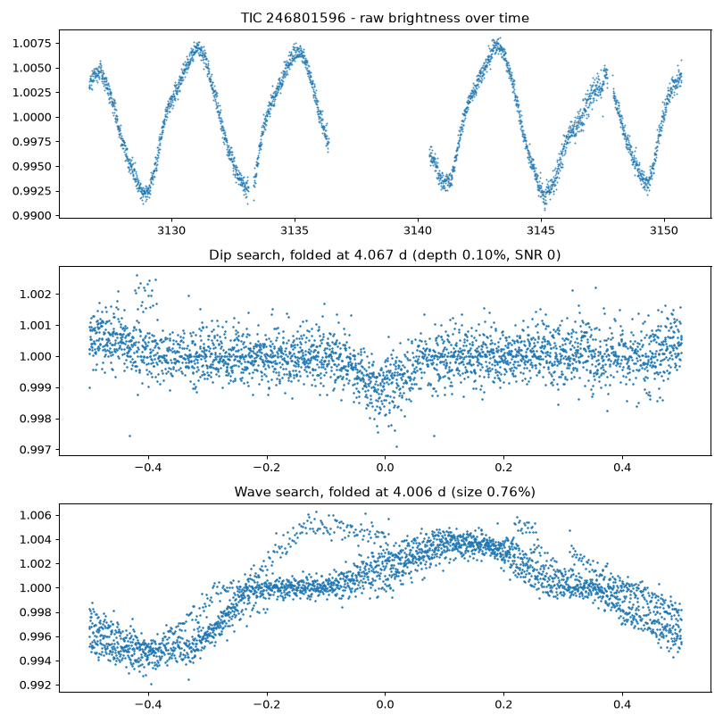

## TIC 38680052  -  likely_planet_transit / no_significant_variability

- AI score: 0.78 | wave period: 0.674 d | dip period hint: 0.674 d
- [Check in SIMBAD](https://simbad.cds.unistra.fr/simbad/sim-coord?Coord=65.5286950074826+-61.3687278545425&CooFrame=FK5&CooEpoch=2000&Radius=2&Radius.unit=arcmin&submit=submit+query) | [TESS page](https://exofop.ipac.caltech.edu/tess/target.php?id=38680052)

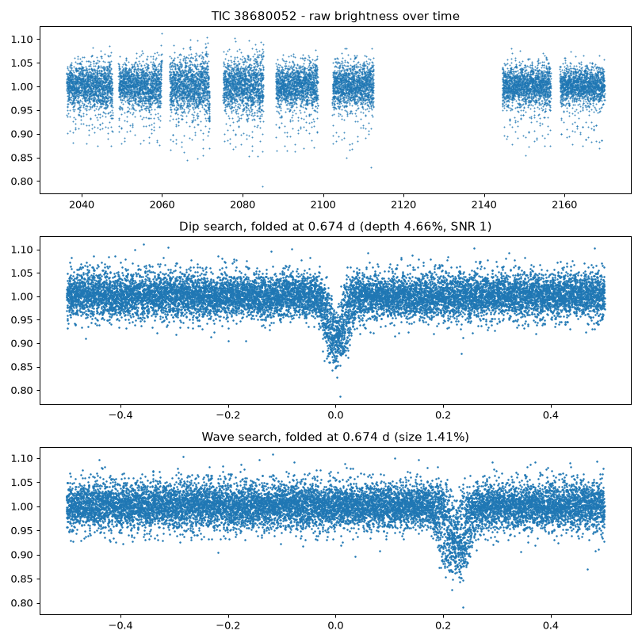

## TIC 188819782  -  unclassified_periodic_variable / likely_pulsating_or_rotating_variable

- AI score: 0.11 | wave period: 1.654 d | dip period hint: 1.656 d
- [Check in SIMBAD](https://simbad.cds.unistra.fr/simbad/sim-coord?Coord=262.616526184858+52.716555159578&CooFrame=FK5&CooEpoch=2000&Radius=2&Radius.unit=arcmin&submit=submit+query) | [TESS page](https://exofop.ipac.caltech.edu/tess/target.php?id=188819782)

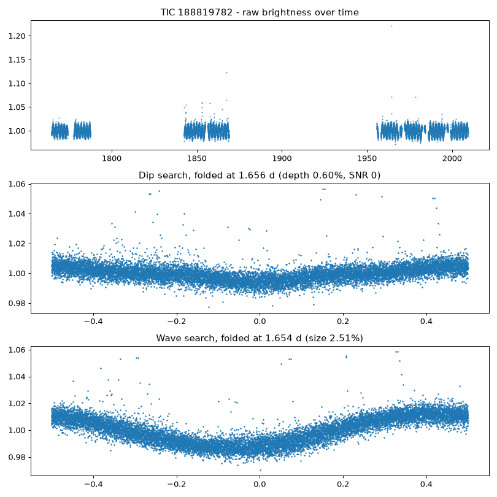

## TIC 144336525  -  unclassified_periodic_variable / no_significant_variability

- AI score: 0.75 | wave period: 0.247 d | dip period hint: 0.742 d
- [Check in SIMBAD](https://simbad.cds.unistra.fr/simbad/sim-coord?Coord=356.114909945176+-46.8665800589582&CooFrame=FK5&CooEpoch=2000&Radius=2&Radius.unit=arcmin&submit=submit+query) | [TESS page](https://exofop.ipac.caltech.edu/tess/target.php?id=144336525)

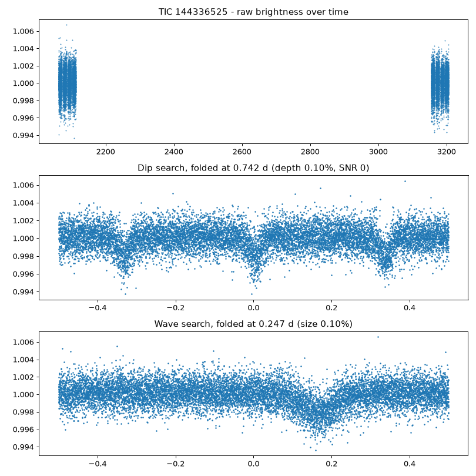

## TIC 140309502  -  likely_planet_transit / likely_pulsating_or_rotating_variable

- AI score: 0.74 | wave period: 2.318 d | dip period hint: 4.650 d
- [Check in SIMBAD](https://simbad.cds.unistra.fr/simbad/sim-coord?Coord=127.722962732911+-44.9758911947464&CooFrame=FK5&CooEpoch=2000&Radius=2&Radius.unit=arcmin&submit=submit+query) | [TESS page](https://exofop.ipac.caltech.edu/tess/target.php?id=140309502)

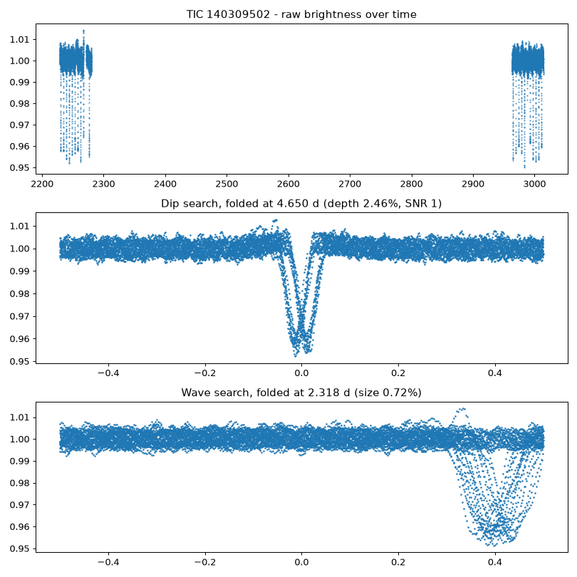

## TIC 117748478  -  likely_planet_transit / likely_pulsating_or_rotating_variable

- AI score: 0.04 | wave period: 0.610 d | dip period hint: 0.610 d
- [Check in SIMBAD](https://simbad.cds.unistra.fr/simbad/sim-coord?Coord=69.2391513633529+-16.2184535724001&CooFrame=FK5&CooEpoch=2000&Radius=2&Radius.unit=arcmin&submit=submit+query) | [TESS page](https://exofop.ipac.caltech.edu/tess/target.php?id=117748478)

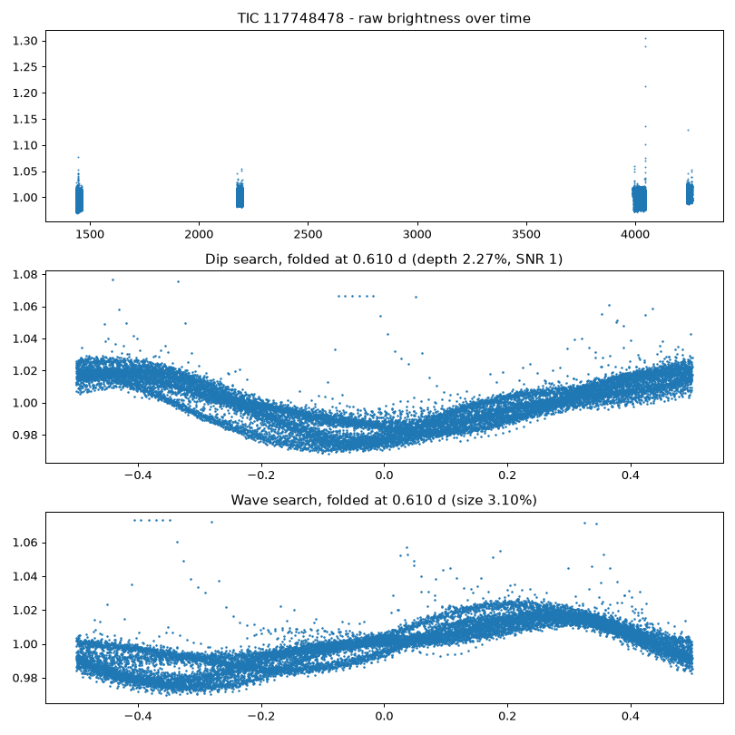

## TIC 460600835  -  unclassified_periodic_variable / no_significant_variability

- AI score: 0.73 | wave period: 1.925 d | dip period hint: 3.818 d
- [Check in SIMBAD](https://simbad.cds.unistra.fr/simbad/sim-coord?Coord=158.137467810136+-61.2829364287374&CooFrame=FK5&CooEpoch=2000&Radius=2&Radius.unit=arcmin&submit=submit+query) | [TESS page](https://exofop.ipac.caltech.edu/tess/target.php?id=460600835)

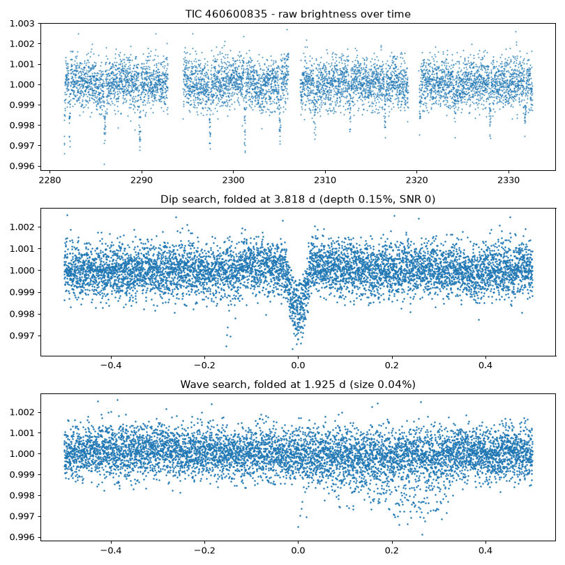

## TIC 48838982  -  unclassified_periodic_variable / no_significant_variability

- AI score: 0.73 | wave period: 5.259 d | dip period hint: 19.444 d
- [Check in SIMBAD](https://simbad.cds.unistra.fr/simbad/sim-coord?Coord=302.146174263838+-33.6042395791761&CooFrame=FK5&CooEpoch=2000&Radius=2&Radius.unit=arcmin&submit=submit+query) | [TESS page](https://exofop.ipac.caltech.edu/tess/target.php?id=48838982)

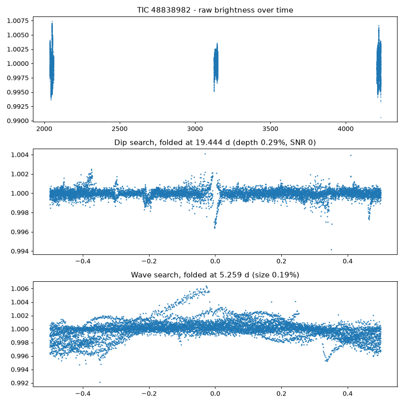

## TIC 401723367  -  likely_planet_transit / likely_pulsating_or_rotating_variable

- AI score: 0.50 | wave period: 3.600 d | dip period hint: 14.429 d
- [Check in SIMBAD](https://simbad.cds.unistra.fr/simbad/sim-coord?Coord=330.880721248981+-81.8040675289648&CooFrame=FK5&CooEpoch=2000&Radius=2&Radius.unit=arcmin&submit=submit+query) | [TESS page](https://exofop.ipac.caltech.edu/tess/target.php?id=401723367)

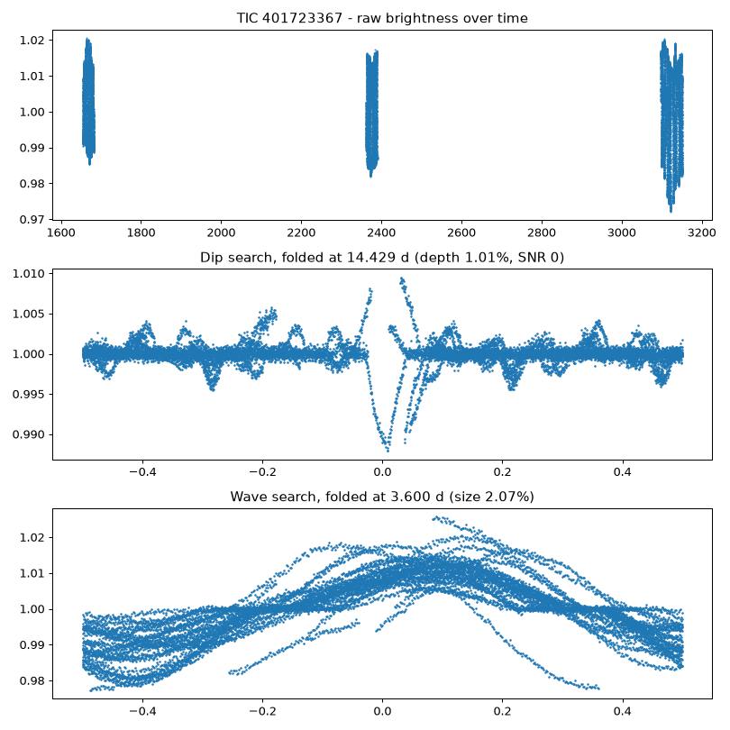

## TIC 152589104  -  likely_planet_transit / likely_pulsating_or_rotating_variable

- AI score: 0.15 | wave period: 1.531 d | dip period hint: 1.534 d
- [Check in SIMBAD](https://simbad.cds.unistra.fr/simbad/sim-coord?Coord=64.8086133408985+-47.8527708281145&CooFrame=FK5&CooEpoch=2000&Radius=2&Radius.unit=arcmin&submit=submit+query) | [TESS page](https://exofop.ipac.caltech.edu/tess/target.php?id=152589104)

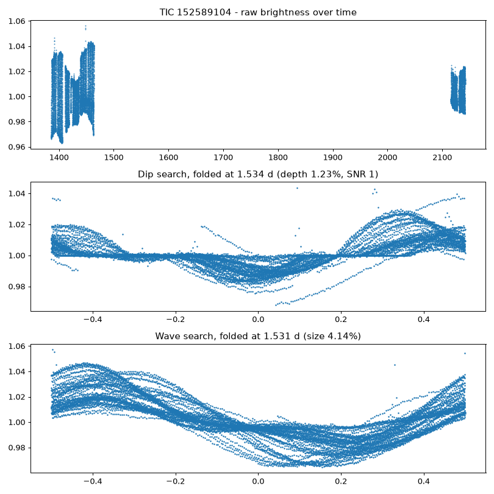

## TIC 120362128  -  likely_planet_transit / likely_pulsating_or_rotating_variable

- AI score: 0.73 | wave period: 1.644 d | dip period hint: 1.644 d
- [Check in SIMBAD](https://simbad.cds.unistra.fr/simbad/sim-coord?Coord=284.926069422759+36.551035172622&CooFrame=FK5&CooEpoch=2000&Radius=2&Radius.unit=arcmin&submit=submit+query) | [TESS page](https://exofop.ipac.caltech.edu/tess/target.php?id=120362128)

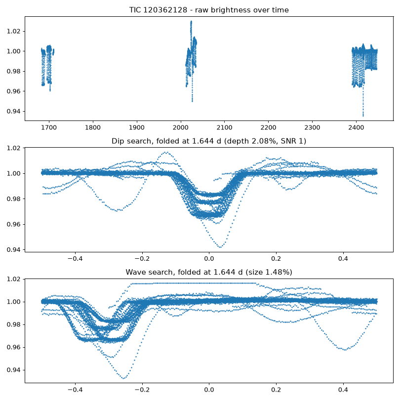

## TIC 308612498  -  unclassified_periodic_variable / likely_pulsating_or_rotating_variable

- AI score: 0.07 | wave period: 2.229 d | dip period hint: 2.220 d
- [Check in SIMBAD](https://simbad.cds.unistra.fr/simbad/sim-coord?Coord=121.576776460112+-61.5342404412362&CooFrame=FK5&CooEpoch=2000&Radius=2&Radius.unit=arcmin&submit=submit+query) | [TESS page](https://exofop.ipac.caltech.edu/tess/target.php?id=308612498)

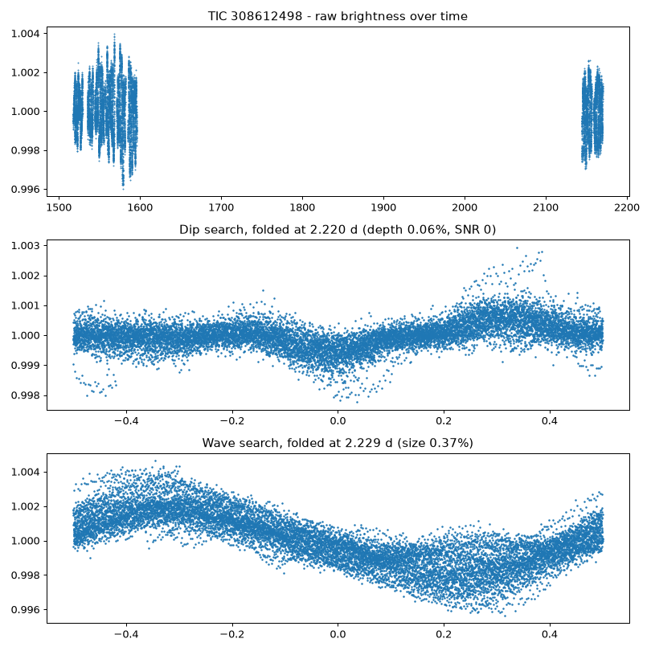

## TIC 306410072  -  likely_eclipsing_binary / no_significant_variability

- AI score: 0.68 | wave period: 2.352 d | dip period hint: 4.718 d
- [Check in SIMBAD](https://simbad.cds.unistra.fr/simbad/sim-coord?Coord=179.442642540048+-60.4513468005216&CooFrame=FK5&CooEpoch=2000&Radius=2&Radius.unit=arcmin&submit=submit+query) | [TESS page](https://exofop.ipac.caltech.edu/tess/target.php?id=306410072)

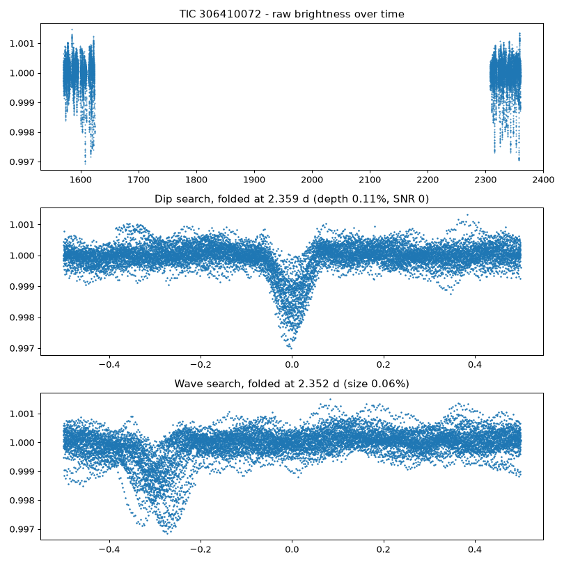

## TIC 277373390  -  unclassified_periodic_variable / likely_pulsating_or_rotating_variable

- AI score: 0.65 | wave period: 0.584 d | dip period hint: 0.584 d
- [Check in SIMBAD](https://simbad.cds.unistra.fr/simbad/sim-coord?Coord=283.762022788937+-33.9909568499451&CooFrame=FK5&CooEpoch=2000&Radius=2&Radius.unit=arcmin&submit=submit+query) | [TESS page](https://exofop.ipac.caltech.edu/tess/target.php?id=277373390)

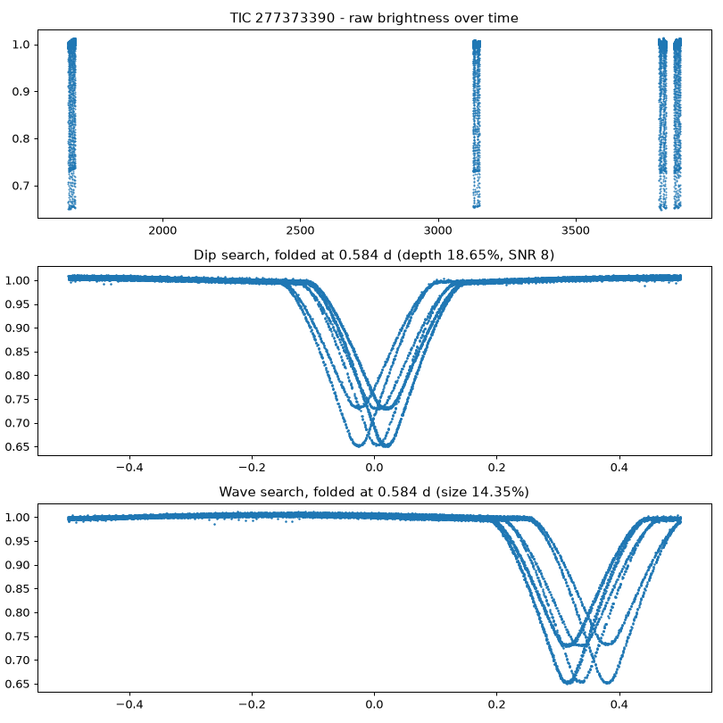
