# Your leads - just look at the pictures

Each lead is a star NOT catalogued in SIMBAD / AAVSO VSX as a variable or binary.
Look at the **bottom two graphs** of each picture:

- **GOOD:** the dots form a clean, thin curve (a dip or a smooth wave). The thinner the curve, the better.
- **BAD:** the dots are a messy cloud with no clear shape. Ignore these.

If a picture looks GOOD: click the SIMBAD link, and if the star shows no variable/binary type,
submit it at https://www.aavso.org/vsx (Submit new variable).

476 leads total; showing the top 50.

## TIC 122220263  -  unclassified_periodic_variable / no_significant_variability

- AI score: 1.00 | wave period: 2.322 d | dip period hint: 18.688 d
- [Check in SIMBAD](https://simbad.cds.unistra.fr/simbad/sim-coord?Coord=290.020842968204+36.6377054978848&CooFrame=FK5&CooEpoch=2000&Radius=2&Radius.unit=arcmin&submit=submit+query) | [TESS page](https://exofop.ipac.caltech.edu/tess/target.php?id=122220263)

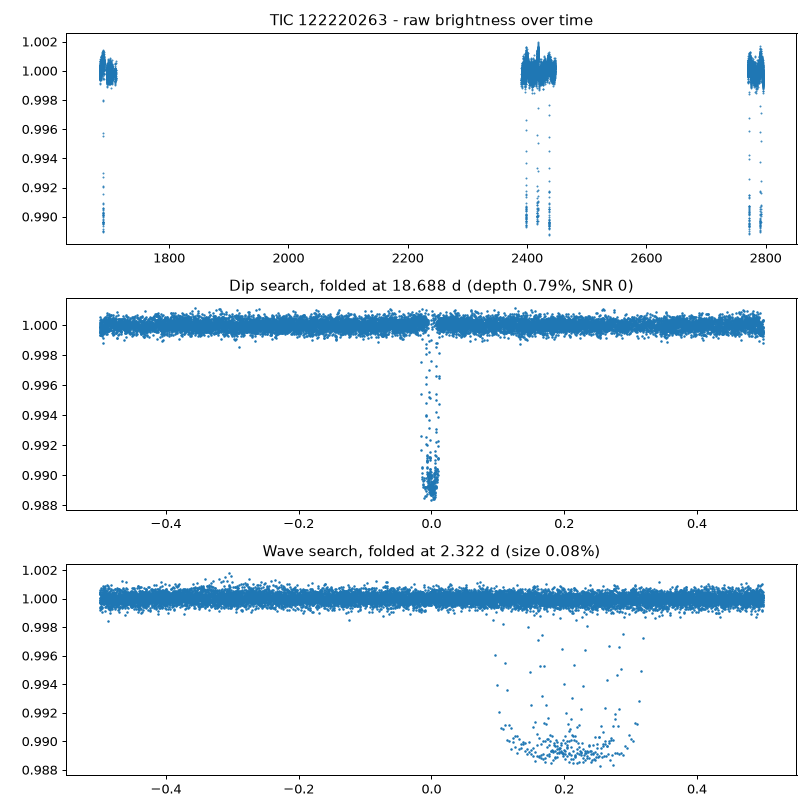

## TIC 33159045  -  likely_planet_transit / likely_pulsating_or_rotating_variable

- AI score: 0.99 | wave period: 2.538 d | dip period hint: 7.580 d
- [Check in SIMBAD](https://simbad.cds.unistra.fr/simbad/sim-coord?Coord=144.669705994284+-43.4384744607037&CooFrame=FK5&CooEpoch=2000&Radius=2&Radius.unit=arcmin&submit=submit+query) | [TESS page](https://exofop.ipac.caltech.edu/tess/target.php?id=33159045)

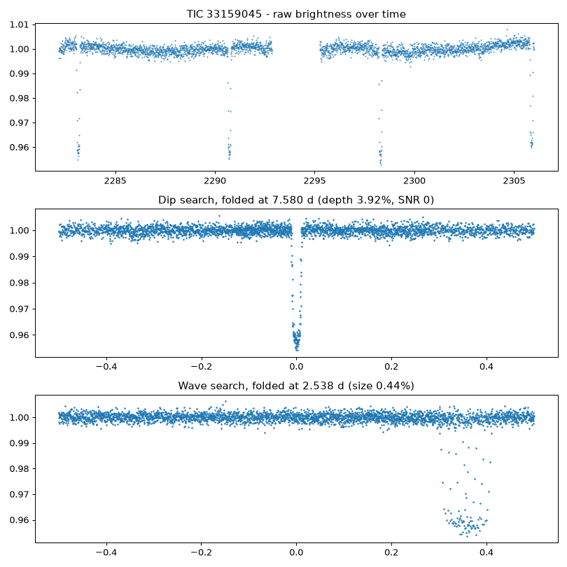

## TIC 115410334  -  unclassified_periodic_variable / no_significant_variability

- AI score: 0.99 | wave period: 2.239 d | dip period hint: 13.433 d
- [Check in SIMBAD](https://simbad.cds.unistra.fr/simbad/sim-coord?Coord=251.880139886882+46.1915276412249&CooFrame=FK5&CooEpoch=2000&Radius=2&Radius.unit=arcmin&submit=submit+query) | [TESS page](https://exofop.ipac.caltech.edu/tess/target.php?id=115410334)

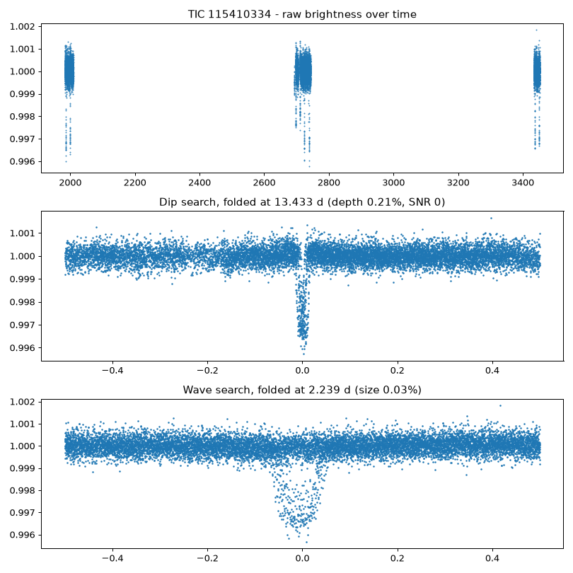

## TIC 260301742  -  likely_planet_transit / likely_pulsating_or_rotating_variable

- AI score: 0.04 | wave period: 0.562 d | dip period hint: 0.562 d
- [Check in SIMBAD](https://simbad.cds.unistra.fr/simbad/sim-coord?Coord=94.7050952973425+-54.2090106285887&CooFrame=FK5&CooEpoch=2000&Radius=2&Radius.unit=arcmin&submit=submit+query) | [TESS page](https://exofop.ipac.caltech.edu/tess/target.php?id=260301742)

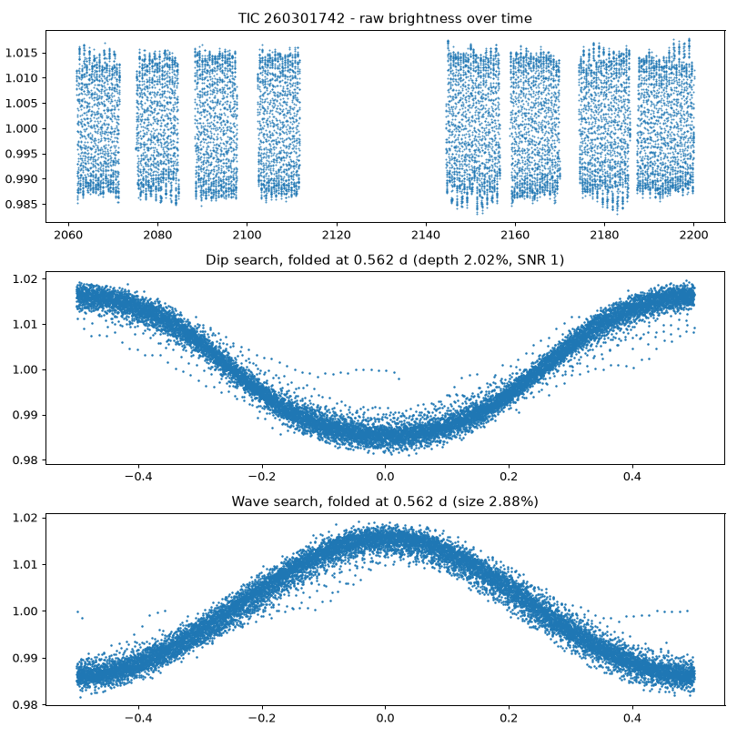

## TIC 356632361  -  unclassified_periodic_variable / likely_pulsating_or_rotating_variable

- AI score: 0.97 | wave period: 2.557 d | dip period hint: 2.611 d
- [Check in SIMBAD](https://simbad.cds.unistra.fr/simbad/sim-coord?Coord=232.314224154951+64.9266444492009&CooFrame=FK5&CooEpoch=2000&Radius=2&Radius.unit=arcmin&submit=submit+query) | [TESS page](https://exofop.ipac.caltech.edu/tess/target.php?id=356632361)

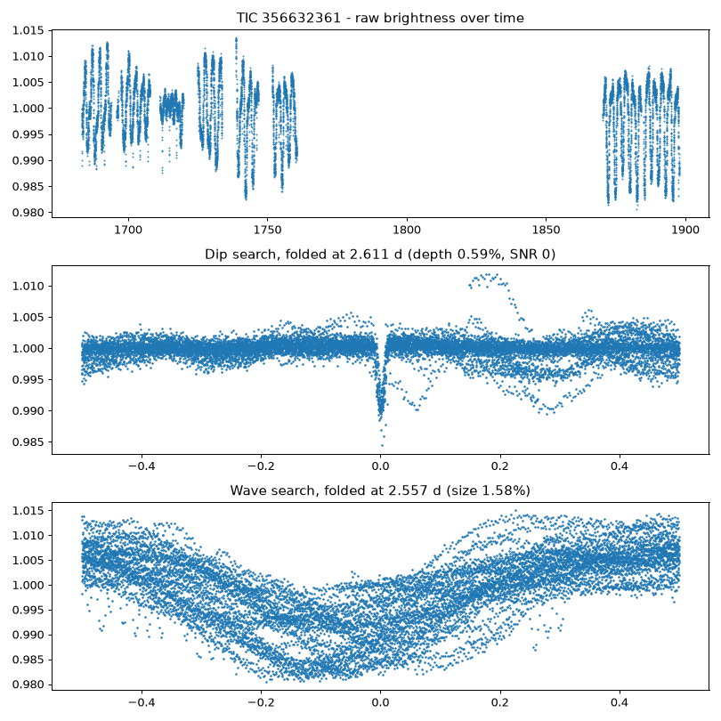

## TIC 156294609  -  unclassified_periodic_variable / likely_pulsating_or_rotating_variable

- AI score: 0.01 | wave period: 0.090 d | dip period hint: 0.543 d
- [Check in SIMBAD](https://simbad.cds.unistra.fr/simbad/sim-coord?Coord=259.315166527963+13.8688318270105&CooFrame=FK5&CooEpoch=2000&Radius=2&Radius.unit=arcmin&submit=submit+query) | [TESS page](https://exofop.ipac.caltech.edu/tess/target.php?id=156294609)

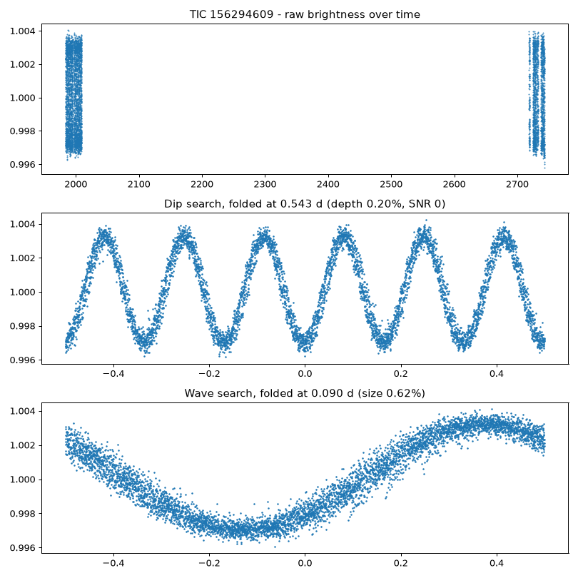

## TIC 378239424  -  unclassified_periodic_variable / likely_pulsating_or_rotating_variable

- AI score: 0.19 | wave period: 1.741 d | dip period hint: 1.739 d
- [Check in SIMBAD](https://simbad.cds.unistra.fr/simbad/sim-coord?Coord=154.997611753556+-60.9943518091612&CooFrame=FK5&CooEpoch=2000&Radius=2&Radius.unit=arcmin&submit=submit+query) | [TESS page](https://exofop.ipac.caltech.edu/tess/target.php?id=378239424)

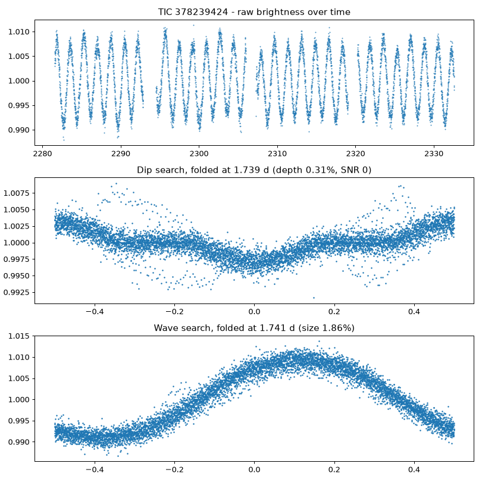

## TIC 153742767  -  likely_planet_transit / likely_pulsating_or_rotating_variable

- AI score: 0.03 | wave period: 0.508 d | dip period hint: 0.507 d
- [Check in SIMBAD](https://simbad.cds.unistra.fr/simbad/sim-coord?Coord=66.5038916727048+-43.7712402271341&CooFrame=FK5&CooEpoch=2000&Radius=2&Radius.unit=arcmin&submit=submit+query) | [TESS page](https://exofop.ipac.caltech.edu/tess/target.php?id=153742767)

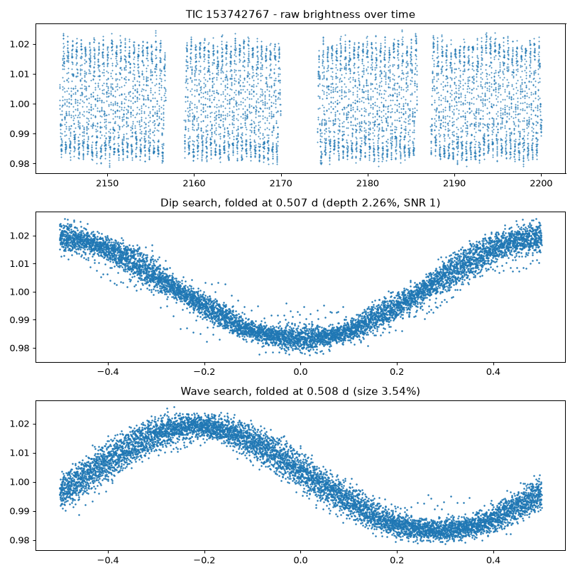

## TIC 407661994  -  unclassified_periodic_variable / no_significant_variability

- AI score: 0.95 | wave period: 1.046 d | dip period hint: 12.554 d
- [Check in SIMBAD](https://simbad.cds.unistra.fr/simbad/sim-coord?Coord=83.0429059237847+-73.0054163282332&CooFrame=FK5&CooEpoch=2000&Radius=2&Radius.unit=arcmin&submit=submit+query) | [TESS page](https://exofop.ipac.caltech.edu/tess/target.php?id=407661994)

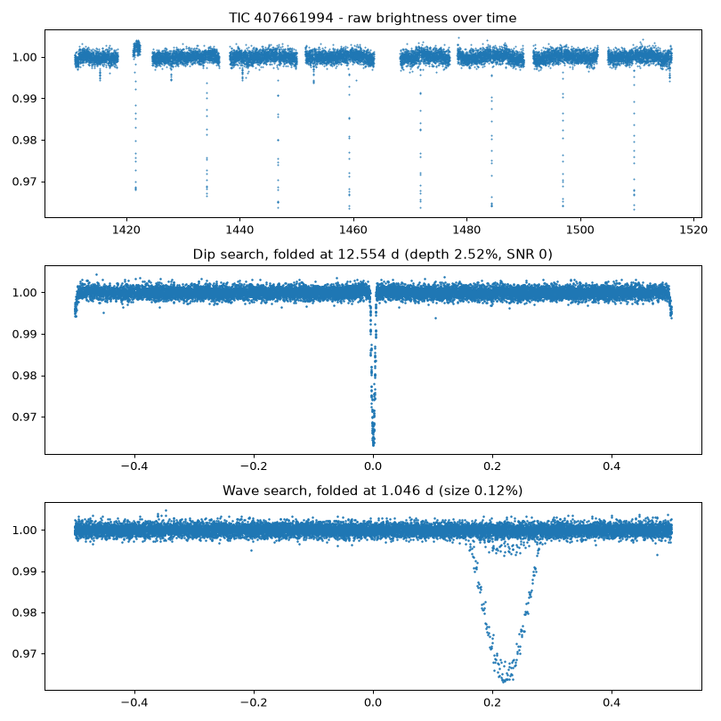

## TIC 255906549  -  likely_eclipsing_binary / no_significant_variability

- AI score: 0.93 | wave period: 2.130 d | dip period hint: 25.551 d
- [Check in SIMBAD](https://simbad.cds.unistra.fr/simbad/sim-coord?Coord=246.976417279334+40.5518927121385&CooFrame=FK5&CooEpoch=2000&Radius=2&Radius.unit=arcmin&submit=submit+query) | [TESS page](https://exofop.ipac.caltech.edu/tess/target.php?id=255906549)

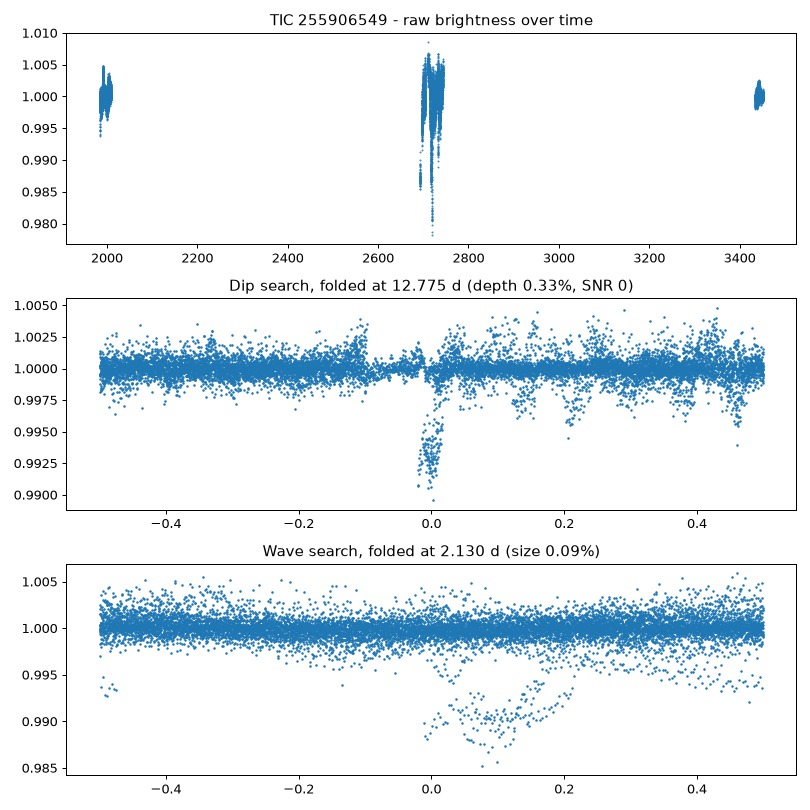

## TIC 310785613  -  likely_planet_transit / no_significant_variability

- AI score: 0.93 | wave period: 3.172 d | dip period hint: 6.455 d
- [Check in SIMBAD](https://simbad.cds.unistra.fr/simbad/sim-coord?Coord=84.1715112213781+48.5544483499015&CooFrame=FK5&CooEpoch=2000&Radius=2&Radius.unit=arcmin&submit=submit+query) | [TESS page](https://exofop.ipac.caltech.edu/tess/target.php?id=310785613)

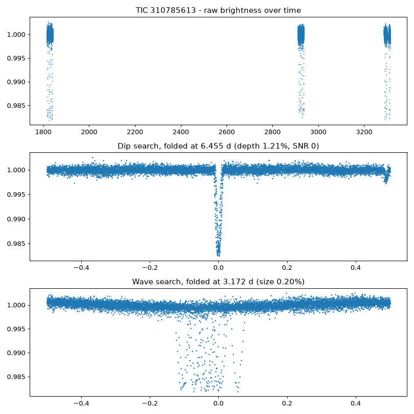

## TIC 233603364  -  unclassified_periodic_variable / likely_pulsating_or_rotating_variable

- AI score: 0.93 | wave period: 1.660 d | dip period hint: 3.324 d
- [Check in SIMBAD](https://simbad.cds.unistra.fr/simbad/sim-coord?Coord=282.799104329353+65.460203252533&CooFrame=FK5&CooEpoch=2000&Radius=2&Radius.unit=arcmin&submit=submit+query) | [TESS page](https://exofop.ipac.caltech.edu/tess/target.php?id=233603364)

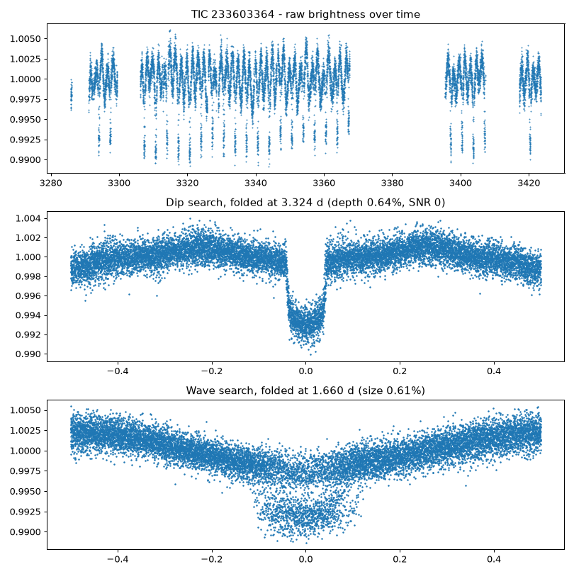

## TIC 232681393  -  unclassified_periodic_variable / likely_pulsating_or_rotating_variable

- AI score: 0.02 | wave period: 0.937 d | dip period hint: 0.936 d
- [Check in SIMBAD](https://simbad.cds.unistra.fr/simbad/sim-coord?Coord=282.365230176552+57.8399338598687&CooFrame=FK5&CooEpoch=2000&Radius=2&Radius.unit=arcmin&submit=submit+query) | [TESS page](https://exofop.ipac.caltech.edu/tess/target.php?id=232681393)

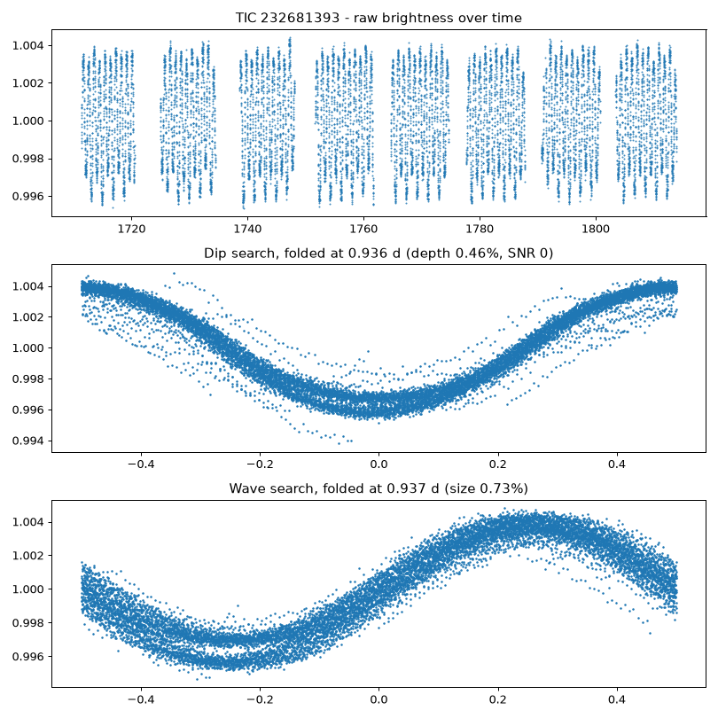

## TIC 287196418  -  likely_eclipsing_binary / likely_pulsating_or_rotating_variable

- AI score: 0.93 | wave period: 1.055 d | dip period hint: 7.390 d
- [Check in SIMBAD](https://simbad.cds.unistra.fr/simbad/sim-coord?Coord=292.734123834902+59.4038510862493&CooFrame=FK5&CooEpoch=2000&Radius=2&Radius.unit=arcmin&submit=submit+query) | [TESS page](https://exofop.ipac.caltech.edu/tess/target.php?id=287196418)

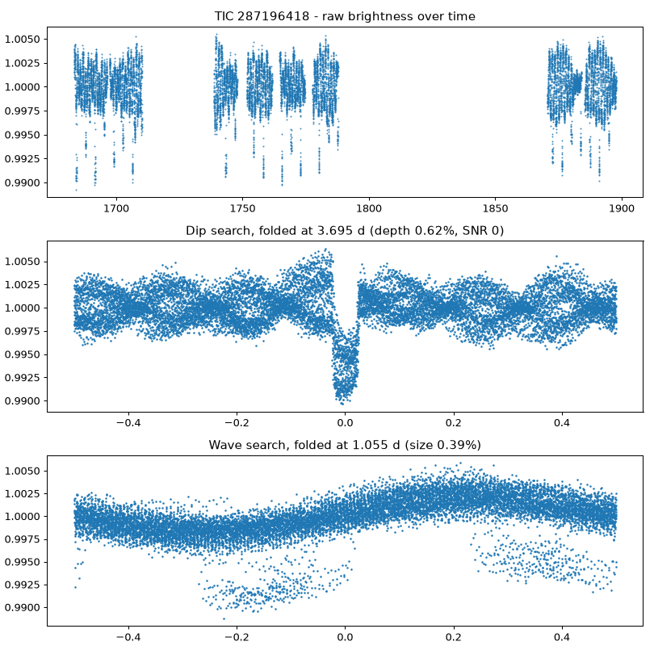

## TIC 401704685  -  unclassified_periodic_variable / no_significant_variability

- AI score: 0.92 | wave period: 2.105 d | dip period hint: 4.210 d
- [Check in SIMBAD](https://simbad.cds.unistra.fr/simbad/sim-coord?Coord=318.863288215084+-83.1644813364236&CooFrame=FK5&CooEpoch=2000&Radius=2&Radius.unit=arcmin&submit=submit+query) | [TESS page](https://exofop.ipac.caltech.edu/tess/target.php?id=401704685)

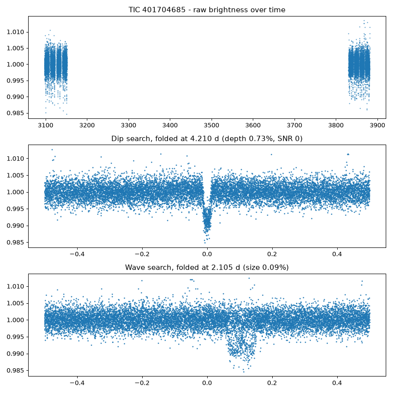

## TIC 157402232  -  unclassified_periodic_variable / likely_pulsating_or_rotating_variable

- AI score: 0.20 | wave period: 2.190 d | dip period hint: 2.173 d
- [Check in SIMBAD](https://simbad.cds.unistra.fr/simbad/sim-coord?Coord=106.291198106555+-36.6871865619863&CooFrame=FK5&CooEpoch=2000&Radius=2&Radius.unit=arcmin&submit=submit+query) | [TESS page](https://exofop.ipac.caltech.edu/tess/target.php?id=157402232)

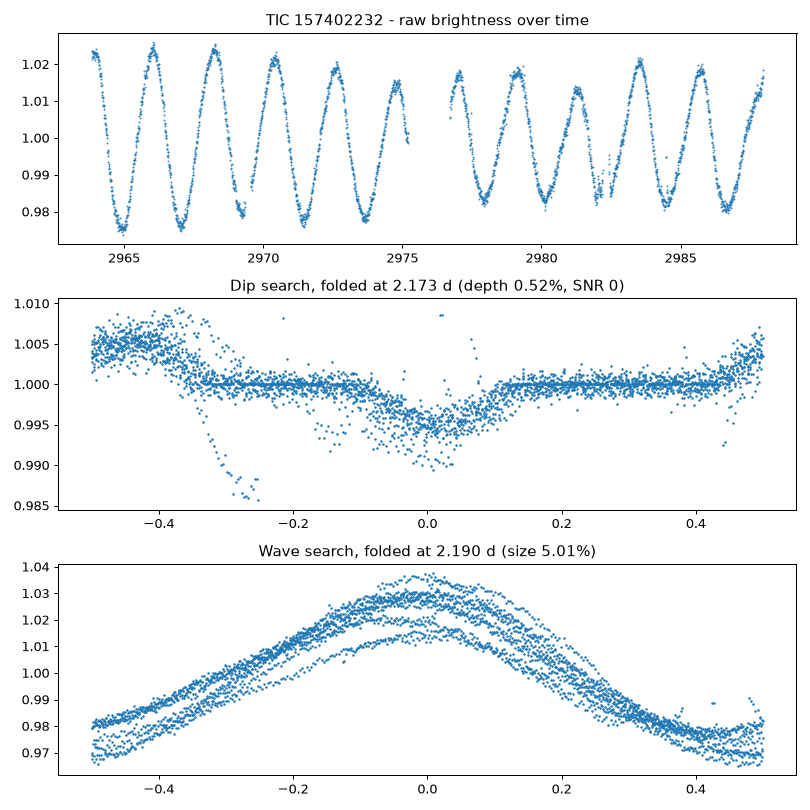

## TIC 410451677  -  unclassified_periodic_variable / likely_pulsating_or_rotating_variable

- AI score: 0.11 | wave period: 2.055 d | dip period hint: 2.055 d
- [Check in SIMBAD](https://simbad.cds.unistra.fr/simbad/sim-coord?Coord=119.990854713286+-60.7467937596076&CooFrame=FK5&CooEpoch=2000&Radius=2&Radius.unit=arcmin&submit=submit+query) | [TESS page](https://exofop.ipac.caltech.edu/tess/target.php?id=410451677)

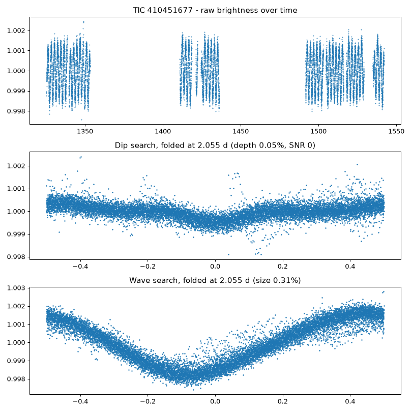

## TIC 233079659  -  unclassified_periodic_variable / likely_pulsating_or_rotating_variable

- AI score: 0.21 | wave period: 0.121 d | dip period hint: 0.604 d
- [Check in SIMBAD](https://simbad.cds.unistra.fr/simbad/sim-coord?Coord=271.638519961946+64.4499211306433&CooFrame=FK5&CooEpoch=2000&Radius=2&Radius.unit=arcmin&submit=submit+query) | [TESS page](https://exofop.ipac.caltech.edu/tess/target.php?id=233079659)

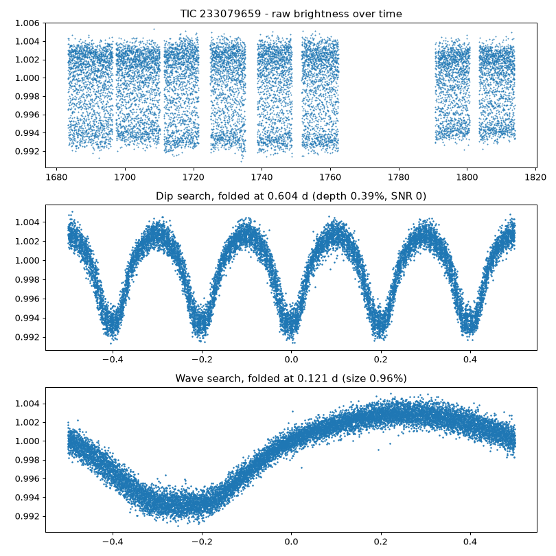

## TIC 83954285  -  unclassified_periodic_variable / likely_pulsating_or_rotating_variable

- AI score: 0.12 | wave period: 2.644 d | dip period hint: 2.623 d
- [Check in SIMBAD](https://simbad.cds.unistra.fr/simbad/sim-coord?Coord=0.0454348695029402+30.1887618065432&CooFrame=FK5&CooEpoch=2000&Radius=2&Radius.unit=arcmin&submit=submit+query) | [TESS page](https://exofop.ipac.caltech.edu/tess/target.php?id=83954285)

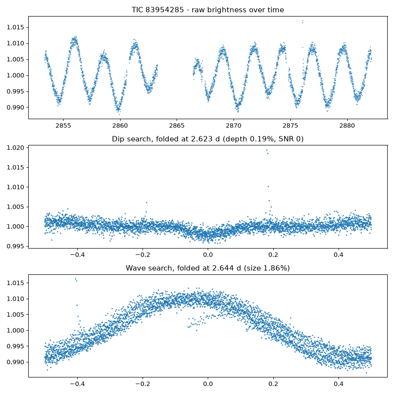

## TIC 336125492  -  unclassified_periodic_variable / no_significant_variability

- AI score: 0.91 | wave period: 1.576 d | dip period hint: 4.727 d
- [Check in SIMBAD](https://simbad.cds.unistra.fr/simbad/sim-coord?Coord=281.065965438305+38.0073640860145&CooFrame=FK5&CooEpoch=2000&Radius=2&Radius.unit=arcmin&submit=submit+query) | [TESS page](https://exofop.ipac.caltech.edu/tess/target.php?id=336125492)

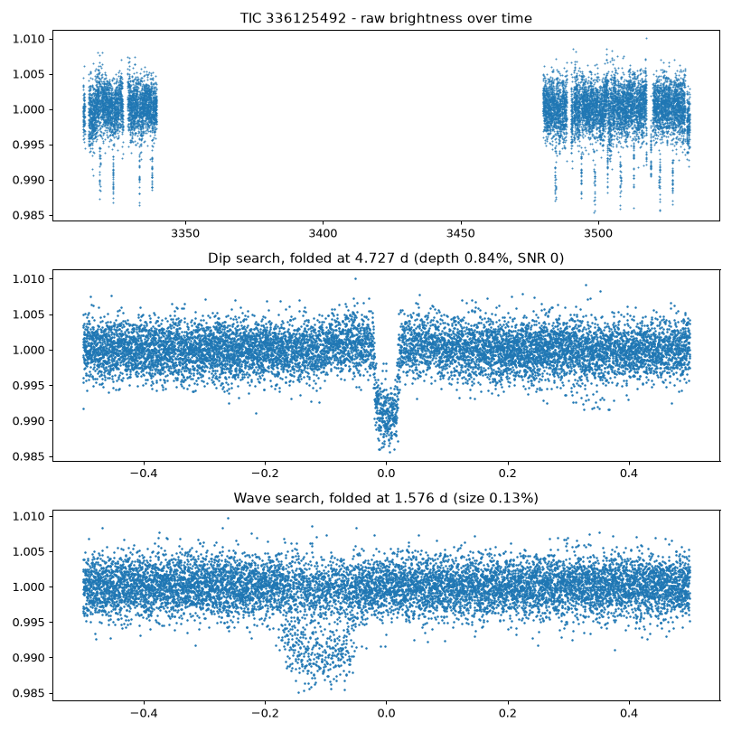

## TIC 44525416  -  unclassified_periodic_variable / likely_pulsating_or_rotating_variable

- AI score: 0.02 | wave period: 0.131 d | dip period hint: 0.525 d
- [Check in SIMBAD](https://simbad.cds.unistra.fr/simbad/sim-coord?Coord=7.54965508652332+35.6435433286644&CooFrame=FK5&CooEpoch=2000&Radius=2&Radius.unit=arcmin&submit=submit+query) | [TESS page](https://exofop.ipac.caltech.edu/tess/target.php?id=44525416)

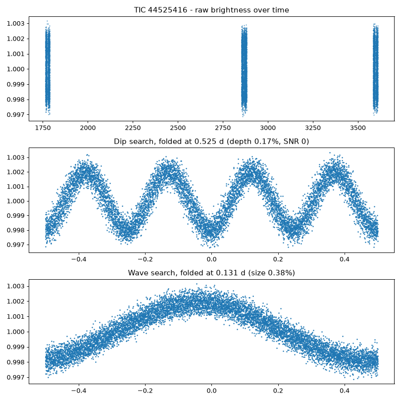

## TIC 200921621  -  likely_planet_transit / likely_pulsating_or_rotating_variable

- AI score: 0.91 | wave period: 2.421 d | dip period hint: 4.831 d
- [Check in SIMBAD](https://simbad.cds.unistra.fr/simbad/sim-coord?Coord=54.5230554423062+36.1409917193704&CooFrame=FK5&CooEpoch=2000&Radius=2&Radius.unit=arcmin&submit=submit+query) | [TESS page](https://exofop.ipac.caltech.edu/tess/target.php?id=200921621)

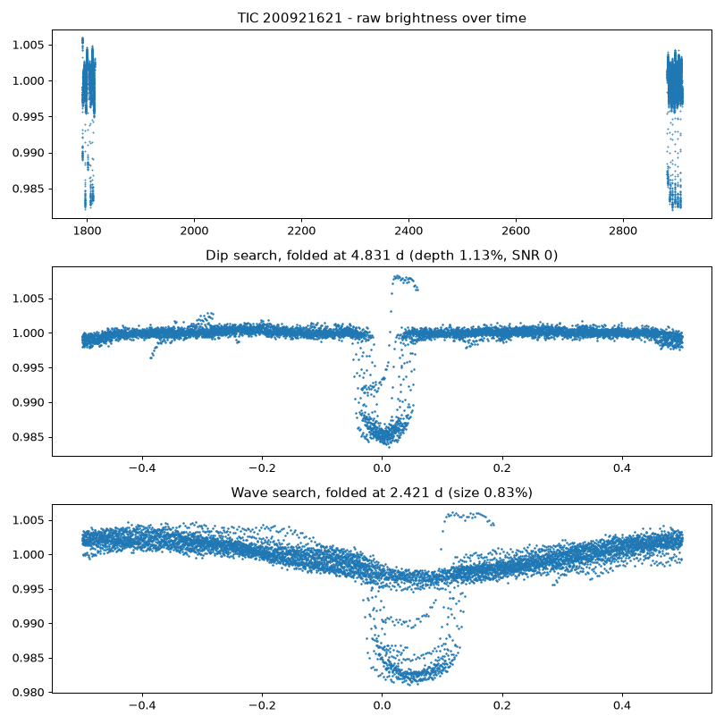

## TIC 131081852  -  likely_eclipsing_binary / no_significant_variability

- AI score: 0.91 | wave period: 1.896 d | dip period hint: 33.184 d
- [Check in SIMBAD](https://simbad.cds.unistra.fr/simbad/sim-coord?Coord=189.762266348388+-31.9921502486101&CooFrame=FK5&CooEpoch=2000&Radius=2&Radius.unit=arcmin&submit=submit+query) | [TESS page](https://exofop.ipac.caltech.edu/tess/target.php?id=131081852)

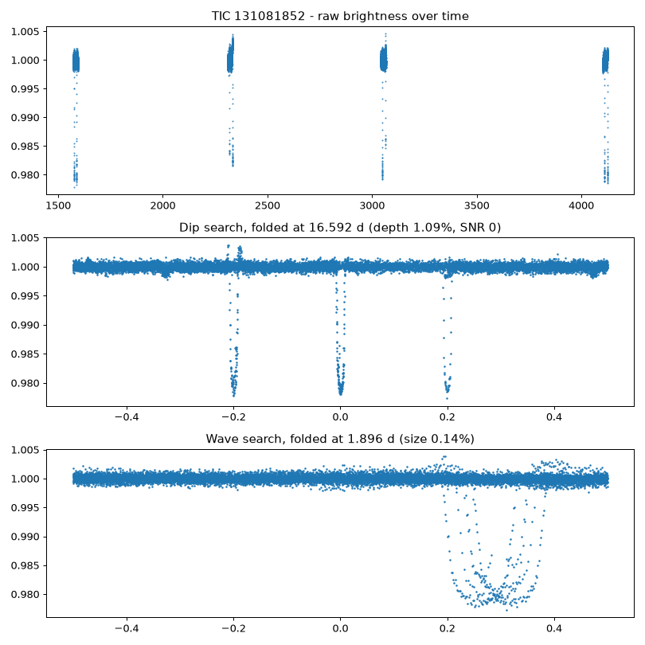

## TIC 349518800  -  unclassified_periodic_variable / likely_pulsating_or_rotating_variable

- AI score: 0.91 | wave period: 1.083 d | dip period hint: 2.165 d
- [Check in SIMBAD](https://simbad.cds.unistra.fr/simbad/sim-coord?Coord=111.211814611496+-62.0924878583018&CooFrame=FK5&CooEpoch=2000&Radius=2&Radius.unit=arcmin&submit=submit+query) | [TESS page](https://exofop.ipac.caltech.edu/tess/target.php?id=349518800)

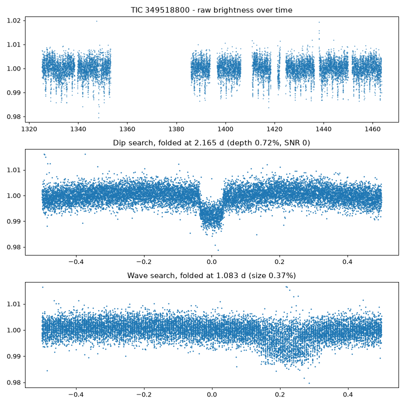

## TIC 288507910  -  likely_planet_transit / no_significant_variability

- AI score: 0.90 | wave period: 2.779 d | dip period hint: 8.346 d
- [Check in SIMBAD](https://simbad.cds.unistra.fr/simbad/sim-coord?Coord=271.538391874982+81.9415605600614&CooFrame=FK5&CooEpoch=2000&Radius=2&Radius.unit=arcmin&submit=submit+query) | [TESS page](https://exofop.ipac.caltech.edu/tess/target.php?id=288507910)

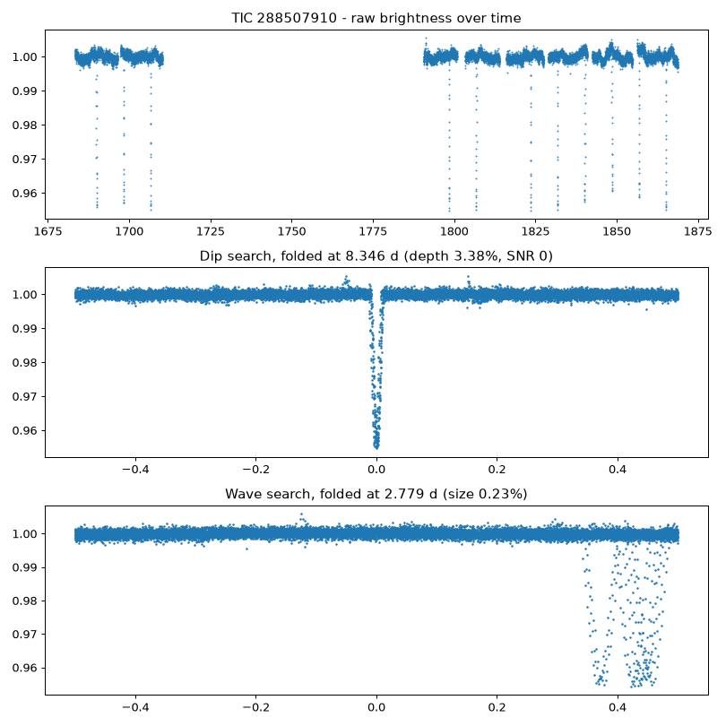

## TIC 441736986  -  unclassified_periodic_variable / no_significant_variability

- AI score: 0.90 | wave period: 0.803 d | dip period hint: 0.804 d
- [Check in SIMBAD](https://simbad.cds.unistra.fr/simbad/sim-coord?Coord=258.836805278923+76.4690041781621&CooFrame=FK5&CooEpoch=2000&Radius=2&Radius.unit=arcmin&submit=submit+query) | [TESS page](https://exofop.ipac.caltech.edu/tess/target.php?id=441736986)

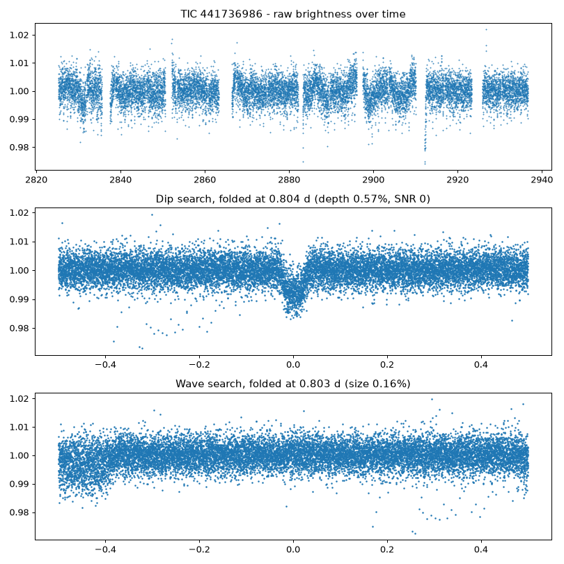

## TIC 391891749  -  unclassified_periodic_variable / likely_pulsating_or_rotating_variable

- AI score: 0.19 | wave period: 2.662 d | dip period hint: 2.660 d
- [Check in SIMBAD](https://simbad.cds.unistra.fr/simbad/sim-coord?Coord=115.5671653767+-69.205933975971&CooFrame=FK5&CooEpoch=2000&Radius=2&Radius.unit=arcmin&submit=submit+query) | [TESS page](https://exofop.ipac.caltech.edu/tess/target.php?id=391891749)

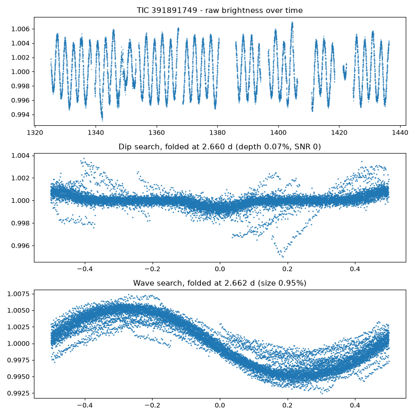

## TIC 116608612  -  unclassified_periodic_variable / no_significant_variability

- AI score: 0.90 | wave period: 1.728 d | dip period hint: 3.456 d
- [Check in SIMBAD](https://simbad.cds.unistra.fr/simbad/sim-coord?Coord=85.6632232071164+35.1857962029472&CooFrame=FK5&CooEpoch=2000&Radius=2&Radius.unit=arcmin&submit=submit+query) | [TESS page](https://exofop.ipac.caltech.edu/tess/target.php?id=116608612)

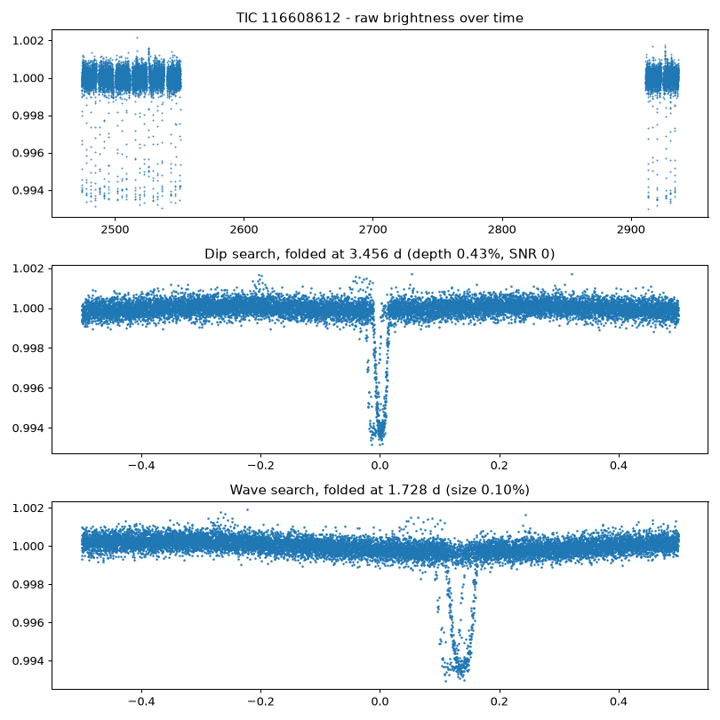

## TIC 417914043  -  unclassified_periodic_variable / no_significant_variability

- AI score: 0.90 | wave period: 0.055 d | dip period hint: 0.844 d
- [Check in SIMBAD](https://simbad.cds.unistra.fr/simbad/sim-coord?Coord=145.445395314308+66.7577255160691&CooFrame=FK5&CooEpoch=2000&Radius=2&Radius.unit=arcmin&submit=submit+query) | [TESS page](https://exofop.ipac.caltech.edu/tess/target.php?id=417914043)

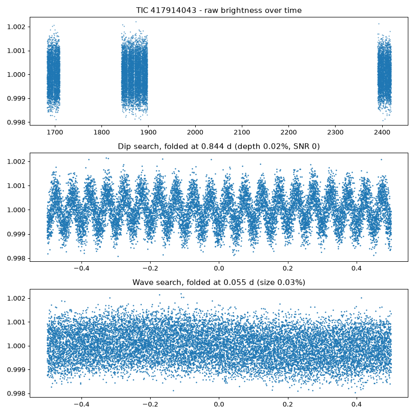

## TIC 177118177  -  unclassified_periodic_variable / likely_pulsating_or_rotating_variable

- AI score: 0.89 | wave period: 1.251 d | dip period hint: 2.504 d
- [Check in SIMBAD](https://simbad.cds.unistra.fr/simbad/sim-coord?Coord=104.296998781894+-66.025585227893&CooFrame=FK5&CooEpoch=2000&Radius=2&Radius.unit=arcmin&submit=submit+query) | [TESS page](https://exofop.ipac.caltech.edu/tess/target.php?id=177118177)

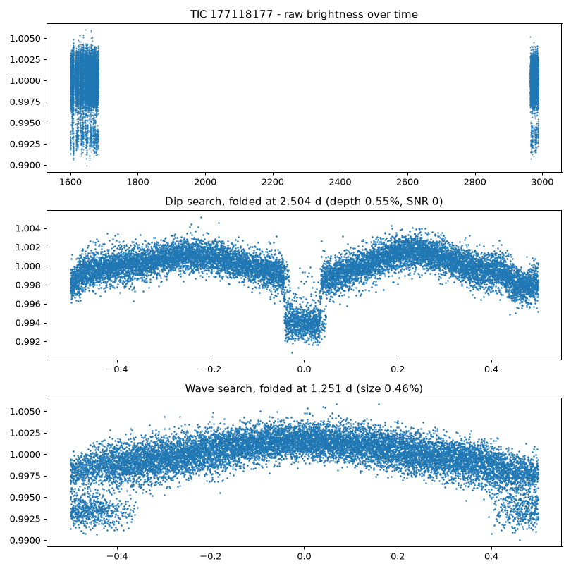

## TIC 357033670  -  likely_eclipsing_binary / no_significant_variability

- AI score: 0.89 | wave period: 2.584 d | dip period hint: 20.674 d
- [Check in SIMBAD](https://simbad.cds.unistra.fr/simbad/sim-coord?Coord=274.099471984017+55.5538358385733&CooFrame=FK5&CooEpoch=2000&Radius=2&Radius.unit=arcmin&submit=submit+query) | [TESS page](https://exofop.ipac.caltech.edu/tess/target.php?id=357033670)

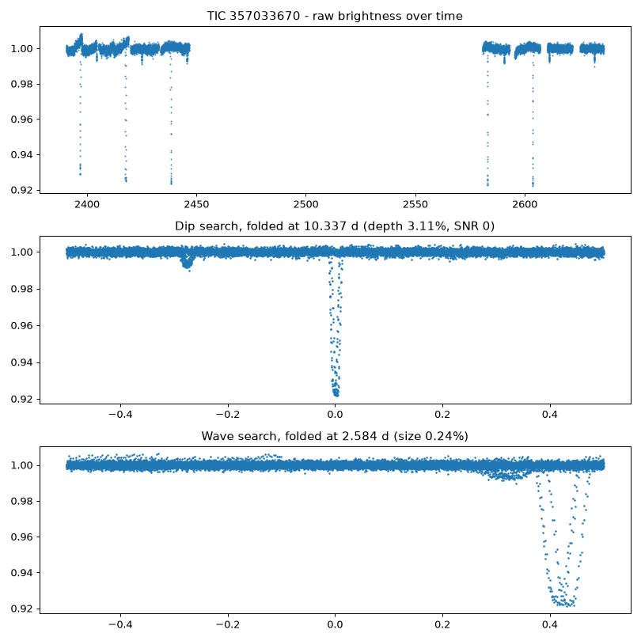

## TIC 271806353  -  likely_planet_transit / no_significant_variability

- AI score: 0.89 | wave period: 0.573 d | dip period hint: 3.439 d
- [Check in SIMBAD](https://simbad.cds.unistra.fr/simbad/sim-coord?Coord=111.442601047701+-77.776673296016&CooFrame=FK5&CooEpoch=2000&Radius=2&Radius.unit=arcmin&submit=submit+query) | [TESS page](https://exofop.ipac.caltech.edu/tess/target.php?id=271806353)

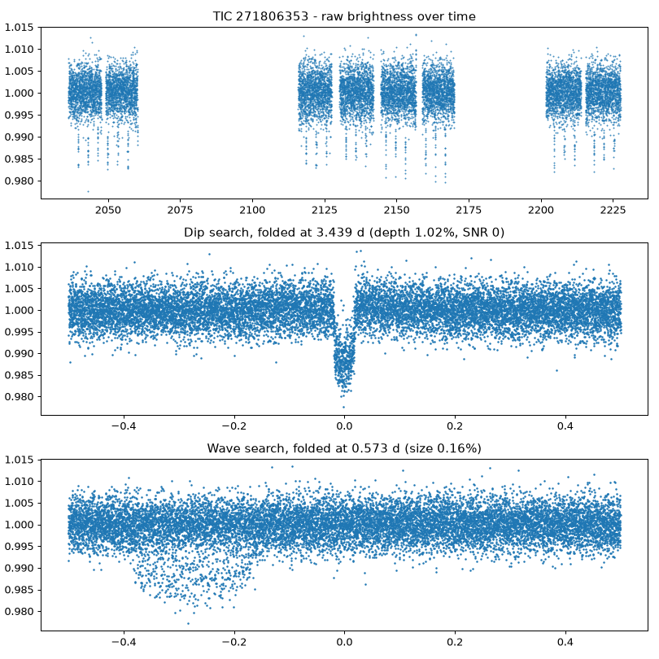

## TIC 140659980  -  likely_planet_transit / likely_pulsating_or_rotating_variable

- AI score: 0.89 | wave period: 2.140 d | dip period hint: 9.443 d
- [Check in SIMBAD](https://simbad.cds.unistra.fr/simbad/sim-coord?Coord=72.4733528183923+-72.4626185802332&CooFrame=FK5&CooEpoch=2000&Radius=2&Radius.unit=arcmin&submit=submit+query) | [TESS page](https://exofop.ipac.caltech.edu/tess/target.php?id=140659980)

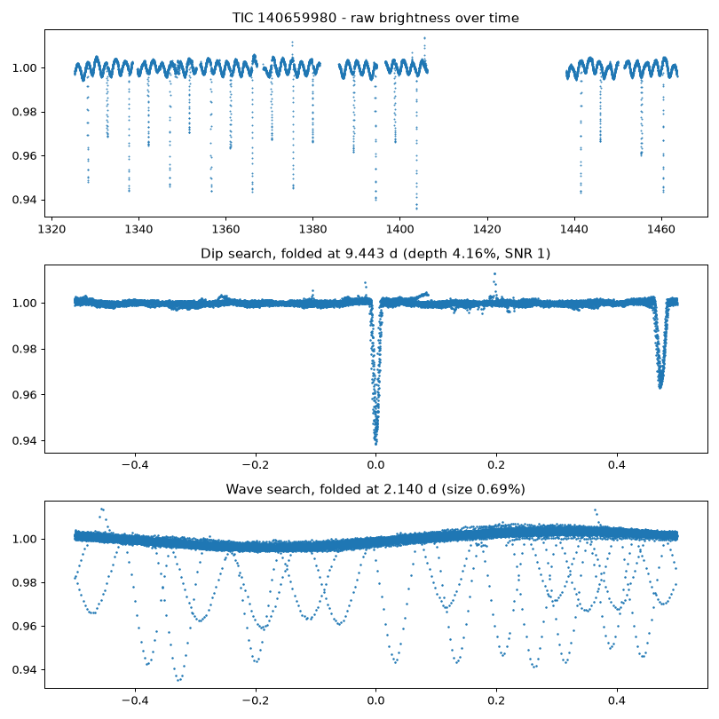

## TIC 209217764  -  likely_planet_transit / no_significant_variability

- AI score: 0.89 | wave period: 2.862 d | dip period hint: 8.767 d
- [Check in SIMBAD](https://simbad.cds.unistra.fr/simbad/sim-coord?Coord=299.202281943166+-29.4419472207818&CooFrame=FK5&CooEpoch=2000&Radius=2&Radius.unit=arcmin&submit=submit+query) | [TESS page](https://exofop.ipac.caltech.edu/tess/target.php?id=209217764)

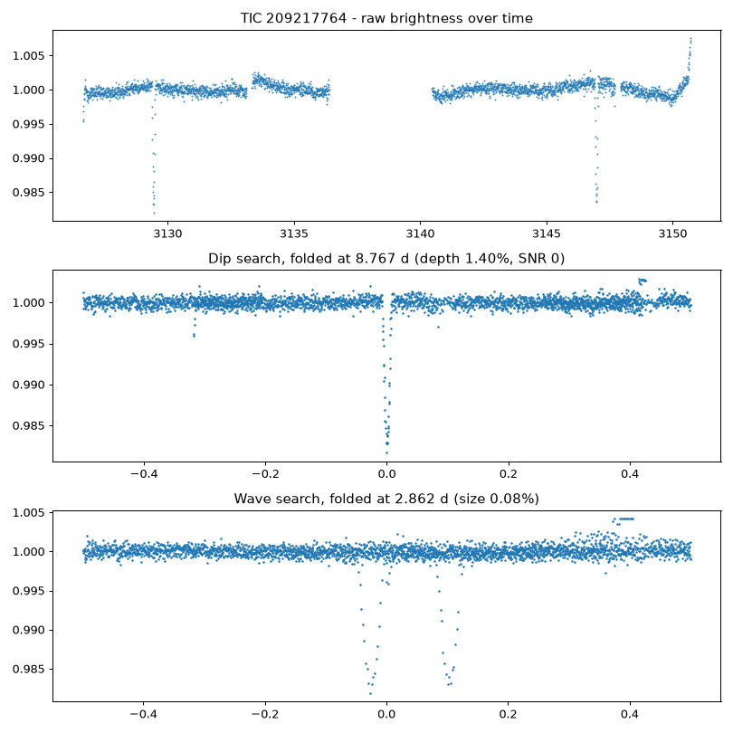

## TIC 155995204  -  likely_planet_transit / no_significant_variability

- AI score: 0.88 | wave period: 0.548 d | dip period hint: 9.314 d
- [Check in SIMBAD](https://simbad.cds.unistra.fr/simbad/sim-coord?Coord=7.65854607582995+-52.0493754273401&CooFrame=FK5&CooEpoch=2000&Radius=2&Radius.unit=arcmin&submit=submit+query) | [TESS page](https://exofop.ipac.caltech.edu/tess/target.php?id=155995204)

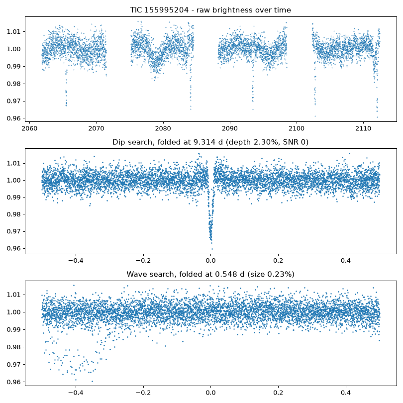

## TIC 436112803  -  unclassified_periodic_variable / likely_pulsating_or_rotating_variable

- AI score: 0.24 | wave period: 2.342 d | dip period hint: 2.342 d
- [Check in SIMBAD](https://simbad.cds.unistra.fr/simbad/sim-coord?Coord=306.143258584349+26.2122531583922&CooFrame=FK5&CooEpoch=2000&Radius=2&Radius.unit=arcmin&submit=submit+query) | [TESS page](https://exofop.ipac.caltech.edu/tess/target.php?id=436112803)

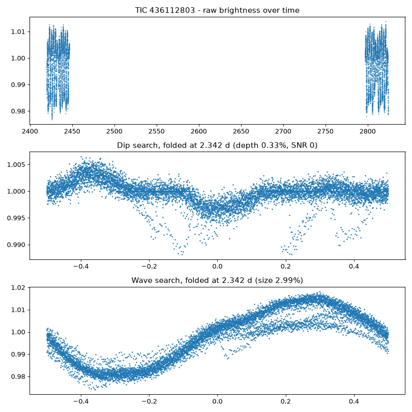

## TIC 158325942  -  unclassified_periodic_variable / no_significant_variability

- AI score: 0.88 | wave period: 0.871 d | dip period hint: 2.612 d
- [Check in SIMBAD](https://simbad.cds.unistra.fr/simbad/sim-coord?Coord=287.00778189847+45.3966208191766&CooFrame=FK5&CooEpoch=2000&Radius=2&Radius.unit=arcmin&submit=submit+query) | [TESS page](https://exofop.ipac.caltech.edu/tess/target.php?id=158325942)

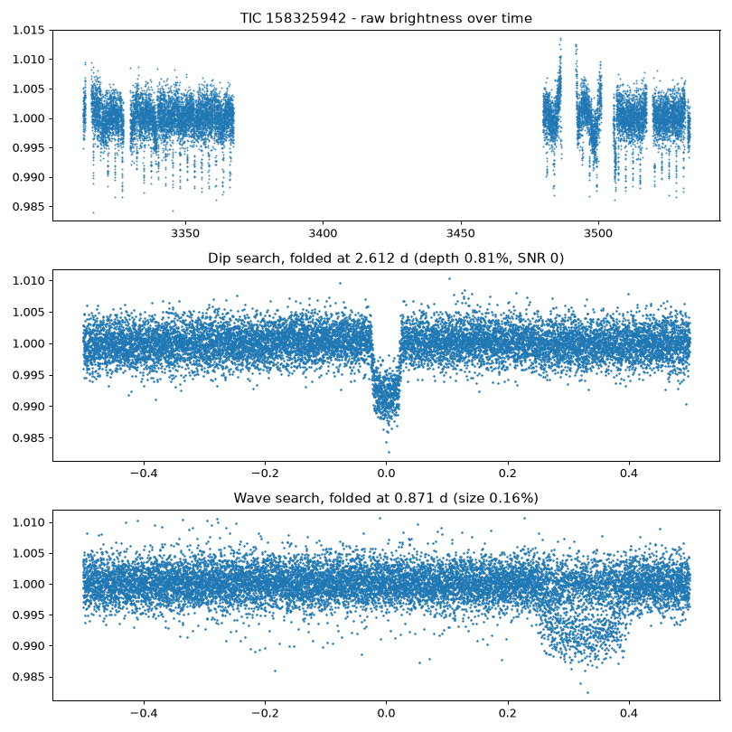

## TIC 279323519  -  unclassified_periodic_variable / likely_pulsating_or_rotating_variable

- AI score: 0.88 | wave period: 2.046 d | dip period hint: 4.080 d
- [Check in SIMBAD](https://simbad.cds.unistra.fr/simbad/sim-coord?Coord=104.402932643869+-58.6012541789222&CooFrame=FK5&CooEpoch=2000&Radius=2&Radius.unit=arcmin&submit=submit+query) | [TESS page](https://exofop.ipac.caltech.edu/tess/target.php?id=279323519)

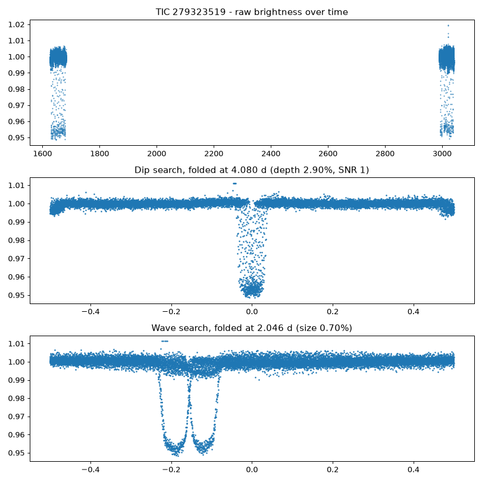

## TIC 354556435  -  likely_planet_transit / no_significant_variability

- AI score: 0.88 | wave period: 8.421 d | dip period hint: 17.248 d
- [Check in SIMBAD](https://simbad.cds.unistra.fr/simbad/sim-coord?Coord=83.8892551493872+-45.0462667654318&CooFrame=FK5&CooEpoch=2000&Radius=2&Radius.unit=arcmin&submit=submit+query) | [TESS page](https://exofop.ipac.caltech.edu/tess/target.php?id=354556435)

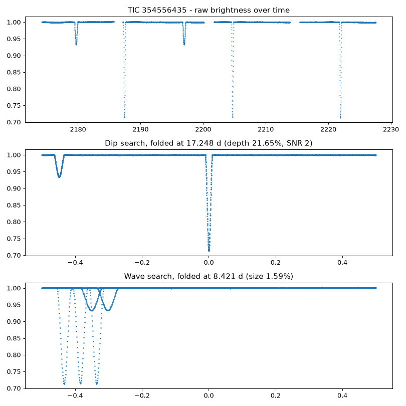

## TIC 87597187  -  likely_planet_transit / likely_pulsating_or_rotating_variable

- AI score: 0.87 | wave period: 2.056 d | dip period hint: 2.045 d
- [Check in SIMBAD](https://simbad.cds.unistra.fr/simbad/sim-coord?Coord=81.5782548998008+47.0737816074643&CooFrame=FK5&CooEpoch=2000&Radius=2&Radius.unit=arcmin&submit=submit+query) | [TESS page](https://exofop.ipac.caltech.edu/tess/target.php?id=87597187)

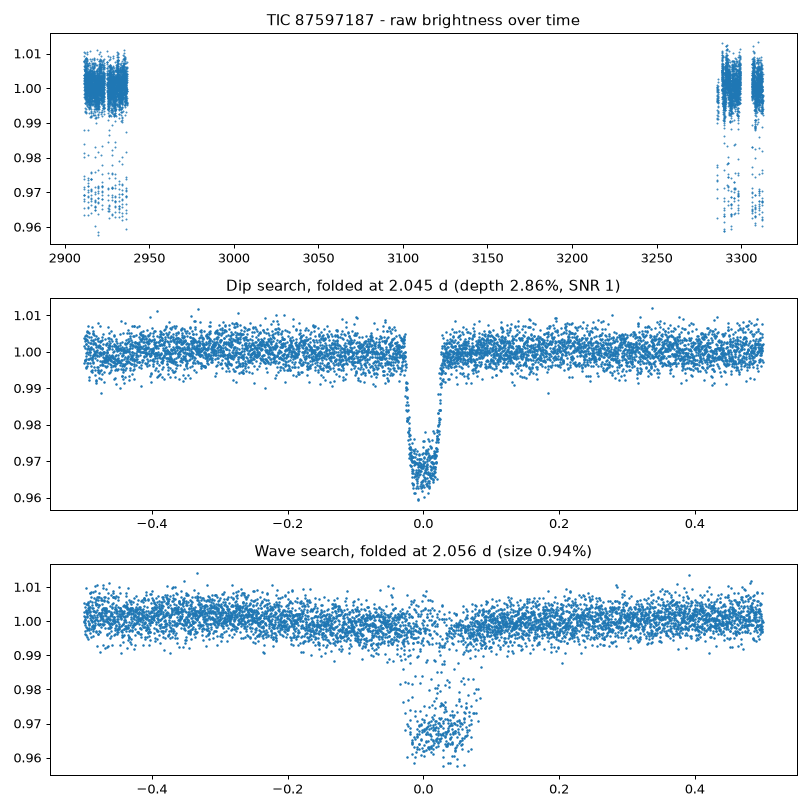

## TIC 102929927  -  likely_eclipsing_binary / no_significant_variability

- AI score: 0.87 | wave period: 1.382 d | dip period hint: 5.529 d
- [Check in SIMBAD](https://simbad.cds.unistra.fr/simbad/sim-coord?Coord=131.928182372564+71.2602323449365&CooFrame=FK5&CooEpoch=2000&Radius=2&Radius.unit=arcmin&submit=submit+query) | [TESS page](https://exofop.ipac.caltech.edu/tess/target.php?id=102929927)

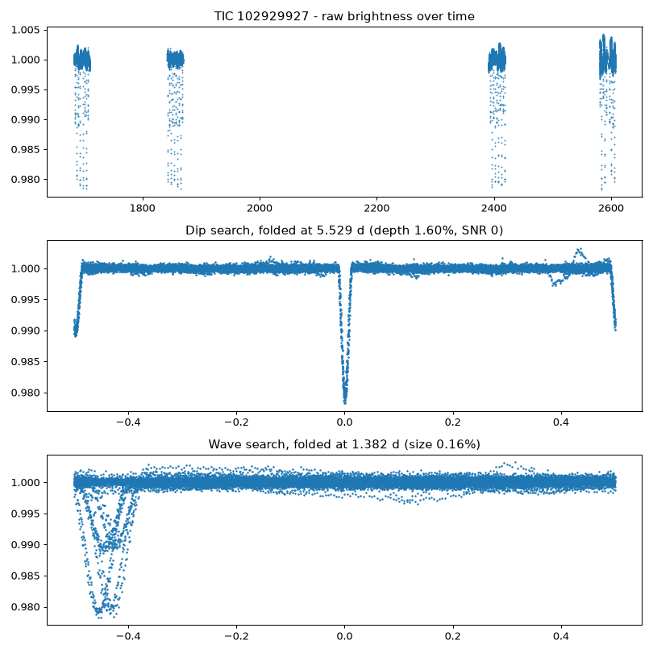

## TIC 140691463  -  unclassified_periodic_variable / no_significant_variability

- AI score: 0.87 | wave period: 2.083 d | dip period hint: 2.085 d
- [Check in SIMBAD](https://simbad.cds.unistra.fr/simbad/sim-coord?Coord=73.7012208916577+-76.6805246012636&CooFrame=FK5&CooEpoch=2000&Radius=2&Radius.unit=arcmin&submit=submit+query) | [TESS page](https://exofop.ipac.caltech.edu/tess/target.php?id=140691463)

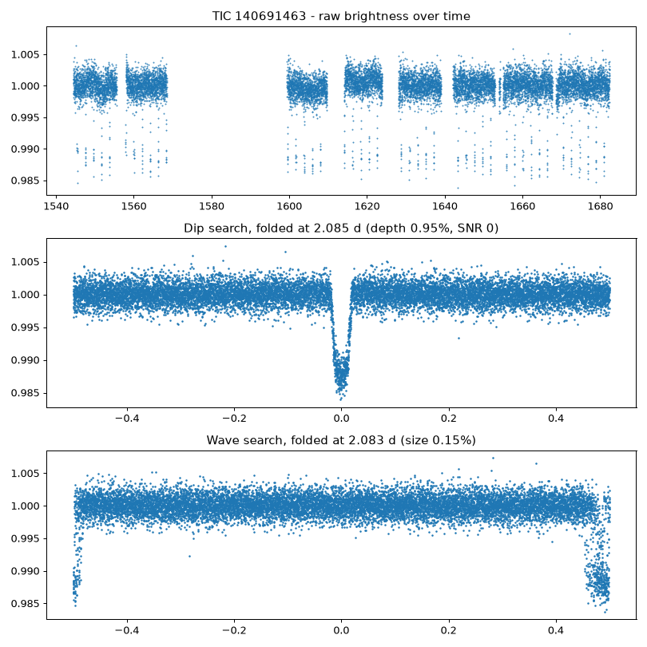

## TIC 138329479  -  unclassified_periodic_variable / no_significant_variability

- AI score: 0.87 | wave period: 0.396 d | dip period hint: 2.374 d
- [Check in SIMBAD](https://simbad.cds.unistra.fr/simbad/sim-coord?Coord=83.0879552615799+79.8091280395454&CooFrame=FK5&CooEpoch=2000&Radius=2&Radius.unit=arcmin&submit=submit+query) | [TESS page](https://exofop.ipac.caltech.edu/tess/target.php?id=138329479)

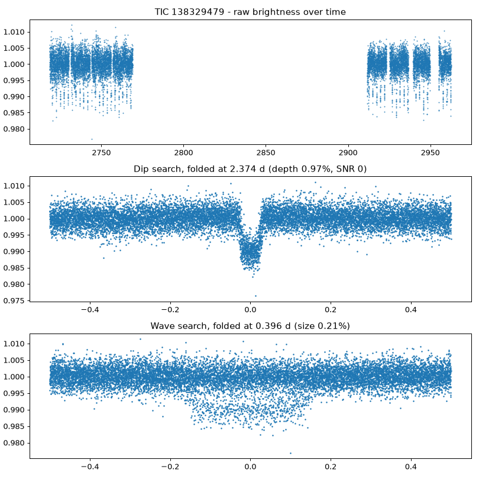

## TIC 307214209  -  unclassified_periodic_variable / likely_pulsating_or_rotating_variable

- AI score: 0.48 | wave period: 0.057 d | dip period hint: 0.574 d
- [Check in SIMBAD](https://simbad.cds.unistra.fr/simbad/sim-coord?Coord=124.661952025637+-71.9772299062962&CooFrame=FK5&CooEpoch=2000&Radius=2&Radius.unit=arcmin&submit=submit+query) | [TESS page](https://exofop.ipac.caltech.edu/tess/target.php?id=307214209)

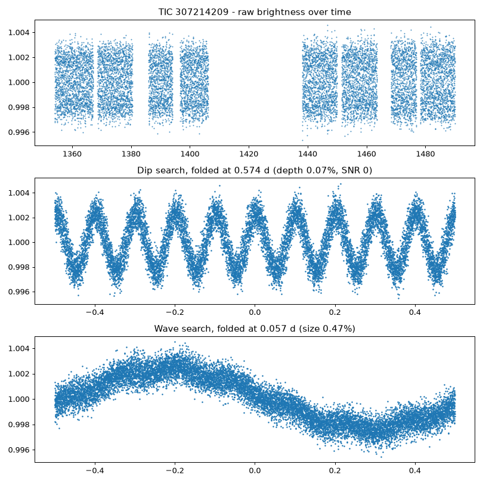

## TIC 387702256  -  unclassified_periodic_variable / likely_pulsating_or_rotating_variable

- AI score: 0.04 | wave period: 0.257 d | dip period hint: 0.514 d
- [Check in SIMBAD](https://simbad.cds.unistra.fr/simbad/sim-coord?Coord=314.363245324838+70.4385407954105&CooFrame=FK5&CooEpoch=2000&Radius=2&Radius.unit=arcmin&submit=submit+query) | [TESS page](https://exofop.ipac.caltech.edu/tess/target.php?id=387702256)

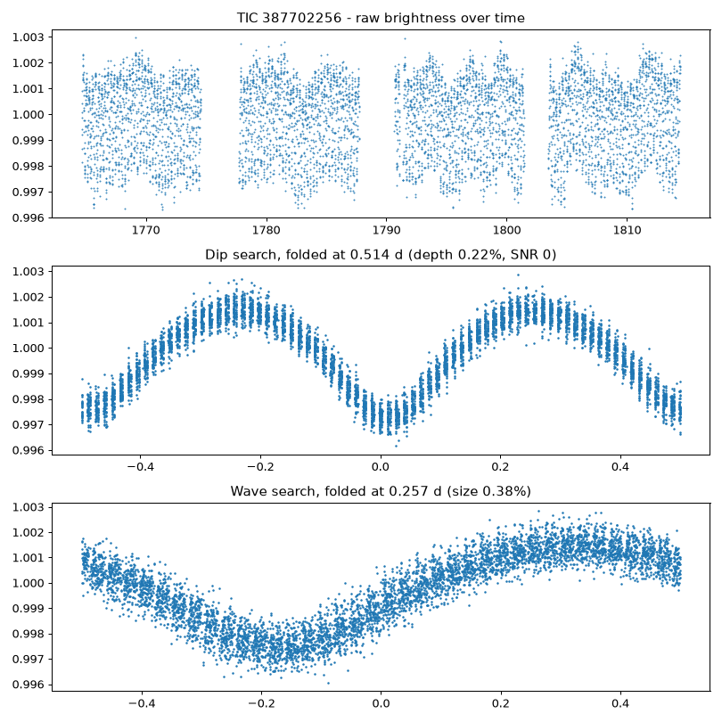

## TIC 409262929  -  unclassified_periodic_variable / no_significant_variability

- AI score: 0.86 | wave period: 1.880 d | dip period hint: 11.254 d
- [Check in SIMBAD](https://simbad.cds.unistra.fr/simbad/sim-coord?Coord=109.647636936451+-13.4989012798404&CooFrame=FK5&CooEpoch=2000&Radius=2&Radius.unit=arcmin&submit=submit+query) | [TESS page](https://exofop.ipac.caltech.edu/tess/target.php?id=409262929)

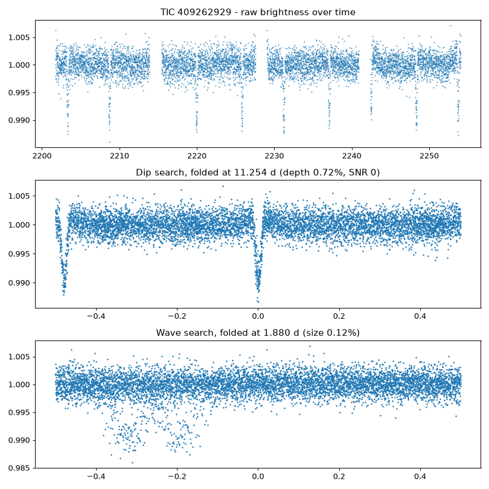

## TIC 98855780  -  likely_planet_transit / likely_pulsating_or_rotating_variable

- AI score: 0.02 | wave period: 0.980 d | dip period hint: 0.983 d
- [Check in SIMBAD](https://simbad.cds.unistra.fr/simbad/sim-coord?Coord=46.1659634552609+-15.0475690984816&CooFrame=FK5&CooEpoch=2000&Radius=2&Radius.unit=arcmin&submit=submit+query) | [TESS page](https://exofop.ipac.caltech.edu/tess/target.php?id=98855780)

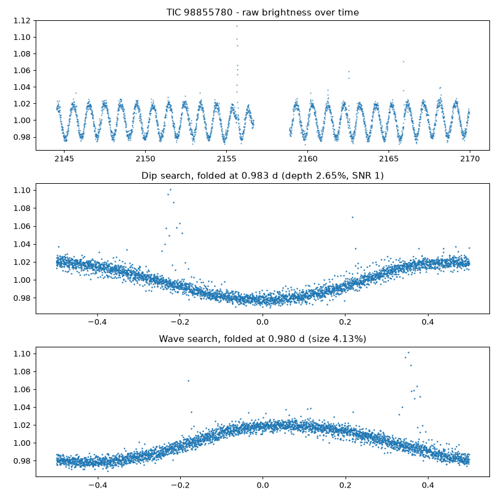

## TIC 180989820  -  unclassified_periodic_variable / no_significant_variability

- AI score: 0.86 | wave period: 2.477 d | dip period hint: 9.873 d
- [Check in SIMBAD](https://simbad.cds.unistra.fr/simbad/sim-coord?Coord=130.257041529306+-40.5848323959381&CooFrame=FK5&CooEpoch=2000&Radius=2&Radius.unit=arcmin&submit=submit+query) | [TESS page](https://exofop.ipac.caltech.edu/tess/target.php?id=180989820)

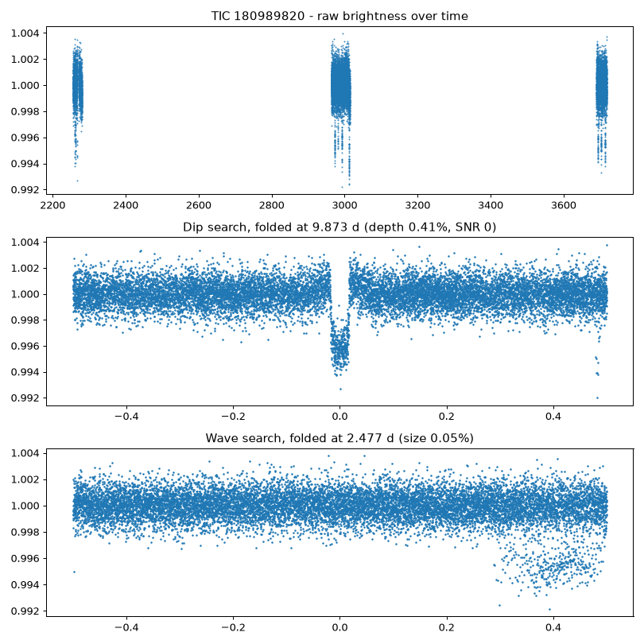

## TIC 170698265  -  likely_planet_transit / likely_pulsating_or_rotating_variable

- AI score: 0.02 | wave period: 0.333 d | dip period hint: 0.666 d
- [Check in SIMBAD](https://simbad.cds.unistra.fr/simbad/sim-coord?Coord=67.6931127348128+-33.0675884170772&CooFrame=FK5&CooEpoch=2000&Radius=2&Radius.unit=arcmin&submit=submit+query) | [TESS page](https://exofop.ipac.caltech.edu/tess/target.php?id=170698265)

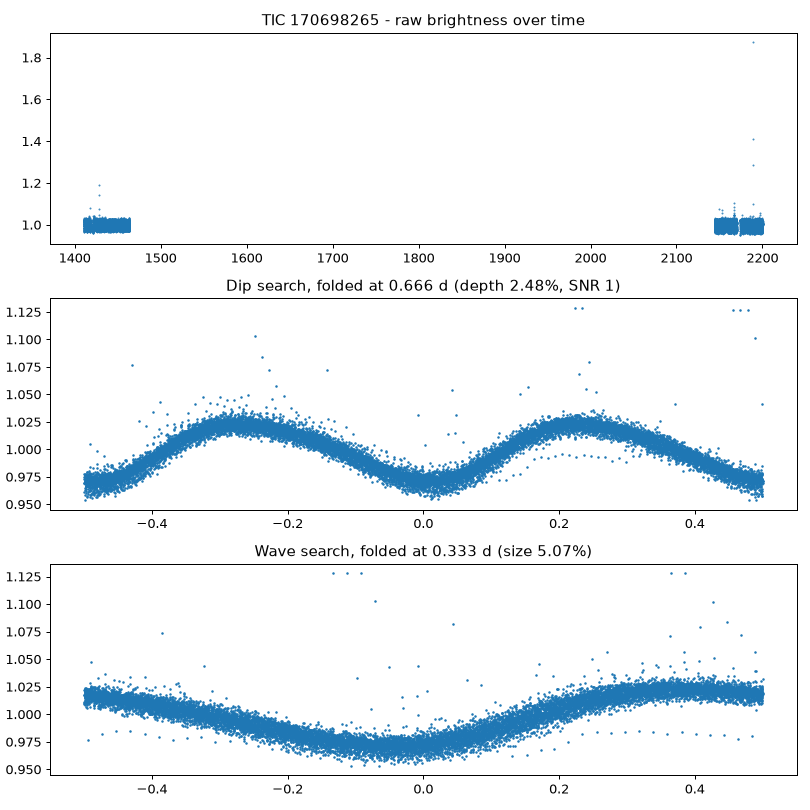

## TIC 170362590  -  likely_planet_transit / likely_pulsating_or_rotating_variable

- AI score: 0.07 | wave period: 1.895 d | dip period hint: 1.888 d
- [Check in SIMBAD](https://simbad.cds.unistra.fr/simbad/sim-coord?Coord=103.069905947227+-45.1267856615162&CooFrame=FK5&CooEpoch=2000&Radius=2&Radius.unit=arcmin&submit=submit+query) | [TESS page](https://exofop.ipac.caltech.edu/tess/target.php?id=170362590)

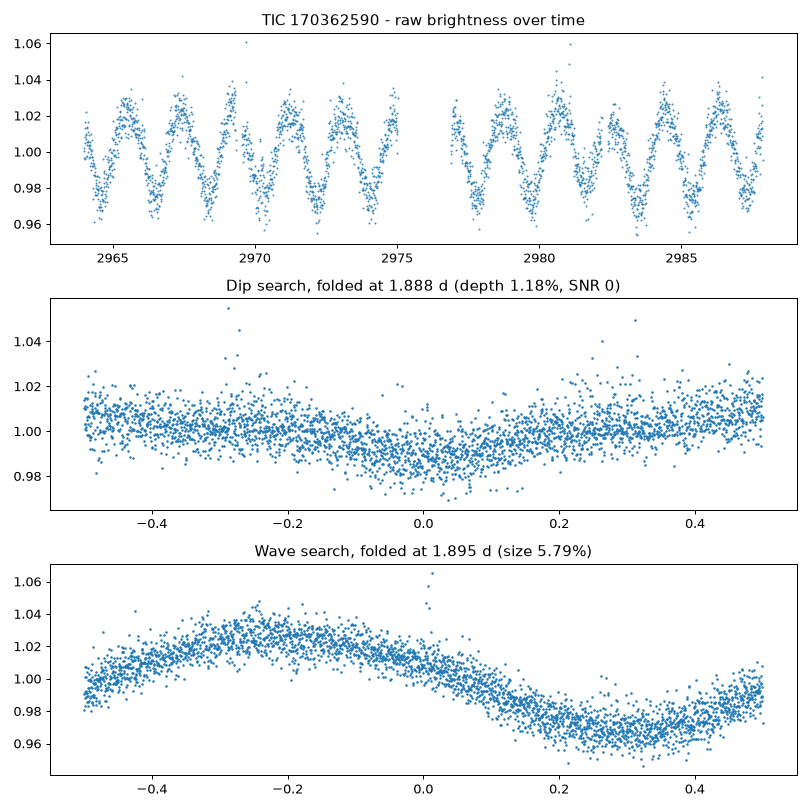
