# Your leads - just look at the pictures

Each lead is a star NOT catalogued in SIMBAD / AAVSO VSX as a variable or binary.
Look at the **bottom two graphs** of each picture:

- **GOOD:** the dots form a clean, thin curve (a dip or a smooth wave). The thinner the curve, the better.
- **BAD:** the dots are a messy cloud with no clear shape. Ignore these.

If a picture looks GOOD: click the SIMBAD link, and if the star shows no variable/binary type,
submit it at https://www.aavso.org/vsx (Submit new variable).

262 leads total; showing the top 50.

## TIC 33159045  -  likely_planet_transit / likely_pulsating_or_rotating_variable

- AI score: 0.99 | wave period: 2.538 d | dip period hint: 7.580 d
- [Check in SIMBAD](https://simbad.cds.unistra.fr/simbad/sim-coord?Coord=144.669705994284+-43.4384744607037&CooFrame=FK5&CooEpoch=2000&Radius=2&Radius.unit=arcmin&submit=submit+query) | [TESS page](https://exofop.ipac.caltech.edu/tess/target.php?id=33159045)

## TIC 260301742  -  likely_planet_transit / likely_pulsating_or_rotating_variable

- AI score: 0.04 | wave period: 0.562 d | dip period hint: 0.562 d
- [Check in SIMBAD](https://simbad.cds.unistra.fr/simbad/sim-coord?Coord=94.7050952973425+-54.2090106285887&CooFrame=FK5&CooEpoch=2000&Radius=2&Radius.unit=arcmin&submit=submit+query) | [TESS page](https://exofop.ipac.caltech.edu/tess/target.php?id=260301742)

## TIC 156294609  -  unclassified_periodic_variable / likely_pulsating_or_rotating_variable

- AI score: 0.01 | wave period: 0.090 d | dip period hint: 0.543 d
- [Check in SIMBAD](https://simbad.cds.unistra.fr/simbad/sim-coord?Coord=259.315166527963+13.8688318270105&CooFrame=FK5&CooEpoch=2000&Radius=2&Radius.unit=arcmin&submit=submit+query) | [TESS page](https://exofop.ipac.caltech.edu/tess/target.php?id=156294609)

## TIC 378239424  -  unclassified_periodic_variable / likely_pulsating_or_rotating_variable

- AI score: 0.19 | wave period: 1.741 d | dip period hint: 1.739 d
- [Check in SIMBAD](https://simbad.cds.unistra.fr/simbad/sim-coord?Coord=154.997611753556+-60.9943518091612&CooFrame=FK5&CooEpoch=2000&Radius=2&Radius.unit=arcmin&submit=submit+query) | [TESS page](https://exofop.ipac.caltech.edu/tess/target.php?id=378239424)

## TIC 153742767  -  likely_planet_transit / likely_pulsating_or_rotating_variable

- AI score: 0.03 | wave period: 0.508 d | dip period hint: 0.507 d
- [Check in SIMBAD](https://simbad.cds.unistra.fr/simbad/sim-coord?Coord=66.5038916727048+-43.7712402271341&CooFrame=FK5&CooEpoch=2000&Radius=2&Radius.unit=arcmin&submit=submit+query) | [TESS page](https://exofop.ipac.caltech.edu/tess/target.php?id=153742767)

## TIC 407661994  -  unclassified_periodic_variable / no_significant_variability

- AI score: 0.95 | wave period: 1.046 d | dip period hint: 12.554 d
- [Check in SIMBAD](https://simbad.cds.unistra.fr/simbad/sim-coord?Coord=83.0429059237847+-73.0054163282332&CooFrame=FK5&CooEpoch=2000&Radius=2&Radius.unit=arcmin&submit=submit+query) | [TESS page](https://exofop.ipac.caltech.edu/tess/target.php?id=407661994)

## TIC 255906549  -  likely_eclipsing_binary / no_significant_variability

- AI score: 0.93 | wave period: 2.130 d | dip period hint: 25.551 d
- [Check in SIMBAD](https://simbad.cds.unistra.fr/simbad/sim-coord?Coord=246.976417279334+40.5518927121385&CooFrame=FK5&CooEpoch=2000&Radius=2&Radius.unit=arcmin&submit=submit+query) | [TESS page](https://exofop.ipac.caltech.edu/tess/target.php?id=255906549)

## TIC 287196418  -  likely_eclipsing_binary / likely_pulsating_or_rotating_variable

- AI score: 0.93 | wave period: 1.055 d | dip period hint: 7.390 d
- [Check in SIMBAD](https://simbad.cds.unistra.fr/simbad/sim-coord?Coord=292.734123834902+59.4038510862493&CooFrame=FK5&CooEpoch=2000&Radius=2&Radius.unit=arcmin&submit=submit+query) | [TESS page](https://exofop.ipac.caltech.edu/tess/target.php?id=287196418)

## TIC 401704685  -  unclassified_periodic_variable / no_significant_variability

- AI score: 0.92 | wave period: 2.105 d | dip period hint: 4.210 d
- [Check in SIMBAD](https://simbad.cds.unistra.fr/simbad/sim-coord?Coord=318.863288215084+-83.1644813364236&CooFrame=FK5&CooEpoch=2000&Radius=2&Radius.unit=arcmin&submit=submit+query) | [TESS page](https://exofop.ipac.caltech.edu/tess/target.php?id=401704685)

## TIC 157402232  -  unclassified_periodic_variable / likely_pulsating_or_rotating_variable

- AI score: 0.20 | wave period: 2.190 d | dip period hint: 2.173 d
- [Check in SIMBAD](https://simbad.cds.unistra.fr/simbad/sim-coord?Coord=106.291198106555+-36.6871865619863&CooFrame=FK5&CooEpoch=2000&Radius=2&Radius.unit=arcmin&submit=submit+query) | [TESS page](https://exofop.ipac.caltech.edu/tess/target.php?id=157402232)

## TIC 410451677  -  unclassified_periodic_variable / likely_pulsating_or_rotating_variable

- AI score: 0.11 | wave period: 2.055 d | dip period hint: 2.055 d
- [Check in SIMBAD](https://simbad.cds.unistra.fr/simbad/sim-coord?Coord=119.990854713286+-60.7467937596076&CooFrame=FK5&CooEpoch=2000&Radius=2&Radius.unit=arcmin&submit=submit+query) | [TESS page](https://exofop.ipac.caltech.edu/tess/target.php?id=410451677)

## TIC 200921621  -  likely_planet_transit / likely_pulsating_or_rotating_variable

- AI score: 0.91 | wave period: 2.421 d | dip period hint: 4.831 d
- [Check in SIMBAD](https://simbad.cds.unistra.fr/simbad/sim-coord?Coord=54.5230554423062+36.1409917193704&CooFrame=FK5&CooEpoch=2000&Radius=2&Radius.unit=arcmin&submit=submit+query) | [TESS page](https://exofop.ipac.caltech.edu/tess/target.php?id=200921621)

## TIC 131081852  -  likely_eclipsing_binary / no_significant_variability

- AI score: 0.91 | wave period: 1.896 d | dip period hint: 33.184 d
- [Check in SIMBAD](https://simbad.cds.unistra.fr/simbad/sim-coord?Coord=189.762266348388+-31.9921502486101&CooFrame=FK5&CooEpoch=2000&Radius=2&Radius.unit=arcmin&submit=submit+query) | [TESS page](https://exofop.ipac.caltech.edu/tess/target.php?id=131081852)

## TIC 349518800  -  unclassified_periodic_variable / likely_pulsating_or_rotating_variable

- AI score: 0.91 | wave period: 1.083 d | dip period hint: 2.165 d
- [Check in SIMBAD](https://simbad.cds.unistra.fr/simbad/sim-coord?Coord=111.211814611496+-62.0924878583018&CooFrame=FK5&CooEpoch=2000&Radius=2&Radius.unit=arcmin&submit=submit+query) | [TESS page](https://exofop.ipac.caltech.edu/tess/target.php?id=349518800)

## TIC 288507910  -  likely_planet_transit / no_significant_variability

- AI score: 0.90 | wave period: 2.779 d | dip period hint: 8.346 d
- [Check in SIMBAD](https://simbad.cds.unistra.fr/simbad/sim-coord?Coord=271.538391874982+81.9415605600614&CooFrame=FK5&CooEpoch=2000&Radius=2&Radius.unit=arcmin&submit=submit+query) | [TESS page](https://exofop.ipac.caltech.edu/tess/target.php?id=288507910)

## TIC 177118177  -  unclassified_periodic_variable / likely_pulsating_or_rotating_variable

- AI score: 0.89 | wave period: 1.251 d | dip period hint: 2.504 d
- [Check in SIMBAD](https://simbad.cds.unistra.fr/simbad/sim-coord?Coord=104.296998781894+-66.025585227893&CooFrame=FK5&CooEpoch=2000&Radius=2&Radius.unit=arcmin&submit=submit+query) | [TESS page](https://exofop.ipac.caltech.edu/tess/target.php?id=177118177)

## TIC 271806353  -  likely_planet_transit / no_significant_variability

- AI score: 0.89 | wave period: 0.573 d | dip period hint: 3.439 d
- [Check in SIMBAD](https://simbad.cds.unistra.fr/simbad/sim-coord?Coord=111.442601047701+-77.776673296016&CooFrame=FK5&CooEpoch=2000&Radius=2&Radius.unit=arcmin&submit=submit+query) | [TESS page](https://exofop.ipac.caltech.edu/tess/target.php?id=271806353)

## TIC 209217764  -  likely_planet_transit / no_significant_variability

- AI score: 0.89 | wave period: 2.862 d | dip period hint: 8.767 d
- [Check in SIMBAD](https://simbad.cds.unistra.fr/simbad/sim-coord?Coord=299.202281943166+-29.4419472207818&CooFrame=FK5&CooEpoch=2000&Radius=2&Radius.unit=arcmin&submit=submit+query) | [TESS page](https://exofop.ipac.caltech.edu/tess/target.php?id=209217764)

## TIC 155995204  -  likely_planet_transit / no_significant_variability

- AI score: 0.88 | wave period: 0.548 d | dip period hint: 9.314 d
- [Check in SIMBAD](https://simbad.cds.unistra.fr/simbad/sim-coord?Coord=7.65854607582995+-52.0493754273401&CooFrame=FK5&CooEpoch=2000&Radius=2&Radius.unit=arcmin&submit=submit+query) | [TESS page](https://exofop.ipac.caltech.edu/tess/target.php?id=155995204)

## TIC 354556435  -  likely_planet_transit / no_significant_variability

- AI score: 0.88 | wave period: 8.421 d | dip period hint: 17.248 d
- [Check in SIMBAD](https://simbad.cds.unistra.fr/simbad/sim-coord?Coord=83.8892551493872+-45.0462667654318&CooFrame=FK5&CooEpoch=2000&Radius=2&Radius.unit=arcmin&submit=submit+query) | [TESS page](https://exofop.ipac.caltech.edu/tess/target.php?id=354556435)

## TIC 87597187  -  likely_planet_transit / likely_pulsating_or_rotating_variable

- AI score: 0.87 | wave period: 2.056 d | dip period hint: 2.045 d
- [Check in SIMBAD](https://simbad.cds.unistra.fr/simbad/sim-coord?Coord=81.5782548998008+47.0737816074643&CooFrame=FK5&CooEpoch=2000&Radius=2&Radius.unit=arcmin&submit=submit+query) | [TESS page](https://exofop.ipac.caltech.edu/tess/target.php?id=87597187)

## TIC 140691463  -  unclassified_periodic_variable / no_significant_variability

- AI score: 0.87 | wave period: 2.083 d | dip period hint: 2.085 d
- [Check in SIMBAD](https://simbad.cds.unistra.fr/simbad/sim-coord?Coord=73.7012208916577+-76.6805246012636&CooFrame=FK5&CooEpoch=2000&Radius=2&Radius.unit=arcmin&submit=submit+query) | [TESS page](https://exofop.ipac.caltech.edu/tess/target.php?id=140691463)

## TIC 307214209  -  unclassified_periodic_variable / likely_pulsating_or_rotating_variable

- AI score: 0.48 | wave period: 0.057 d | dip period hint: 0.574 d
- [Check in SIMBAD](https://simbad.cds.unistra.fr/simbad/sim-coord?Coord=124.661952025637+-71.9772299062962&CooFrame=FK5&CooEpoch=2000&Radius=2&Radius.unit=arcmin&submit=submit+query) | [TESS page](https://exofop.ipac.caltech.edu/tess/target.php?id=307214209)

## TIC 387702256  -  unclassified_periodic_variable / likely_pulsating_or_rotating_variable

- AI score: 0.04 | wave period: 0.257 d | dip period hint: 0.514 d
- [Check in SIMBAD](https://simbad.cds.unistra.fr/simbad/sim-coord?Coord=314.363245324838+70.4385407954105&CooFrame=FK5&CooEpoch=2000&Radius=2&Radius.unit=arcmin&submit=submit+query) | [TESS page](https://exofop.ipac.caltech.edu/tess/target.php?id=387702256)

## TIC 409262929  -  unclassified_periodic_variable / no_significant_variability

- AI score: 0.86 | wave period: 1.880 d | dip period hint: 11.254 d
- [Check in SIMBAD](https://simbad.cds.unistra.fr/simbad/sim-coord?Coord=109.647636936451+-13.4989012798404&CooFrame=FK5&CooEpoch=2000&Radius=2&Radius.unit=arcmin&submit=submit+query) | [TESS page](https://exofop.ipac.caltech.edu/tess/target.php?id=409262929)

## TIC 180989820  -  unclassified_periodic_variable / no_significant_variability

- AI score: 0.86 | wave period: 2.477 d | dip period hint: 9.873 d
- [Check in SIMBAD](https://simbad.cds.unistra.fr/simbad/sim-coord?Coord=130.257041529306+-40.5848323959381&CooFrame=FK5&CooEpoch=2000&Radius=2&Radius.unit=arcmin&submit=submit+query) | [TESS page](https://exofop.ipac.caltech.edu/tess/target.php?id=180989820)

## TIC 170698265  -  likely_planet_transit / likely_pulsating_or_rotating_variable

- AI score: 0.02 | wave period: 0.333 d | dip period hint: 0.666 d
- [Check in SIMBAD](https://simbad.cds.unistra.fr/simbad/sim-coord?Coord=67.6931127348128+-33.0675884170772&CooFrame=FK5&CooEpoch=2000&Radius=2&Radius.unit=arcmin&submit=submit+query) | [TESS page](https://exofop.ipac.caltech.edu/tess/target.php?id=170698265)

## TIC 170362590  -  likely_planet_transit / likely_pulsating_or_rotating_variable

- AI score: 0.07 | wave period: 1.895 d | dip period hint: 1.888 d
- [Check in SIMBAD](https://simbad.cds.unistra.fr/simbad/sim-coord?Coord=103.069905947227+-45.1267856615162&CooFrame=FK5&CooEpoch=2000&Radius=2&Radius.unit=arcmin&submit=submit+query) | [TESS page](https://exofop.ipac.caltech.edu/tess/target.php?id=170362590)

## TIC 260502102  -  likely_planet_transit / likely_pulsating_or_rotating_variable

- AI score: 0.86 | wave period: 1.219 d | dip period hint: 7.314 d
- [Check in SIMBAD](https://simbad.cds.unistra.fr/simbad/sim-coord?Coord=96.5159949937714+-59.0161666148624&CooFrame=FK5&CooEpoch=2000&Radius=2&Radius.unit=arcmin&submit=submit+query) | [TESS page](https://exofop.ipac.caltech.edu/tess/target.php?id=260502102)

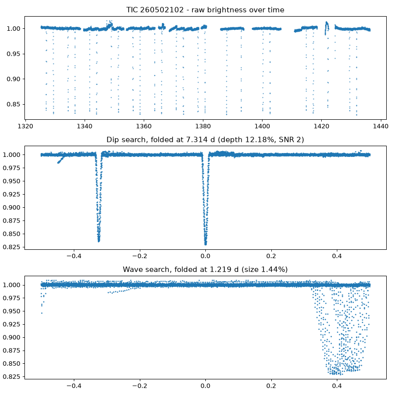

## TIC 24536661  -  likely_planet_transit / likely_pulsating_or_rotating_variable

- AI score: 0.04 | wave period: 0.215 d | dip period hint: 0.644 d
- [Check in SIMBAD](https://simbad.cds.unistra.fr/simbad/sim-coord?Coord=141.111929274013+-31.573110002202&CooFrame=FK5&CooEpoch=2000&Radius=2&Radius.unit=arcmin&submit=submit+query) | [TESS page](https://exofop.ipac.caltech.edu/tess/target.php?id=24536661)

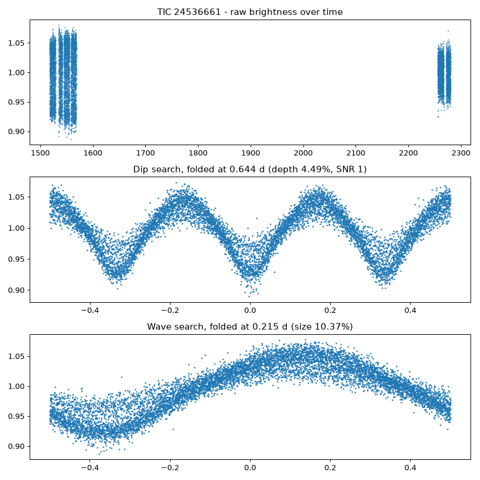

## TIC 70723644  -  unclassified_periodic_variable / no_significant_variability

- AI score: 0.85 | wave period: 2.894 d | dip period hint: 14.442 d
- [Check in SIMBAD](https://simbad.cds.unistra.fr/simbad/sim-coord?Coord=0.294996105966126+-32.7568366833269&CooFrame=FK5&CooEpoch=2000&Radius=2&Radius.unit=arcmin&submit=submit+query) | [TESS page](https://exofop.ipac.caltech.edu/tess/target.php?id=70723644)

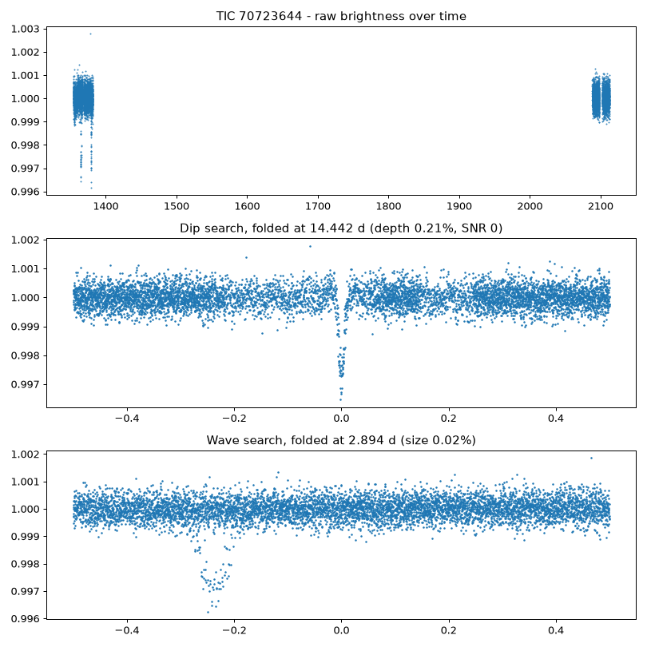

## TIC 334754418  -  likely_eclipsing_binary / likely_pulsating_or_rotating_variable

- AI score: 0.85 | wave period: 0.382 d | dip period hint: 0.764 d
- [Check in SIMBAD](https://simbad.cds.unistra.fr/simbad/sim-coord?Coord=246.507271405094+60.8568012696386&CooFrame=FK5&CooEpoch=2000&Radius=2&Radius.unit=arcmin&submit=submit+query) | [TESS page](https://exofop.ipac.caltech.edu/tess/target.php?id=334754418)

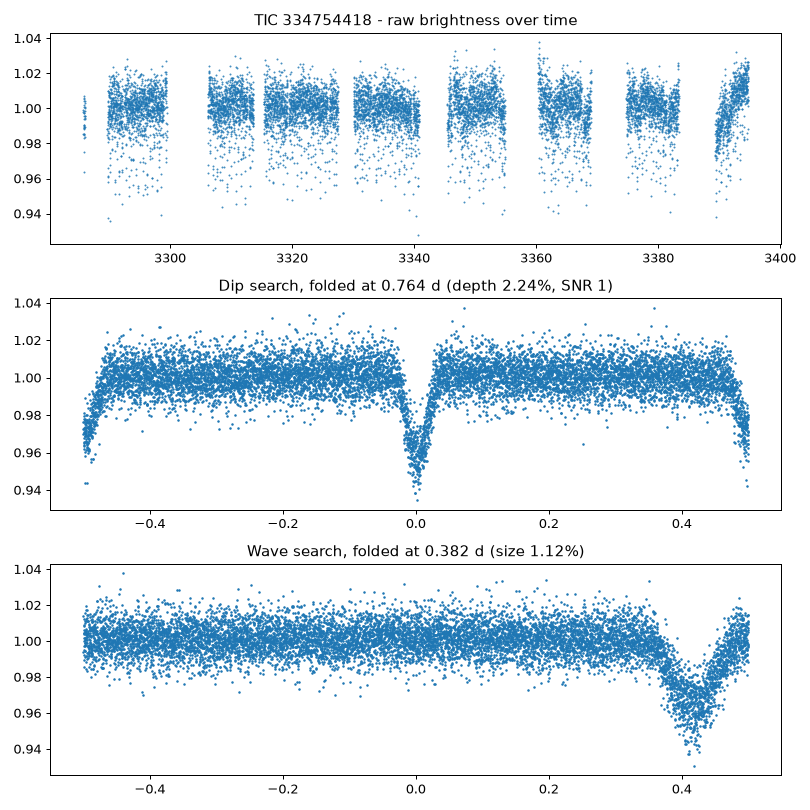

## TIC 190990336  -  likely_planet_transit / no_significant_variability

- AI score: 0.85 | wave period: 2.763 d | dip period hint: 5.547 d
- [Check in SIMBAD](https://simbad.cds.unistra.fr/simbad/sim-coord?Coord=134.373092891527+-39.7784237689224&CooFrame=FK5&CooEpoch=2000&Radius=2&Radius.unit=arcmin&submit=submit+query) | [TESS page](https://exofop.ipac.caltech.edu/tess/target.php?id=190990336)

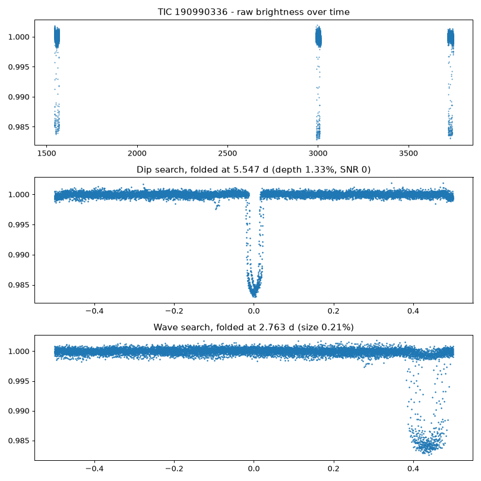

## TIC 129269428  -  unclassified_periodic_variable / likely_pulsating_or_rotating_variable

- AI score: 0.01 | wave period: 0.291 d | dip period hint: 0.581 d
- [Check in SIMBAD](https://simbad.cds.unistra.fr/simbad/sim-coord?Coord=118.793849250175+-29.0169226708876&CooFrame=FK5&CooEpoch=2000&Radius=2&Radius.unit=arcmin&submit=submit+query) | [TESS page](https://exofop.ipac.caltech.edu/tess/target.php?id=129269428)

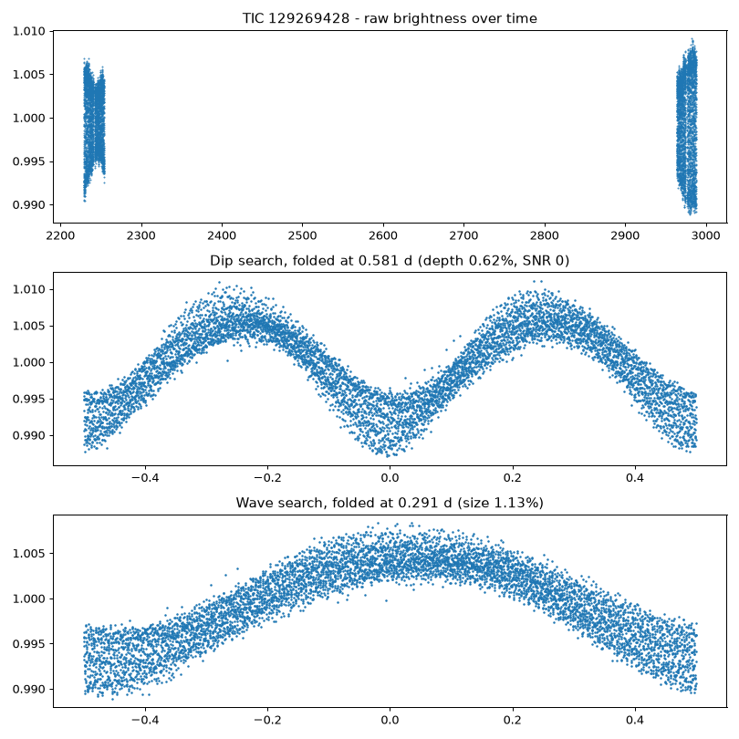

## TIC 256171214  -  likely_planet_transit / likely_pulsating_or_rotating_variable

- AI score: 0.02 | wave period: 0.748 d | dip period hint: 0.748 d
- [Check in SIMBAD](https://simbad.cds.unistra.fr/simbad/sim-coord?Coord=199.570992610354+-54.1019939291165&CooFrame=FK5&CooEpoch=2000&Radius=2&Radius.unit=arcmin&submit=submit+query) | [TESS page](https://exofop.ipac.caltech.edu/tess/target.php?id=256171214)

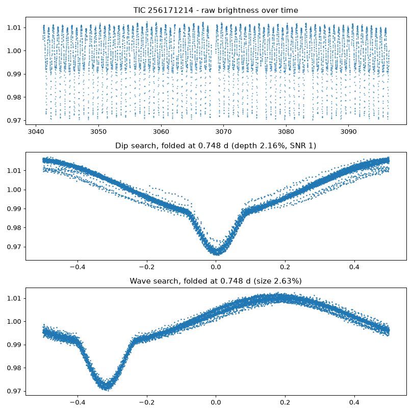

## TIC 199688293  -  unclassified_periodic_variable / likely_pulsating_or_rotating_variable

- AI score: 0.02 | wave period: 0.810 d | dip period hint: 0.810 d
- [Check in SIMBAD](https://simbad.cds.unistra.fr/simbad/sim-coord?Coord=253.155933387724+57.2585436747509&CooFrame=FK5&CooEpoch=2000&Radius=2&Radius.unit=arcmin&submit=submit+query) | [TESS page](https://exofop.ipac.caltech.edu/tess/target.php?id=199688293)

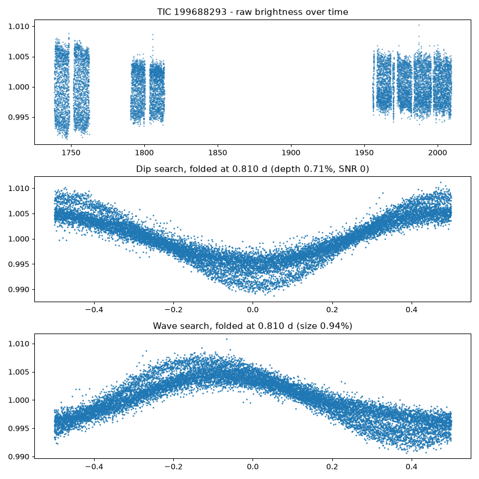

## TIC 408420719  -  unclassified_periodic_variable / likely_pulsating_or_rotating_variable

- AI score: 0.07 | wave period: 2.736 d | dip period hint: 2.756 d
- [Check in SIMBAD](https://simbad.cds.unistra.fr/simbad/sim-coord?Coord=161.331814274305+-19.6943077309349&CooFrame=FK5&CooEpoch=2000&Radius=2&Radius.unit=arcmin&submit=submit+query) | [TESS page](https://exofop.ipac.caltech.edu/tess/target.php?id=408420719)

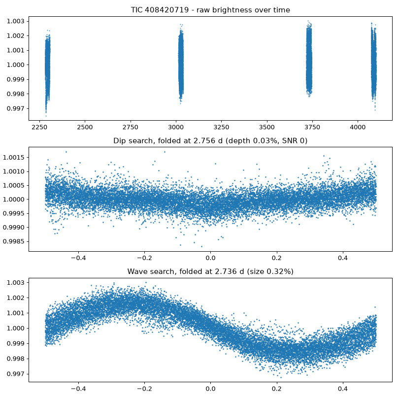

## TIC 229507862  -  likely_eclipsing_binary / no_significant_variability

- AI score: 0.84 | wave period: 1.475 d | dip period hint: 5.901 d
- [Check in SIMBAD](https://simbad.cds.unistra.fr/simbad/sim-coord?Coord=297.04050328107+63.274240459532&CooFrame=FK5&CooEpoch=2000&Radius=2&Radius.unit=arcmin&submit=submit+query) | [TESS page](https://exofop.ipac.caltech.edu/tess/target.php?id=229507862)

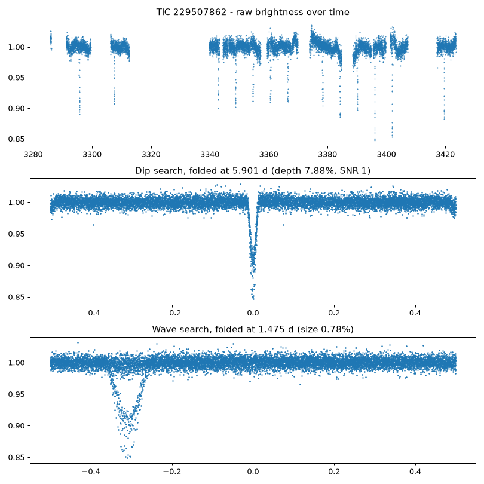

## TIC 293115739  -  unclassified_periodic_variable / likely_pulsating_or_rotating_variable

- AI score: 0.07 | wave period: 1.417 d | dip period hint: 1.419 d
- [Check in SIMBAD](https://simbad.cds.unistra.fr/simbad/sim-coord?Coord=49.0462396412997+3.70058054164969&CooFrame=FK5&CooEpoch=2000&Radius=2&Radius.unit=arcmin&submit=submit+query) | [TESS page](https://exofop.ipac.caltech.edu/tess/target.php?id=293115739)

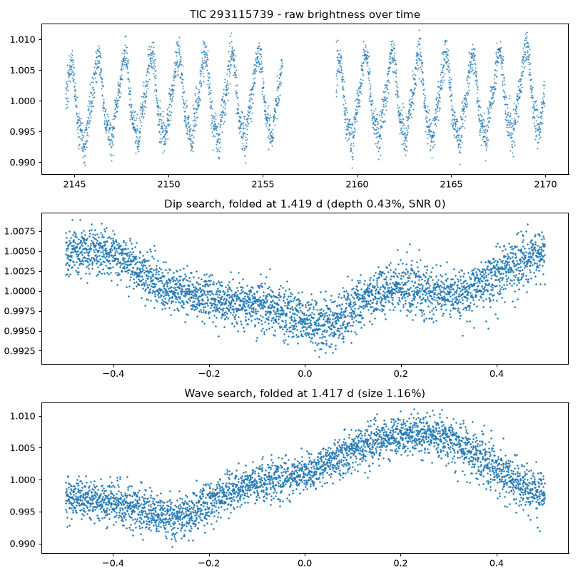

## TIC 119058688  -  unclassified_periodic_variable / likely_pulsating_or_rotating_variable

- AI score: 0.83 | wave period: 2.434 d | dip period hint: 12.121 d
- [Check in SIMBAD](https://simbad.cds.unistra.fr/simbad/sim-coord?Coord=135.947947916973+-19.8254339411249&CooFrame=FK5&CooEpoch=2000&Radius=2&Radius.unit=arcmin&submit=submit+query) | [TESS page](https://exofop.ipac.caltech.edu/tess/target.php?id=119058688)

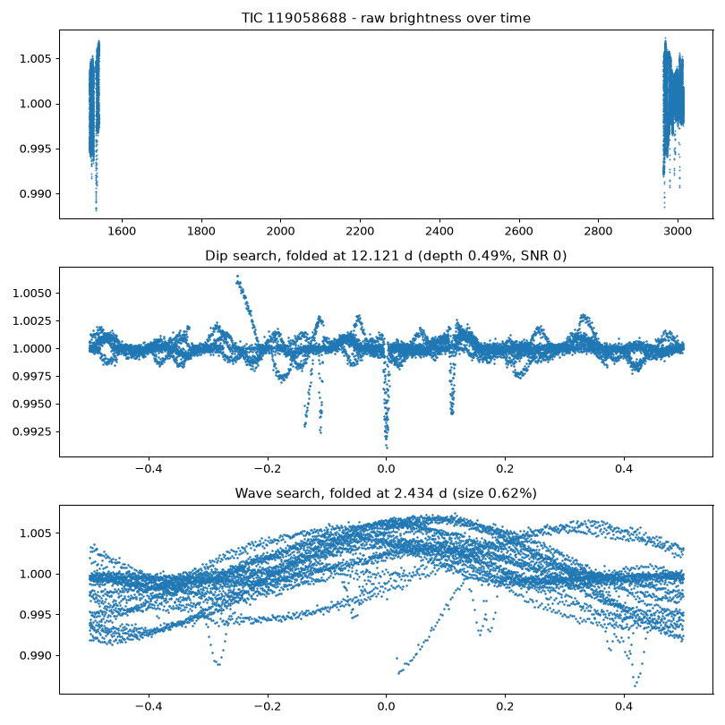

## TIC 200433954  -  unclassified_periodic_variable / likely_pulsating_or_rotating_variable

- AI score: 0.06 | wave period: 1.877 d | dip period hint: 1.871 d
- [Check in SIMBAD](https://simbad.cds.unistra.fr/simbad/sim-coord?Coord=70.2117087026382+-43.8901828282259&CooFrame=FK5&CooEpoch=2000&Radius=2&Radius.unit=arcmin&submit=submit+query) | [TESS page](https://exofop.ipac.caltech.edu/tess/target.php?id=200433954)

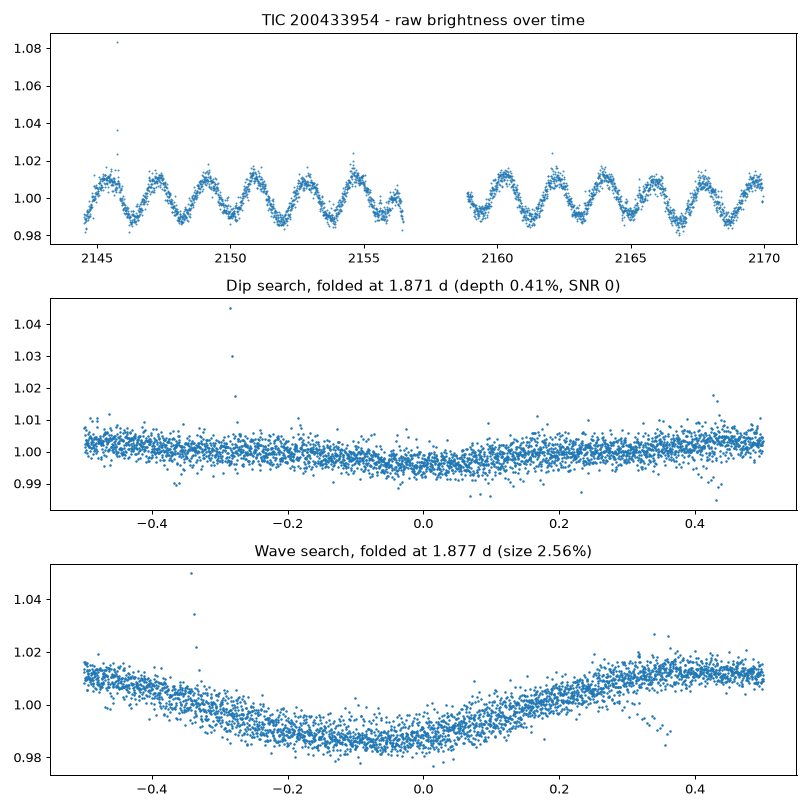

## TIC 271693722  -  unclassified_periodic_variable / likely_pulsating_or_rotating_variable

- AI score: 0.09 | wave period: 1.923 d | dip period hint: 1.923 d
- [Check in SIMBAD](https://simbad.cds.unistra.fr/simbad/sim-coord?Coord=109.549272615195+-75.3474008329959&CooFrame=FK5&CooEpoch=2000&Radius=2&Radius.unit=arcmin&submit=submit+query) | [TESS page](https://exofop.ipac.caltech.edu/tess/target.php?id=271693722)

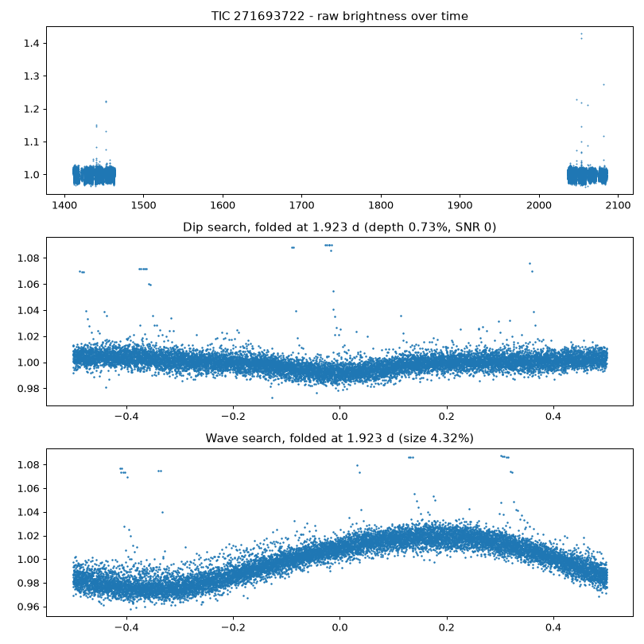

## TIC 256512446  -  likely_eclipsing_binary / no_significant_variability

- AI score: 0.82 | wave period: 0.895 d | dip period hint: 16.114 d
- [Check in SIMBAD](https://simbad.cds.unistra.fr/simbad/sim-coord?Coord=299.436206492903+60.6620404417201&CooFrame=FK5&CooEpoch=2000&Radius=2&Radius.unit=arcmin&submit=submit+query) | [TESS page](https://exofop.ipac.caltech.edu/tess/target.php?id=256512446)

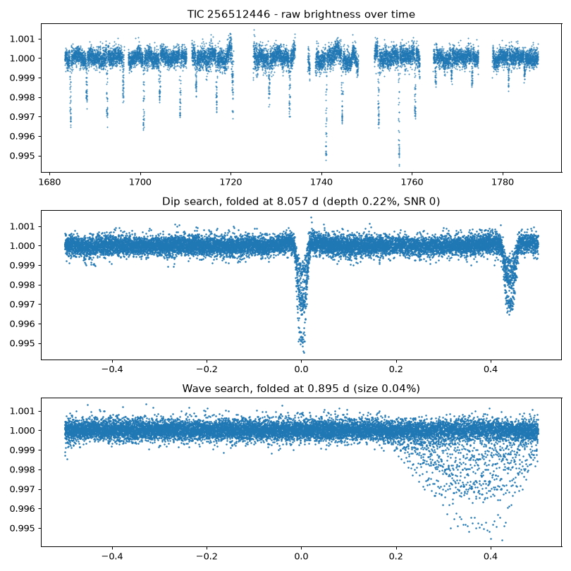

## TIC 349154435  -  likely_eclipsing_binary / likely_pulsating_or_rotating_variable

- AI score: 0.82 | wave period: 2.223 d | dip period hint: 4.432 d
- [Check in SIMBAD](https://simbad.cds.unistra.fr/simbad/sim-coord?Coord=108.180246877035+-62.0165121620785&CooFrame=FK5&CooEpoch=2000&Radius=2&Radius.unit=arcmin&submit=submit+query) | [TESS page](https://exofop.ipac.caltech.edu/tess/target.php?id=349154435)

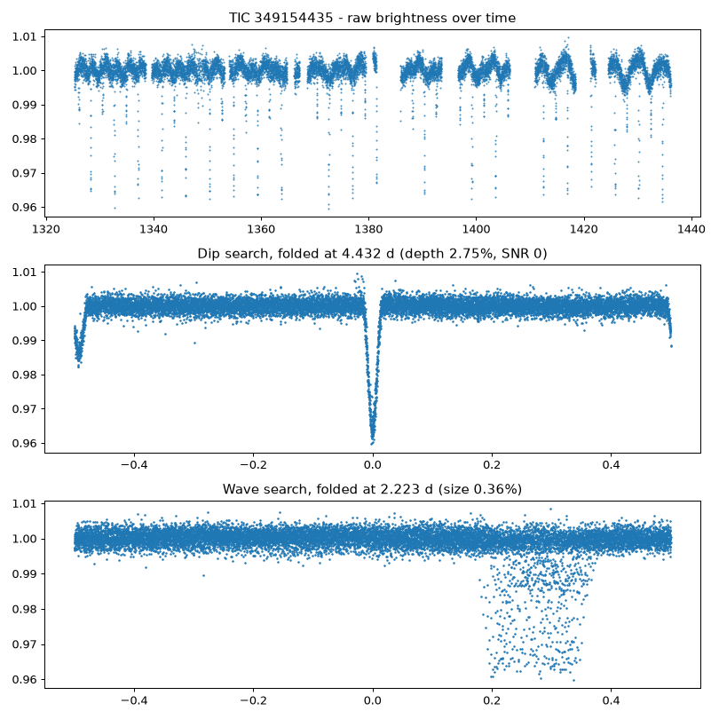

## TIC 251330763  -  unclassified_periodic_variable / likely_pulsating_or_rotating_variable

- AI score: 0.05 | wave period: 2.640 d | dip period hint: 2.670 d
- [Check in SIMBAD](https://simbad.cds.unistra.fr/simbad/sim-coord?Coord=44.1978986606881+56.3501919210958&CooFrame=FK5&CooEpoch=2000&Radius=2&Radius.unit=arcmin&submit=submit+query) | [TESS page](https://exofop.ipac.caltech.edu/tess/target.php?id=251330763)

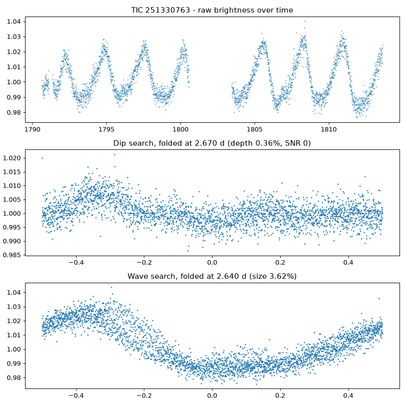

## TIC 310645659  -  likely_planet_transit / likely_pulsating_or_rotating_variable

- AI score: 0.01 | wave period: 0.423 d | dip period hint: 0.847 d
- [Check in SIMBAD](https://simbad.cds.unistra.fr/simbad/sim-coord?Coord=129.03424239333+-63.3382474767499&CooFrame=FK5&CooEpoch=2000&Radius=2&Radius.unit=arcmin&submit=submit+query) | [TESS page](https://exofop.ipac.caltech.edu/tess/target.php?id=310645659)

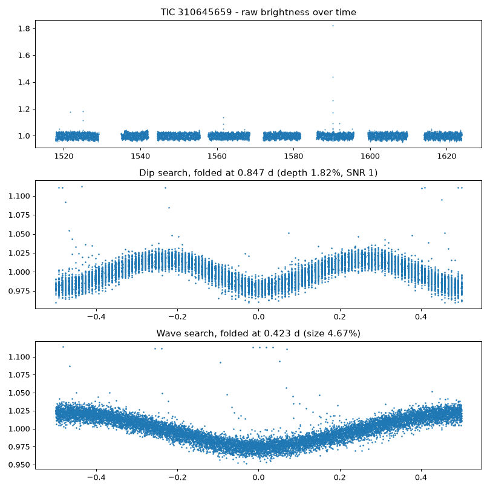

## TIC 373915220  -  likely_planet_transit / likely_pulsating_or_rotating_variable

- AI score: 0.81 | wave period: 0.588 d | dip period hint: 6.471 d
- [Check in SIMBAD](https://simbad.cds.unistra.fr/simbad/sim-coord?Coord=81.7525720409428+-67.9944238757284&CooFrame=FK5&CooEpoch=2000&Radius=2&Radius.unit=arcmin&submit=submit+query) | [TESS page](https://exofop.ipac.caltech.edu/tess/target.php?id=373915220)

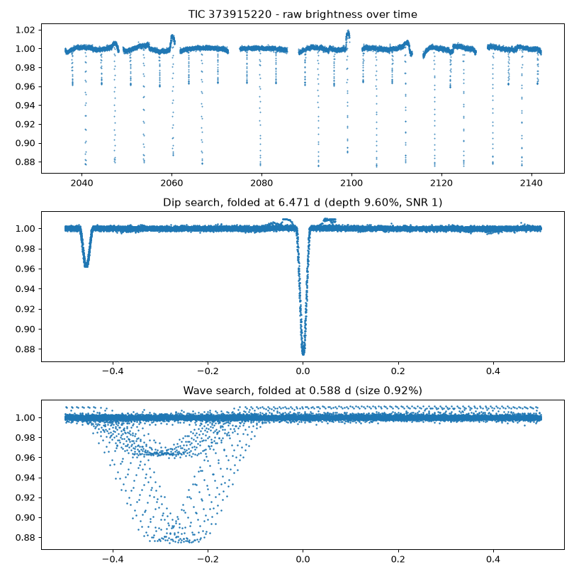

## TIC 229458136  -  likely_eclipsing_binary / likely_pulsating_or_rotating_variable

- AI score: 0.81 | wave period: 0.401 d | dip period hint: 1.602 d
- [Check in SIMBAD](https://simbad.cds.unistra.fr/simbad/sim-coord?Coord=294.736190104535+62.5283370772237&CooFrame=FK5&CooEpoch=2000&Radius=2&Radius.unit=arcmin&submit=submit+query) | [TESS page](https://exofop.ipac.caltech.edu/tess/target.php?id=229458136)

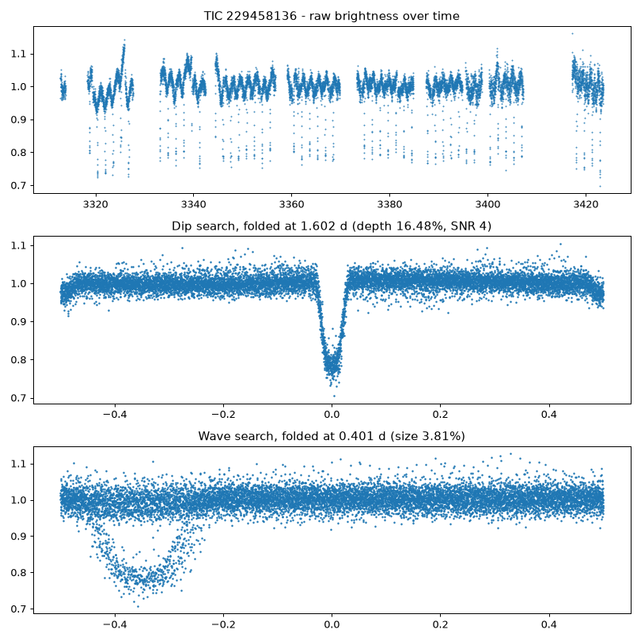

## TIC 10823089  -  likely_planet_transit / likely_pulsating_or_rotating_variable

- AI score: 0.81 | wave period: 3.251 d | dip period hint: 6.446 d
- [Check in SIMBAD](https://simbad.cds.unistra.fr/simbad/sim-coord?Coord=110.303323898352+-22.8426923352415&CooFrame=FK5&CooEpoch=2000&Radius=2&Radius.unit=arcmin&submit=submit+query) | [TESS page](https://exofop.ipac.caltech.edu/tess/target.php?id=10823089)

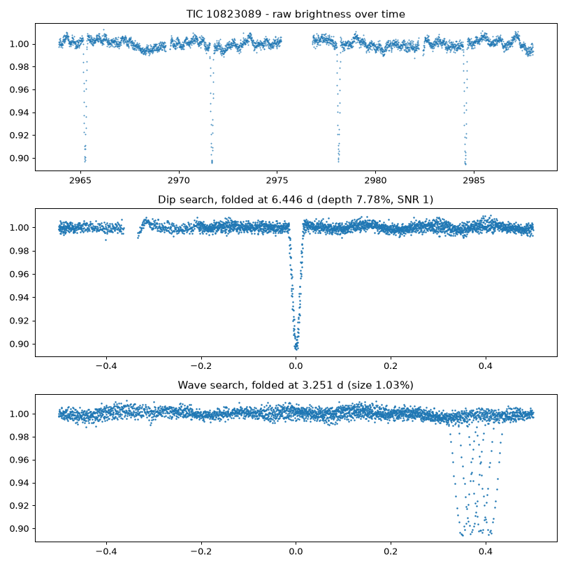

## TIC 149413539  -  unclassified_periodic_variable / likely_pulsating_or_rotating_variable

- AI score: 0.00 | wave period: 0.295 d | dip period hint: 0.590 d
- [Check in SIMBAD](https://simbad.cds.unistra.fr/simbad/sim-coord?Coord=116.122058574091+-31.7159063595686&CooFrame=FK5&CooEpoch=2000&Radius=2&Radius.unit=arcmin&submit=submit+query) | [TESS page](https://exofop.ipac.caltech.edu/tess/target.php?id=149413539)

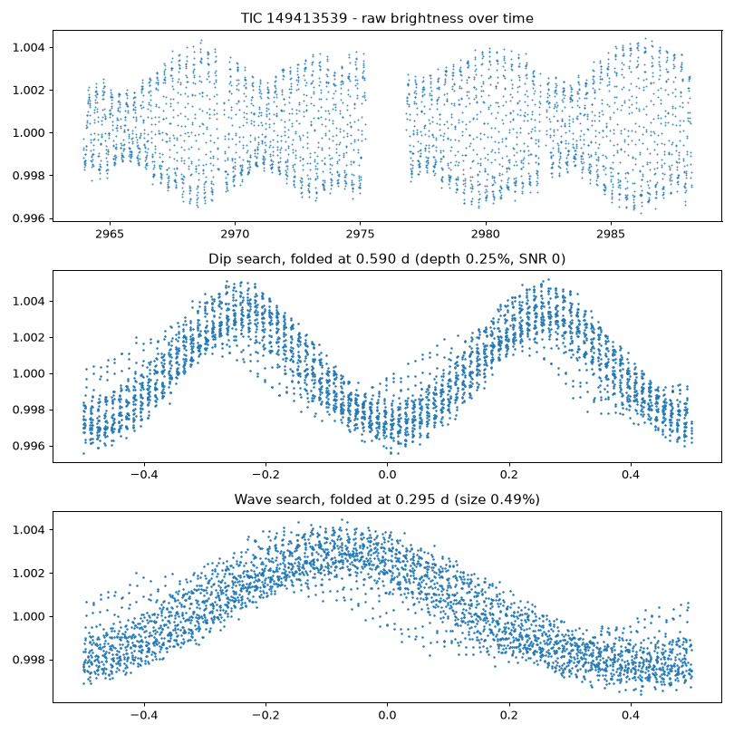
