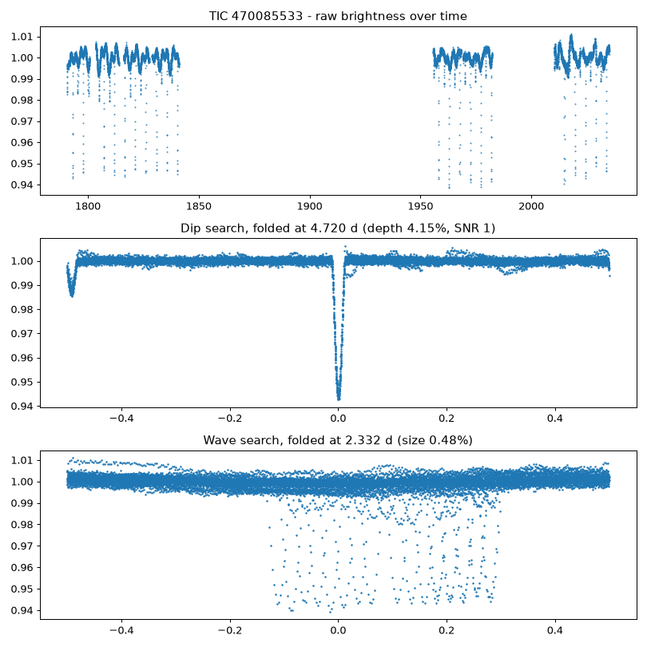
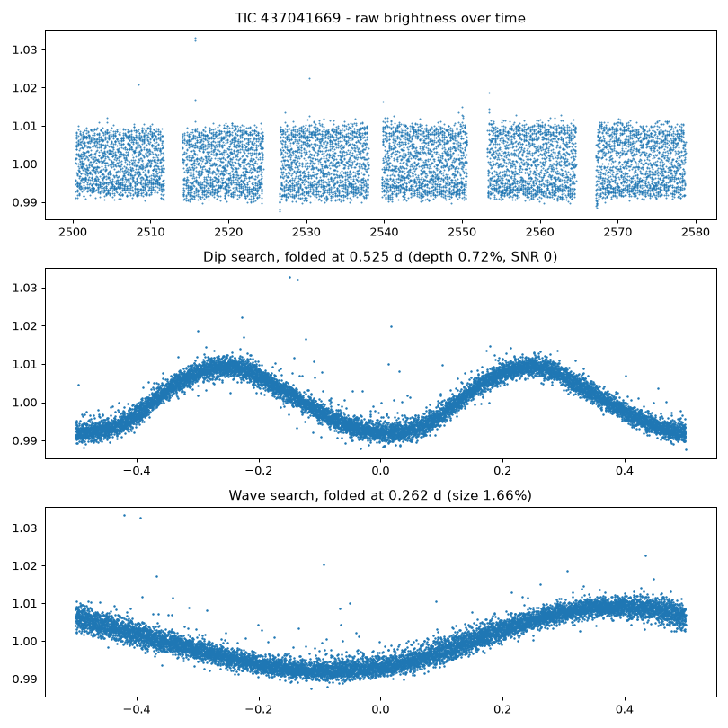
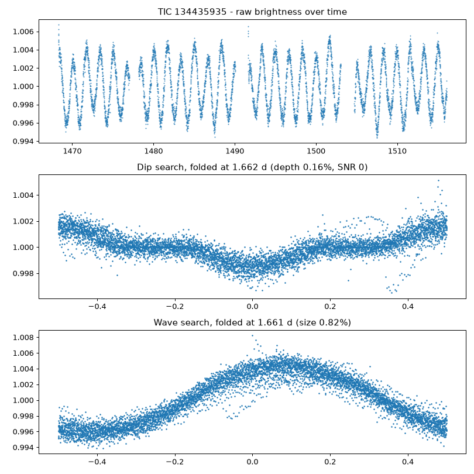
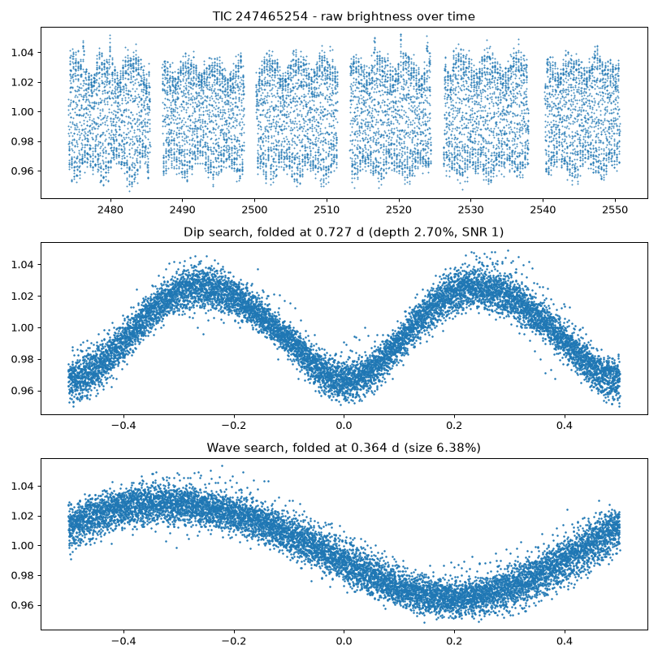
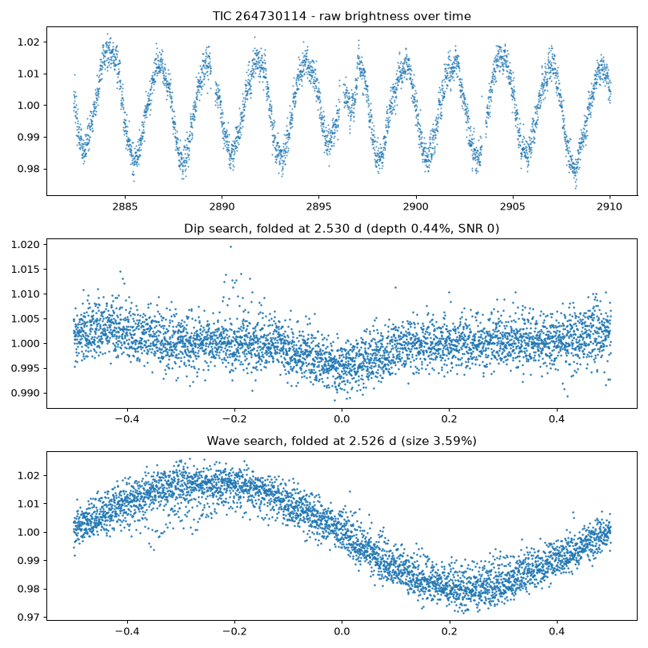

@Voider03 here are your best new leads this week (5). Each one is NOT in SIMBAD, AAVSO VSX, Gaia DR3 variables or ASAS-SN, and shows a clean, repeating shape.

## What to do (about 2 minutes per lead)
1. **Look at the picture.** If the bottom two graphs show a thin, clean curve, continue. If it is a messy cloud, skip it.
2. **Open [AAVSO VSX](https://vsx.aavso.org)** and log in (one-time free registration on that same site).
3. Click **Submit** and choose **New Star Form**. Paste the coordinates from the box below and press **Spot check**. If it says the star is already known or pending, stop - someone was first. If not, copy the other values from the box, attach the picture, and submit.
4. AAVSO volunteers review it and may ask you questions. That review is how a find becomes official.

## Choosing the star type in the dropdown (use the picture; the moderators can correct it)
- **EA** = flat line between the dips, narrow sharp dips (stars far apart).
- **EB** = brightness never flat, dips of clearly *unequal* depth.
- **EW** = brightness never flat, two *nearly equal* dips per cycle, usually a period under 1 day.
- **ROT** = smooth, slowly changing wave from star spots on a spinning star.
- **VAR** = generic variable. If you are unsure, this is the safe choice.

---
### TIC 470085533 - best guess: pulsating or spinning variable star

[Open the picture full size](https://raw.githubusercontent.com/Voider03/star-discovery/main/candidates/plots/TIC_470085533.png)
_(Sky photo unavailable this time.)_
_Live VSX check could not run just now - rely on the Spot check in the form._
**Fill the form from top to bottom. Each grey box is ONE field: tap it, copy, paste.**

**Primary name**
```
TIC 470085533
```
**Discoverer** (your own name, the way you want to be credited)

**Position - RA** (hours minutes seconds)
```
21 46 22.31
```
**Position - Dec** (degrees arcmin arcsec)
```
+80 05 23.6
```
_If the form wants plain degrees instead: RA 326.59297, Dec +80.08988_

**Variability type** (pick it in the dropdown)
```
VAR
```
**Period (days)**
```
2.33169
```
**Passband** (if TESS is not in the list, leave blank)
```
TESS
```
**Epoch, Max magnitude, Min magnitude:** leave blank if you have no value for them (the pipeline does not measure them).

**Remarks**
```
Found in NASA TESS 2-minute photometry (TIC 470085533) with an automated period search. Amplitude about 0.005 mag in the TESS band (red-sensitive, so it differs from V-band). The period was found automatically and may be half the true period if this is a two-star system.
```
**Reference / data source**
```
NASA TESS 2-minute light curves (SPOC, MAST). Position from the TESS Input Catalog (TIC, Gaia-based), J2000.
```
**Light curve / phase plot upload:** attach the picture above (open it full size, then save it).

**Tip:** tick **Draft only** the first time. You can save, look it over, and only then submit for real.

[Open AAVSO VSX](https://vsx.aavso.org) | [VSX coordinate search](https://www.aavso.org/vsx/index.php?view=search.top) | [Double-check in SIMBAD](https://simbad.cds.unistra.fr/simbad/sim-coord?Coord=326.592966856589+80.0898786806288&CooFrame=FK5&CooEpoch=2000&Radius=2&Radius.unit=arcmin&submit=submit+query) | [TESS page](https://exofop.ipac.caltech.edu/tess/target.php?id=470085533)

---
### TIC 437041669 - best guess: pulsating or spinning variable star

[Open the picture full size](https://raw.githubusercontent.com/Voider03/star-discovery/main/candidates/plots/TIC_437041669.png)
_(Sky photo unavailable this time.)_
_Live VSX check could not run just now - rely on the Spot check in the form._
**Fill the form from top to bottom. Each grey box is ONE field: tap it, copy, paste.**

**Primary name**
```
TIC 437041669
```
**Discoverer** (your own name, the way you want to be credited)

**Position - RA** (hours minutes seconds)
```
08 56 19.55
```
**Position - Dec** (degrees arcmin arcsec)
```
+12 39 49.8
```
_If the form wants plain degrees instead: RA 134.08144, Dec +12.66383_

**Variability type** (pick it in the dropdown)
```
VAR
```
**Period (days)**
```
0.26246
```
**Passband** (if TESS is not in the list, leave blank)
```
TESS
```
**Epoch, Max magnitude, Min magnitude:** leave blank if you have no value for them (the pipeline does not measure them).

**Remarks**
```
Found in NASA TESS 2-minute photometry (TIC 437041669) with an automated period search. Amplitude about 0.018 mag in the TESS band (red-sensitive, so it differs from V-band). The period was found automatically and may be half the true period if this is a two-star system.
```
**Reference / data source**
```
NASA TESS 2-minute light curves (SPOC, MAST). Position from the TESS Input Catalog (TIC, Gaia-based), J2000.
```
**Light curve / phase plot upload:** attach the picture above (open it full size, then save it).

**Tip:** tick **Draft only** the first time. You can save, look it over, and only then submit for real.

[Open AAVSO VSX](https://vsx.aavso.org) | [VSX coordinate search](https://www.aavso.org/vsx/index.php?view=search.top) | [Double-check in SIMBAD](https://simbad.cds.unistra.fr/simbad/sim-coord?Coord=134.081441076229+12.6638277112855&CooFrame=FK5&CooEpoch=2000&Radius=2&Radius.unit=arcmin&submit=submit+query) | [TESS page](https://exofop.ipac.caltech.edu/tess/target.php?id=437041669)

---
### TIC 134435935 - best guess: pulsating or spinning variable star

[Open the picture full size](https://raw.githubusercontent.com/Voider03/star-discovery/main/candidates/plots/TIC_134435935.png)
_(Sky photo unavailable this time.)_
_Live VSX check could not run just now - rely on the Spot check in the form._
**Fill the form from top to bottom. Each grey box is ONE field: tap it, copy, paste.**

**Primary name**
```
TIC 134435935
```
**Discoverer** (your own name, the way you want to be credited)

**Position - RA** (hours minutes seconds)
```
07 11 48.85
```
**Position - Dec** (degrees arcmin arcsec)
```
-47 30 23.9
```
_If the form wants plain degrees instead: RA 107.95353, Dec -47.50663_

**Variability type** (pick it in the dropdown)
```
VAR
```
**Period (days)**
```
1.66119
```
**Passband** (if TESS is not in the list, leave blank)
```
TESS
```
**Epoch, Max magnitude, Min magnitude:** leave blank if you have no value for them (the pipeline does not measure them).

**Remarks**
```
Found in NASA TESS 2-minute photometry (TIC 134435935) with an automated period search. Amplitude about 0.009 mag in the TESS band (red-sensitive, so it differs from V-band). The period was found automatically and may be half the true period if this is a two-star system.
```
**Reference / data source**
```
NASA TESS 2-minute light curves (SPOC, MAST). Position from the TESS Input Catalog (TIC, Gaia-based), J2000.
```
**Light curve / phase plot upload:** attach the picture above (open it full size, then save it).

**Tip:** tick **Draft only** the first time. You can save, look it over, and only then submit for real.

[Open AAVSO VSX](https://vsx.aavso.org) | [VSX coordinate search](https://www.aavso.org/vsx/index.php?view=search.top) | [Double-check in SIMBAD](https://simbad.cds.unistra.fr/simbad/sim-coord?Coord=107.953534723684+-47.5066322601037&CooFrame=FK5&CooEpoch=2000&Radius=2&Radius.unit=arcmin&submit=submit+query) | [TESS page](https://exofop.ipac.caltech.edu/tess/target.php?id=134435935)

---
### TIC 247465254 - best guess: pulsating or spinning variable star

[Open the picture full size](https://raw.githubusercontent.com/Voider03/star-discovery/main/candidates/plots/TIC_247465254.png)
_(Sky photo unavailable this time.)_
_Live VSX check could not run just now - rely on the Spot check in the form._
**Fill the form from top to bottom. Each grey box is ONE field: tap it, copy, paste.**

**Primary name**
```
TIC 247465254
```
**Discoverer** (your own name, the way you want to be credited)

**Position - RA** (hours minutes seconds)
```
05 42 45.42
```
**Position - Dec** (degrees arcmin arcsec)
```
+12 42 20.7
```
_If the form wants plain degrees instead: RA 85.68927, Dec +12.70576_

**Variability type** (pick it in the dropdown)
```
VAR
```
**Period (days)**
```
0.36363
```
**Passband** (if TESS is not in the list, leave blank)
```
TESS
```
**Epoch, Max magnitude, Min magnitude:** leave blank if you have no value for them (the pipeline does not measure them).

**Remarks**
```
Found in NASA TESS 2-minute photometry (TIC 247465254) with an automated period search. Amplitude about 0.069 mag in the TESS band (red-sensitive, so it differs from V-band). The period was found automatically and may be half the true period if this is a two-star system.
```
**Reference / data source**
```
NASA TESS 2-minute light curves (SPOC, MAST). Position from the TESS Input Catalog (TIC, Gaia-based), J2000.
```
**Light curve / phase plot upload:** attach the picture above (open it full size, then save it).

**Tip:** tick **Draft only** the first time. You can save, look it over, and only then submit for real.

[Open AAVSO VSX](https://vsx.aavso.org) | [VSX coordinate search](https://www.aavso.org/vsx/index.php?view=search.top) | [Double-check in SIMBAD](https://simbad.cds.unistra.fr/simbad/sim-coord?Coord=85.6892653391974+12.7057575438745&CooFrame=FK5&CooEpoch=2000&Radius=2&Radius.unit=arcmin&submit=submit+query) | [TESS page](https://exofop.ipac.caltech.edu/tess/target.php?id=247465254)

---
### TIC 264730114 - best guess: pulsating or spinning variable star

[Open the picture full size](https://raw.githubusercontent.com/Voider03/star-discovery/main/candidates/plots/TIC_264730114.png)
_(Sky photo unavailable this time.)_
_Live VSX check could not run just now - rely on the Spot check in the form._
**Fill the form from top to bottom. Each grey box is ONE field: tap it, copy, paste.**

**Primary name**
```
TIC 264730114
```
**Discoverer** (your own name, the way you want to be credited)

**Position - RA** (hours minutes seconds)
```
02 19 01.56
```
**Position - Dec** (degrees arcmin arcsec)
```
+57 05 22.5
```
_If the form wants plain degrees instead: RA 34.75649, Dec +57.08958_

**Variability type** (pick it in the dropdown)
```
VAR
```
**Period (days)**
```
2.52602
```
**Passband** (if TESS is not in the list, leave blank)
```
TESS
```
**Epoch, Max magnitude, Min magnitude:** leave blank if you have no value for them (the pipeline does not measure them).

**Remarks**
```
Found in NASA TESS 2-minute photometry (TIC 264730114) with an automated period search. Amplitude about 0.039 mag in the TESS band (red-sensitive, so it differs from V-band). The period was found automatically and may be half the true period if this is a two-star system.
```
**Reference / data source**
```
NASA TESS 2-minute light curves (SPOC, MAST). Position from the TESS Input Catalog (TIC, Gaia-based), J2000.
```
**Light curve / phase plot upload:** attach the picture above (open it full size, then save it).

**Tip:** tick **Draft only** the first time. You can save, look it over, and only then submit for real.

[Open AAVSO VSX](https://vsx.aavso.org) | [VSX coordinate search](https://www.aavso.org/vsx/index.php?view=search.top) | [Double-check in SIMBAD](https://simbad.cds.unistra.fr/simbad/sim-coord?Coord=34.7564948029802+57.0895767082136&CooFrame=FK5&CooEpoch=2000&Radius=2&Radius.unit=arcmin&submit=submit+query) | [TESS page](https://exofop.ipac.caltech.edu/tess/target.php?id=264730114)
