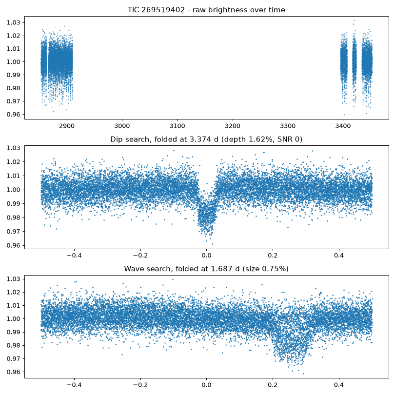
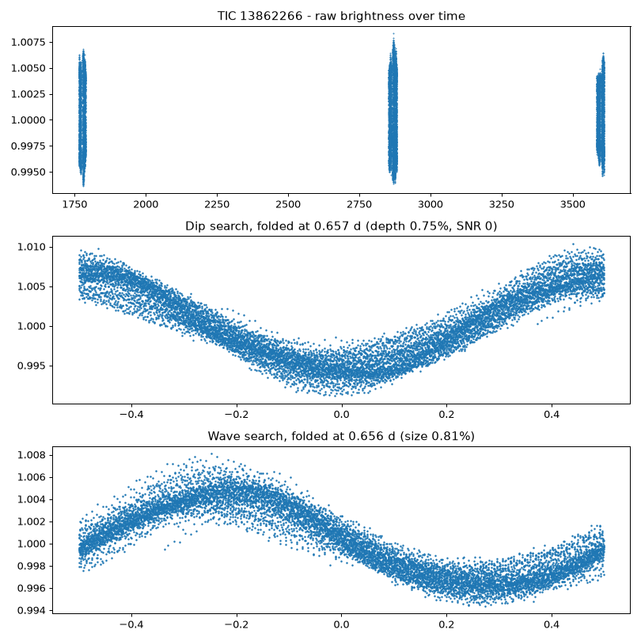
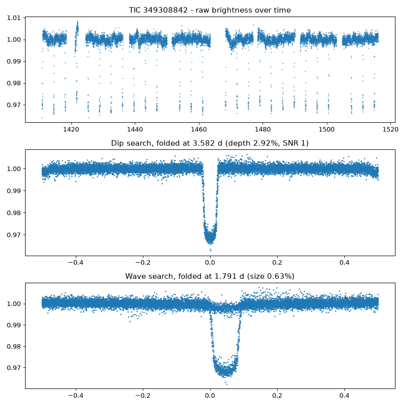
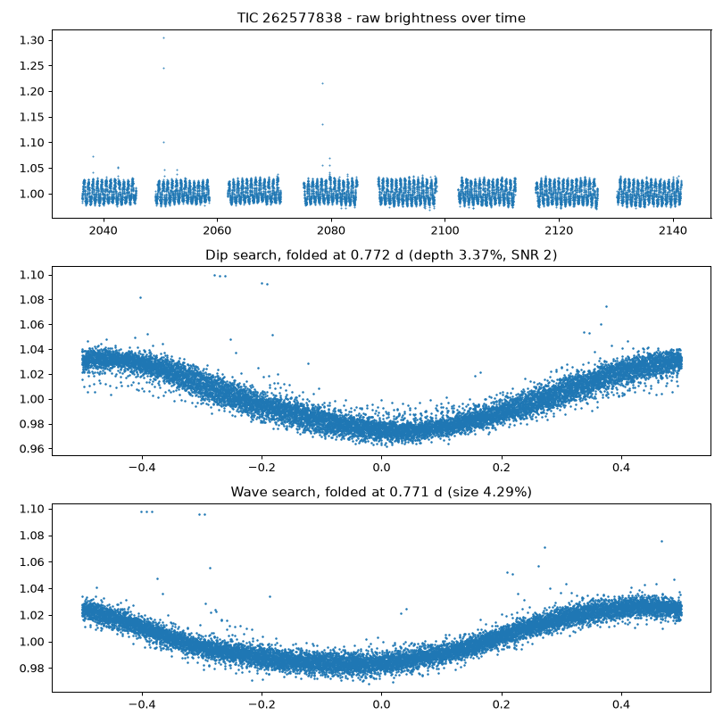
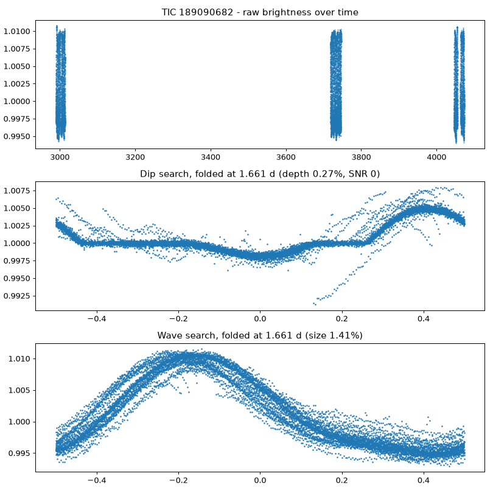

@Voider03 here are your best new leads this week (5). Each one is NOT in SIMBAD, AAVSO VSX, Gaia DR3 variables or ASAS-SN, and shows a clean, repeating shape.

## What to do (about 2 minutes per lead)
1. **Look at the picture.** If the bottom two graphs show a thin, clean curve, continue. If it is a messy cloud, skip it.
2. **Open [AAVSO VSX](https://vsx.aavso.org)** and log in (one-time free registration on that same site).
3. Click **Submit** and choose **New Star Form**. Paste the coordinates from the box below and press **Spot check**. If it says the star is already known or pending, stop - someone was first. If not, copy the other values from the box, attach the picture, and submit.
4. AAVSO volunteers review it and may ask you questions. That review is how a find becomes official.

## Choosing the star type in the dropdown (use the picture; the moderators can correct it)
- **EA** = flat line between the dips, narrow sharp dips (stars far apart).
- **EB** = brightness never flat, dips of clearly *unequal* depth.
- **EW** = brightness never flat, two *nearly equal* dips per cycle, usually a period under 1 day.
- **ROT** = smooth, slowly changing wave from star spots on a spinning star.
- **VAR** = generic variable. If you are unsure, this is the safe choice.

---
### TIC 269519402 - best guess: pulsating or spinning variable star

[Open the picture full size](https://raw.githubusercontent.com/Voider03/star-discovery/main/candidates/plots/TIC_269519402.png)
_(Sky photo unavailable this time.)_
_Live VSX check could not run just now - rely on the Spot check in the form._
**Fill the form from top to bottom. Each grey box is ONE field: tap it, copy, paste.**

**Primary name**
```
TIC 269519402
```
**Discoverer** (your own name, the way you want to be credited)

**Position - RA** (hours minutes seconds)
```
23 22 47.38
```
**Position - Dec** (degrees arcmin arcsec)
```
+61 56 11.8
```
_If the form wants plain degrees instead: RA 350.69742, Dec +61.93662_

**Variability type** (pick it in the dropdown)
```
VAR
```
**Period (days)**
```
1.68675
```
**Passband** (if TESS is not in the list, leave blank)
```
TESS
```
**Epoch, Max magnitude, Min magnitude:** leave blank if you have no value for them (the pipeline does not measure them).

**Remarks**
```
Found in NASA TESS 2-minute photometry (TIC 269519402) with an automated period search. Amplitude about 0.008 mag in the TESS band (red-sensitive, so it differs from V-band). The period was found automatically and may be half the true period if this is a two-star system.
```
**Reference / data source**
```
NASA TESS 2-minute light curves (SPOC, MAST). Position from the TESS Input Catalog (TIC, Gaia-based), J2000.
```
**Light curve / phase plot upload:** attach the picture above (open it full size, then save it).

**Tip:** tick **Draft only** the first time. You can save, look it over, and only then submit for real.

[Open AAVSO VSX](https://vsx.aavso.org) | [VSX coordinate search](https://www.aavso.org/vsx/index.php?view=search.top) | [Double-check in SIMBAD](https://simbad.cds.unistra.fr/simbad/sim-coord?Coord=350.697422380603+61.9366248081776&CooFrame=FK5&CooEpoch=2000&Radius=2&Radius.unit=arcmin&submit=submit+query) | [TESS page](https://exofop.ipac.caltech.edu/tess/target.php?id=269519402)

---
### TIC 13862266 - best guess: pulsating or spinning variable star

[Open the picture full size](https://raw.githubusercontent.com/Voider03/star-discovery/main/candidates/plots/TIC_13862266.png)
_(Sky photo unavailable this time.)_
_Live VSX check could not run just now - rely on the Spot check in the form._
**Fill the form from top to bottom. Each grey box is ONE field: tap it, copy, paste.**

**Primary name**
```
TIC 13862266
```
**Discoverer** (your own name, the way you want to be credited)

**Position - RA** (hours minutes seconds)
```
00 49 07.35
```
**Position - Dec** (degrees arcmin arcsec)
```
+28 25 49.0
```
_If the form wants plain degrees instead: RA 12.28062, Dec +28.43027_

**Variability type** (pick it in the dropdown)
```
VAR
```
**Period (days)**
```
0.65608
```
**Passband** (if TESS is not in the list, leave blank)
```
TESS
```
**Epoch, Max magnitude, Min magnitude:** leave blank if you have no value for them (the pipeline does not measure them).

**Remarks**
```
Found in NASA TESS 2-minute photometry (TIC 13862266) with an automated period search. Amplitude about 0.009 mag in the TESS band (red-sensitive, so it differs from V-band). The period was found automatically and may be half the true period if this is a two-star system.
```
**Reference / data source**
```
NASA TESS 2-minute light curves (SPOC, MAST). Position from the TESS Input Catalog (TIC, Gaia-based), J2000.
```
**Light curve / phase plot upload:** attach the picture above (open it full size, then save it).

**Tip:** tick **Draft only** the first time. You can save, look it over, and only then submit for real.

[Open AAVSO VSX](https://vsx.aavso.org) | [VSX coordinate search](https://www.aavso.org/vsx/index.php?view=search.top) | [Double-check in SIMBAD](https://simbad.cds.unistra.fr/simbad/sim-coord?Coord=12.2806162844053+28.4302702821113&CooFrame=FK5&CooEpoch=2000&Radius=2&Radius.unit=arcmin&submit=submit+query) | [TESS page](https://exofop.ipac.caltech.edu/tess/target.php?id=13862266)

---
### TIC 349308842 - best guess: pulsating or spinning variable star

[Open the picture full size](https://raw.githubusercontent.com/Voider03/star-discovery/main/candidates/plots/TIC_349308842.png)
_(Sky photo unavailable this time.)_
_Live VSX check could not run just now - rely on the Spot check in the form._
**Fill the form from top to bottom. Each grey box is ONE field: tap it, copy, paste.**

**Primary name**
```
TIC 349308842
```
**Discoverer** (your own name, the way you want to be credited)

**Position - RA** (hours minutes seconds)
```
07 18 59.26
```
**Position - Dec** (degrees arcmin arcsec)
```
-61 23 55.8
```
_If the form wants plain degrees instead: RA 109.74693, Dec -61.39882_

**Variability type** (pick it in the dropdown)
```
VAR
```
**Period (days)**
```
1.79127
```
**Passband** (if TESS is not in the list, leave blank)
```
TESS
```
**Epoch, Max magnitude, Min magnitude:** leave blank if you have no value for them (the pipeline does not measure them).

**Remarks**
```
Found in NASA TESS 2-minute photometry (TIC 349308842) with an automated period search. Amplitude about 0.007 mag in the TESS band (red-sensitive, so it differs from V-band). The period was found automatically and may be half the true period if this is a two-star system.
```
**Reference / data source**
```
NASA TESS 2-minute light curves (SPOC, MAST). Position from the TESS Input Catalog (TIC, Gaia-based), J2000.
```
**Light curve / phase plot upload:** attach the picture above (open it full size, then save it).

**Tip:** tick **Draft only** the first time. You can save, look it over, and only then submit for real.

[Open AAVSO VSX](https://vsx.aavso.org) | [VSX coordinate search](https://www.aavso.org/vsx/index.php?view=search.top) | [Double-check in SIMBAD](https://simbad.cds.unistra.fr/simbad/sim-coord?Coord=109.746934634809+-61.3988247404549&CooFrame=FK5&CooEpoch=2000&Radius=2&Radius.unit=arcmin&submit=submit+query) | [TESS page](https://exofop.ipac.caltech.edu/tess/target.php?id=349308842)

---
### TIC 262577838 - best guess: pulsating or spinning variable star

[Open the picture full size](https://raw.githubusercontent.com/Voider03/star-discovery/main/candidates/plots/TIC_262577838.png)
_(Sky photo unavailable this time.)_
_Live VSX check could not run just now - rely on the Spot check in the form._
**Fill the form from top to bottom. Each grey box is ONE field: tap it, copy, paste.**

**Primary name**
```
TIC 262577838
```
**Discoverer** (your own name, the way you want to be credited)

**Position - RA** (hours minutes seconds)
```
07 44 48.54
```
**Position - Dec** (degrees arcmin arcsec)
```
-64 32 59.1
```
_If the form wants plain degrees instead: RA 116.20224, Dec -64.54975_

**Variability type** (pick it in the dropdown)
```
VAR
```
**Period (days)**
```
0.77143
```
**Passband** (if TESS is not in the list, leave blank)
```
TESS
```
**Epoch, Max magnitude, Min magnitude:** leave blank if you have no value for them (the pipeline does not measure them).

**Remarks**
```
Found in NASA TESS 2-minute photometry (TIC 262577838) with an automated period search. Amplitude about 0.047 mag in the TESS band (red-sensitive, so it differs from V-band). The period was found automatically and may be half the true period if this is a two-star system.
```
**Reference / data source**
```
NASA TESS 2-minute light curves (SPOC, MAST). Position from the TESS Input Catalog (TIC, Gaia-based), J2000.
```
**Light curve / phase plot upload:** attach the picture above (open it full size, then save it).

**Tip:** tick **Draft only** the first time. You can save, look it over, and only then submit for real.

[Open AAVSO VSX](https://vsx.aavso.org) | [VSX coordinate search](https://www.aavso.org/vsx/index.php?view=search.top) | [Double-check in SIMBAD](https://simbad.cds.unistra.fr/simbad/sim-coord?Coord=116.202240040716+-64.5497469686375&CooFrame=FK5&CooEpoch=2000&Radius=2&Radius.unit=arcmin&submit=submit+query) | [TESS page](https://exofop.ipac.caltech.edu/tess/target.php?id=262577838)

---
### TIC 189090682 - best guess: pulsating or spinning variable star

[Open the picture full size](https://raw.githubusercontent.com/Voider03/star-discovery/main/candidates/plots/TIC_189090682.png)
_(Sky photo unavailable this time.)_
_Live VSX check could not run just now - rely on the Spot check in the form._
**Fill the form from top to bottom. Each grey box is ONE field: tap it, copy, paste.**

**Primary name**
```
TIC 189090682
```
**Discoverer** (your own name, the way you want to be credited)

**Position - RA** (hours minutes seconds)
```
09 21 44.84
```
**Position - Dec** (degrees arcmin arcsec)
```
-26 10 54.4
```
_If the form wants plain degrees instead: RA 140.43685, Dec -26.18178_

**Variability type** (pick it in the dropdown)
```
VAR
```
**Period (days)**
```
1.66134
```
**Passband** (if TESS is not in the list, leave blank)
```
TESS
```
**Epoch, Max magnitude, Min magnitude:** leave blank if you have no value for them (the pipeline does not measure them).

**Remarks**
```
Found in NASA TESS 2-minute photometry (TIC 189090682) with an automated period search. Amplitude about 0.015 mag in the TESS band (red-sensitive, so it differs from V-band). The period was found automatically and may be half the true period if this is a two-star system.
```
**Reference / data source**
```
NASA TESS 2-minute light curves (SPOC, MAST). Position from the TESS Input Catalog (TIC, Gaia-based), J2000.
```
**Light curve / phase plot upload:** attach the picture above (open it full size, then save it).

**Tip:** tick **Draft only** the first time. You can save, look it over, and only then submit for real.

[Open AAVSO VSX](https://vsx.aavso.org) | [VSX coordinate search](https://www.aavso.org/vsx/index.php?view=search.top) | [Double-check in SIMBAD](https://simbad.cds.unistra.fr/simbad/sim-coord?Coord=140.4368534673+-26.1817753586097&CooFrame=FK5&CooEpoch=2000&Radius=2&Radius.unit=arcmin&submit=submit+query) | [TESS page](https://exofop.ipac.caltech.edu/tess/target.php?id=189090682)
