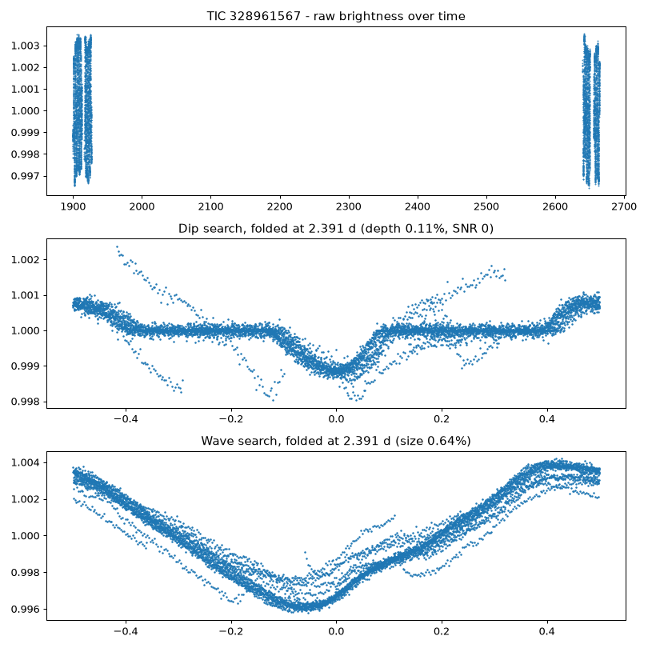
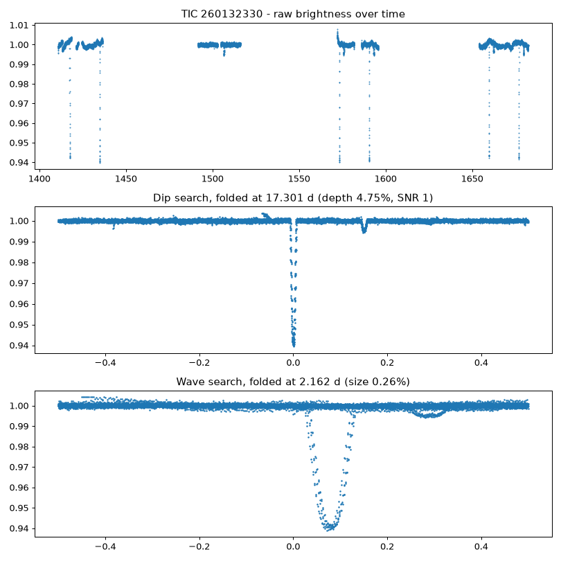
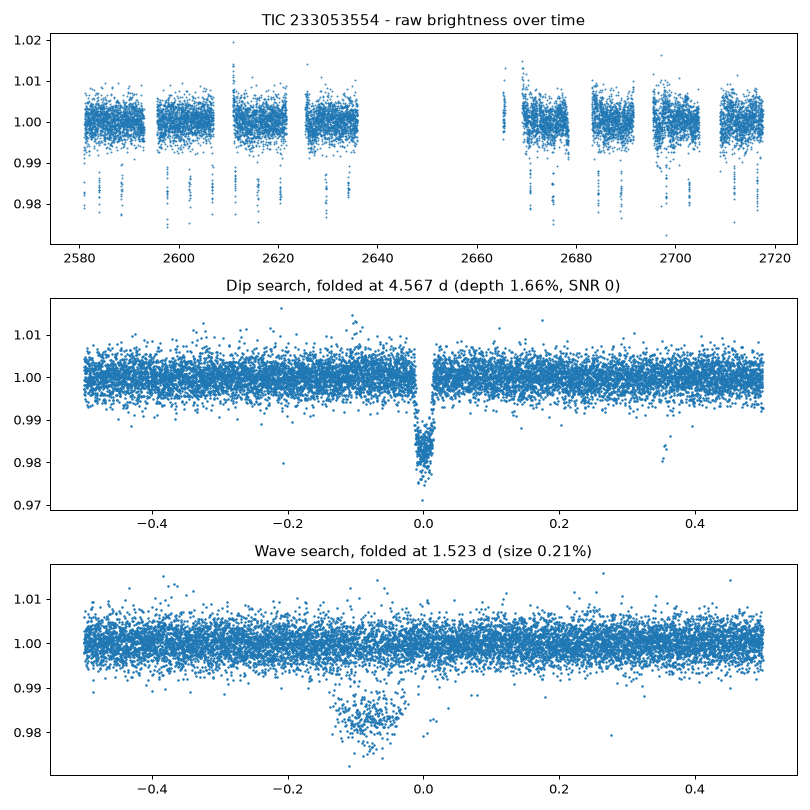
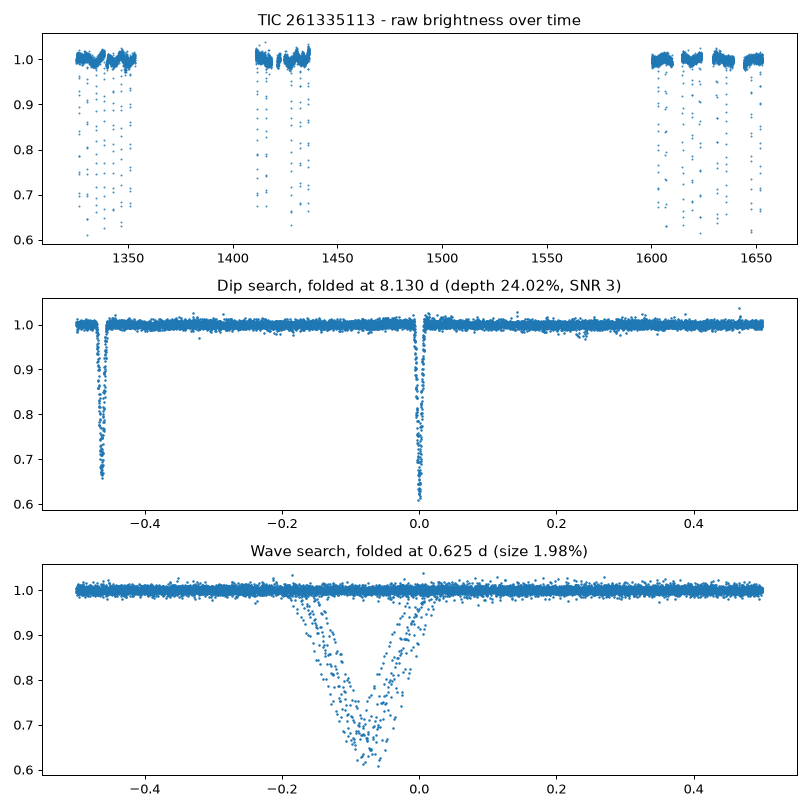
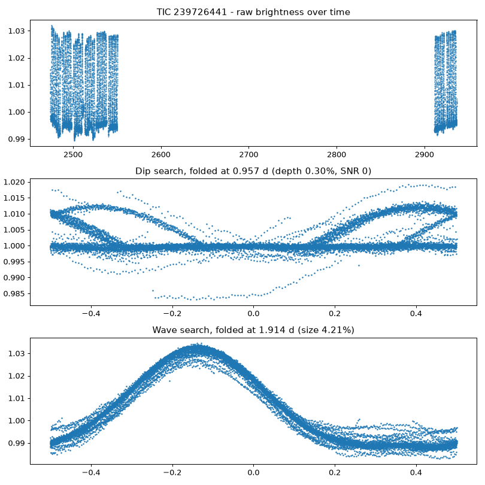

@Voider03 here are your best new leads this week (5). Each one is NOT in SIMBAD, AAVSO VSX, Gaia DR3 variables or ASAS-SN, and shows a clean, repeating shape.

## What to do (about 2 minutes per lead)
1. **Look at the picture.** If the bottom two graphs show a thin, clean curve, continue. If it is a messy cloud, skip it.
2. **Open [AAVSO VSX](https://vsx.aavso.org)** and log in (one-time free registration on that same site).
3. Click **Submit** and choose **New Star Form**. Paste the coordinates from the box below and press **Spot check**. If it says the star is already known or pending, stop - someone was first. If not, copy the other values from the box, attach the picture, and submit.
4. AAVSO volunteers review it and may ask you questions. That review is how a find becomes official.

## Choosing the star type in the dropdown (use the picture; the moderators can correct it)
- **EA** = flat line between the dips, narrow sharp dips (stars far apart).
- **EB** = brightness never flat, dips of clearly *unequal* depth.
- **EW** = brightness never flat, two *nearly equal* dips per cycle, usually a period under 1 day.
- **ROT** = smooth, slowly changing wave from star spots on a spinning star.
- **VAR** = generic variable. If you are unsure, this is the safe choice.

---
### TIC 328961567 - best guess: pulsating or spinning variable star

[Open the picture full size](https://raw.githubusercontent.com/Voider03/star-discovery/main/candidates/plots/TIC_328961567.png)
_(Sky photo unavailable this time.)_
_Live VSX check could not run just now - rely on the Spot check in the form._
**Fill the form from top to bottom. Each grey box is ONE field: tap it, copy, paste.**

**Primary name**
```
TIC 328961567
```
**Discoverer** (your own name, the way you want to be credited)

**Position - RA** (hours minutes seconds)
```
12 22 10.83
```
**Position - Dec** (degrees arcmin arcsec)
```
+24 46 25.9
```
_If the form wants plain degrees instead: RA 185.54511, Dec +24.77387_

**Variability type** (pick it in the dropdown)
```
VAR
```
**Period (days)**
```
2.39143
```
**Passband** (if TESS is not in the list, leave blank)
```
TESS
```
**Epoch, Max magnitude, Min magnitude:** leave blank if you have no value for them (the pipeline does not measure them).

**Remarks**
```
Found in NASA TESS 2-minute photometry (TIC 328961567) with an automated period search. Amplitude about 0.007 mag in the TESS band (red-sensitive, so it differs from V-band). The period was found automatically and may be half the true period if this is a two-star system.
```
**Reference / data source**
```
NASA TESS 2-minute light curves (SPOC, MAST). Position from the TESS Input Catalog (TIC, Gaia-based), J2000.
```
**Light curve / phase plot upload:** attach the picture above (open it full size, then save it).

**Tip:** tick **Draft only** the first time. You can save, look it over, and only then submit for real.

[Open AAVSO VSX](https://vsx.aavso.org) | [VSX coordinate search](https://www.aavso.org/vsx/index.php?view=search.top) | [Double-check in SIMBAD](https://simbad.cds.unistra.fr/simbad/sim-coord?Coord=185.545111256323+24.7738671330881&CooFrame=FK5&CooEpoch=2000&Radius=2&Radius.unit=arcmin&submit=submit+query) | [TESS page](https://exofop.ipac.caltech.edu/tess/target.php?id=328961567)

---
### TIC 260132330 - best guess: repeating dip (could be a planet or a binary)

[Open the picture full size](https://raw.githubusercontent.com/Voider03/star-discovery/main/candidates/plots/TIC_260132330.png)
_(Sky photo unavailable this time.)_
_Live VSX check could not run just now - rely on the Spot check in the form._
**Fill the form from top to bottom. Each grey box is ONE field: tap it, copy, paste.**

**Primary name**
```
TIC 260132330
```
**Discoverer** (your own name, the way you want to be credited)

**Position - RA** (hours minutes seconds)
```
06 10 23.29
```
**Position - Dec** (degrees arcmin arcsec)
```
-56 22 39.8
```
_If the form wants plain degrees instead: RA 92.59702, Dec -56.37772_

**Variability type** (pick it in the dropdown)
```
VAR
```
**Period (days)**
```
17.30075
```
**Passband** (if TESS is not in the list, leave blank)
```
TESS
```
**Epoch, Max magnitude, Min magnitude:** leave blank if you have no value for them (the pipeline does not measure them).

**Remarks**
```
Found in NASA TESS 2-minute photometry (TIC 260132330) with an automated period search. Amplitude about 0.052 mag in the TESS band (red-sensitive, so it differs from V-band). The period was found automatically and may be half the true period if this is a two-star system.
```
**Reference / data source**
```
NASA TESS 2-minute light curves (SPOC, MAST). Position from the TESS Input Catalog (TIC, Gaia-based), J2000.
```
**Light curve / phase plot upload:** attach the picture above (open it full size, then save it).

**Tip:** tick **Draft only** the first time. You can save, look it over, and only then submit for real.

[Open AAVSO VSX](https://vsx.aavso.org) | [VSX coordinate search](https://www.aavso.org/vsx/index.php?view=search.top) | [Double-check in SIMBAD](https://simbad.cds.unistra.fr/simbad/sim-coord?Coord=92.5970231340478+-56.3777217671456&CooFrame=FK5&CooEpoch=2000&Radius=2&Radius.unit=arcmin&submit=submit+query) | [TESS page](https://exofop.ipac.caltech.edu/tess/target.php?id=260132330)
_This one looks like a planet-style dip. The TESS page link is the better place to report it._

---
### TIC 233053554 - best guess: repeating dip (could be a planet or a binary)

[Open the picture full size](https://raw.githubusercontent.com/Voider03/star-discovery/main/candidates/plots/TIC_233053554.png)
_(Sky photo unavailable this time.)_
_Live VSX check could not run just now - rely on the Spot check in the form._
**Fill the form from top to bottom. Each grey box is ONE field: tap it, copy, paste.**

**Primary name**
```
TIC 233053554
```
**Discoverer** (your own name, the way you want to be credited)

**Position - RA** (hours minutes seconds)
```
17 56 43.04
```
**Position - Dec** (degrees arcmin arcsec)
```
+64 46 00.3
```
_If the form wants plain degrees instead: RA 269.17932, Dec +64.76674_

**Variability type** (pick it in the dropdown)
```
VAR
```
**Period (days)**
```
4.56733
```
**Passband** (if TESS is not in the list, leave blank)
```
TESS
```
**Epoch, Max magnitude, Min magnitude:** leave blank if you have no value for them (the pipeline does not measure them).

**Remarks**
```
Found in NASA TESS 2-minute photometry (TIC 233053554) with an automated period search. Amplitude about 0.018 mag in the TESS band (red-sensitive, so it differs from V-band). The period was found automatically and may be half the true period if this is a two-star system.
```
**Reference / data source**
```
NASA TESS 2-minute light curves (SPOC, MAST). Position from the TESS Input Catalog (TIC, Gaia-based), J2000.
```
**Light curve / phase plot upload:** attach the picture above (open it full size, then save it).

**Tip:** tick **Draft only** the first time. You can save, look it over, and only then submit for real.

[Open AAVSO VSX](https://vsx.aavso.org) | [VSX coordinate search](https://www.aavso.org/vsx/index.php?view=search.top) | [Double-check in SIMBAD](https://simbad.cds.unistra.fr/simbad/sim-coord?Coord=269.179321713282+64.7667382293543&CooFrame=FK5&CooEpoch=2000&Radius=2&Radius.unit=arcmin&submit=submit+query) | [TESS page](https://exofop.ipac.caltech.edu/tess/target.php?id=233053554)
_This one looks like a planet-style dip. The TESS page link is the better place to report it._

---
### TIC 261335113 - best guess: repeating dip (could be a planet or a binary)

[Open the picture full size](https://raw.githubusercontent.com/Voider03/star-discovery/main/candidates/plots/TIC_261335113.png)
_(Sky photo unavailable this time.)_
_Live VSX check could not run just now - rely on the Spot check in the form._
**Fill the form from top to bottom. Each grey box is ONE field: tap it, copy, paste.**

**Primary name**
```
TIC 261335113
```
**Discoverer** (your own name, the way you want to be credited)

**Position - RA** (hours minutes seconds)
```
06 09 20.37
```
**Position - Dec** (degrees arcmin arcsec)
```
-80 41 39.4
```
_If the form wants plain degrees instead: RA 92.33487, Dec -80.69427_

**Variability type** (pick it in the dropdown)
```
VAR
```
**Period (days)**
```
8.13022
```
**Passband** (if TESS is not in the list, leave blank)
```
TESS
```
**Epoch, Max magnitude, Min magnitude:** leave blank if you have no value for them (the pipeline does not measure them).

**Remarks**
```
Found in NASA TESS 2-minute photometry (TIC 261335113) with an automated period search. Amplitude about 0.261 mag in the TESS band (red-sensitive, so it differs from V-band). The period was found automatically and may be half the true period if this is a two-star system.
```
**Reference / data source**
```
NASA TESS 2-minute light curves (SPOC, MAST). Position from the TESS Input Catalog (TIC, Gaia-based), J2000.
```
**Light curve / phase plot upload:** attach the picture above (open it full size, then save it).

**Tip:** tick **Draft only** the first time. You can save, look it over, and only then submit for real.

[Open AAVSO VSX](https://vsx.aavso.org) | [VSX coordinate search](https://www.aavso.org/vsx/index.php?view=search.top) | [Double-check in SIMBAD](https://simbad.cds.unistra.fr/simbad/sim-coord?Coord=92.3348671313104+-80.6942695924553&CooFrame=FK5&CooEpoch=2000&Radius=2&Radius.unit=arcmin&submit=submit+query) | [TESS page](https://exofop.ipac.caltech.edu/tess/target.php?id=261335113)
_This one looks like a planet-style dip. The TESS page link is the better place to report it._

---
### TIC 239726441 - best guess: pulsating or spinning variable star

[Open the picture full size](https://raw.githubusercontent.com/Voider03/star-discovery/main/candidates/plots/TIC_239726441.png)
_(Sky photo unavailable this time.)_
_Live VSX check could not run just now - rely on the Spot check in the form._
**Fill the form from top to bottom. Each grey box is ONE field: tap it, copy, paste.**

**Primary name**
```
TIC 239726441
```
**Discoverer** (your own name, the way you want to be credited)

**Position - RA** (hours minutes seconds)
```
05 45 54.95
```
**Position - Dec** (degrees arcmin arcsec)
```
+33 43 09.6
```
_If the form wants plain degrees instead: RA 86.47895, Dec +33.71932_

**Variability type** (pick it in the dropdown)
```
VAR
```
**Period (days)**
```
1.91396
```
**Passband** (if TESS is not in the list, leave blank)
```
TESS
```
**Epoch, Max magnitude, Min magnitude:** leave blank if you have no value for them (the pipeline does not measure them).

**Remarks**
```
Found in NASA TESS 2-minute photometry (TIC 239726441) with an automated period search. Amplitude about 0.046 mag in the TESS band (red-sensitive, so it differs from V-band). The period was found automatically and may be half the true period if this is a two-star system.
```
**Reference / data source**
```
NASA TESS 2-minute light curves (SPOC, MAST). Position from the TESS Input Catalog (TIC, Gaia-based), J2000.
```
**Light curve / phase plot upload:** attach the picture above (open it full size, then save it).

**Tip:** tick **Draft only** the first time. You can save, look it over, and only then submit for real.

[Open AAVSO VSX](https://vsx.aavso.org) | [VSX coordinate search](https://www.aavso.org/vsx/index.php?view=search.top) | [Double-check in SIMBAD](https://simbad.cds.unistra.fr/simbad/sim-coord?Coord=86.4789502341242+33.7193236484379&CooFrame=FK5&CooEpoch=2000&Radius=2&Radius.unit=arcmin&submit=submit+query) | [TESS page](https://exofop.ipac.caltech.edu/tess/target.php?id=239726441)
